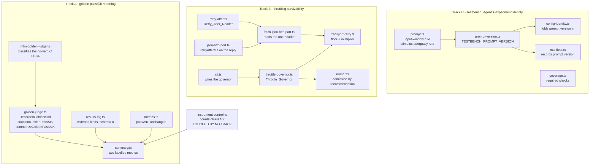

# Design Document

## Overview

Four changes stand between the working harness and a citable pass@k number.
This design assigns each to the module that already owns the concern, so the four are separable and three of them can be executed concurrently by separate agents on one working tree.

| # | Problem | Owning module | Track |
| --- | --- | --- | --- |
| 1 | pass@k is gated on the wrong judge for the capability claim | `app/eval/golden-judge.ts` + `app/eval/sweep/summary.ts` | A |
| 2 | a rate-limit burst destroys a campaign | `app/eval/sweep/transport-retry.ts` + `app/agent/model-router/` + `app/eval/sweep/runner.ts` | B |
| 3 | our testbench invents input-side timing | `app/agent/roles/testbench/prompt.ts` | C |
| 4 | the named coverage gaps are unclosed | `app/agent/roles/testbench/prompt.ts` + `coverage.ts` | C |

Problems 3 and 4 land in the same three files and the same test files, so they are **one track executed in order**, not two parallel ones.
Track C additionally owns the experiment-identity change (Requirement 11), because Track C is the track that changes the prompt and therefore the only track that can make a prompt change visible in the fingerprint.

### Research findings that shaped the design

**Separating a self-graded verdict from an independent judge.**
The practice this design follows - collect answers in one step, judge them in a separate and deliberately adversarial step, and never let the producer grade itself - is the same separation described in [a published blind-judge harness reference](https://github.com/daymade/claude-code-skills/blob/main/llm-eval-harness/references/quality_blind_judge.md).
A related finding in the LLM-as-judge literature is that a harness reporting a single verdict without any grader-disagreement metric can present grader noise as a property of the system under test ([Necessary but Not Sufficient, arXiv 2606.26185](https://arxiv.org/abs/2606.26185)).
This repository already reports the disagreement (`MISSED BUGS` / `over-strict`); what it lacks is the judge's own pass rate as a first-class number.
Content was rephrased for compliance with licensing restrictions.

**Provider throttling.**
Two points from current practice are load-bearing here.
First, `Retry-After` arrives either as a count of seconds or as an HTTP-date ([API rate limiting field guide](https://iotools.cloud/journal/api-rate-limiting-headers-exponential-backoff-and-surviving-the-429/)), so a reader must handle both forms.
Second, a client should sleep at least as long as `Retry-After` asks but never less than its own jittered backoff, because the header can legitimately resolve to zero while the host is still refusing ([429 resolution guide](https://www.heatware.net/devops-cloud/api-rate-limit-exceeded-error-429/)).
The same guidance pairs backoff with reducing request volume rather than only retrying it ([Nylas 429 guidance](https://cli.nylas.com/guides/email-api-429-rate-limit-fix)).
That is exactly the split this design makes between Requirement 6 (wait longer) and Requirement 7 (ask for less).
Content was rephrased for compliance with licensing restrictions.

### What is deliberately not in scope

The harness, the sweep engine, the resume index, the deferred-slot retry, the circuit breaker, the positive control, the negative control, the mutation calibration cache, the golden scorer, and the artifact store all exist and work.
No task in this spec rebuilds any of them.

## Architecture



### Dependency direction

Every change flows inward-only, as the repository already requires: `app/eval` may depend on `app/agent`, never the reverse.
Track C's prompt-version constant lives in `app/agent` and is read by `app/eval/sweep/config-identity.ts` and `app/eval/sweep/manifest.ts`, which is the existing direction.
`app/eval/sweep/manifest.ts` already reads the pinned corpus constants directly rather than receiving them as parameters, precisely so a manifest cannot claim a corpus the code will not import; the prompt version is read the same way and for the same reason, which is also what keeps `cli.ts` out of Track C.

### The one module no track may touch

`app/eval/instrument-control.ts` is the single owner of `countsInPassAtK`, the denominator invariant that protects the `Verified` label.
This spec adds a metric beside it and changes nothing inside it.
That is enforced structurally: the golden predicate lives in `app/eval/golden-judge.ts`, and `instrument-control.ts` gains no import of the golden vocabulary (Requirement 4.6).

## Components and Interfaces

### Area 1 - Golden pass@k reporting (Track A)

**`app/eval/golden-judge.ts`** gains three things and keeps everything it has.

The recorded verdict's `kind` widens from the banner vocabulary to a **recorded** vocabulary:

```ts
/** What the independent judge established about one candidate; a closed set. */
export type RecordedGoldenKind =
  /** The golden testbench printed its pass banner. */
  | 'passed'
  /** The golden testbench reported wrong results. */
  | 'failed'
  /** No banner, and the run emitted build diagnostics: the candidate did not elaborate. */
  | 'did-not-build'
  /** No banner and no diagnostics: the judge run produced nothing. */
  | 'no-output'
  /** The run was killed for exceeding a resource bound we imposed. */
  | 'timed-out';
```

This is a **different type from `GoldenVerdictKind`** in `app/eval/corpus/golden-banner.ts`, which stays at `passed | failed | error`.
Keeping them apart is the whole point: `GoldenVerdictKind` is the banner grammar of a third-party testbench and must not be reshaped by our reporting needs, and `app/eval/corpus/mutation-calibration.ts` deliberately reads `GoldenScore.timedOut` rather than the banner kind for a documented reason.
Widening the banner kind would have forced a change in `calibrationOf` for no benefit; widening the recorded kind touches nothing in calibration.

The membership predicate:

```ts
/** The two facts golden-denominator membership is decided from. */
export interface GoldenPassAtKEligibility {
  readonly outcomeStatus: SampleOutcomeStatus;
  readonly golden: RecordedGoldenVerdict | null;
}

/**
 * THE GOLDEN DENOMINATOR INVARIANT.
 *
 * A sample counts in the golden denominator if and ONLY if the loop reached an oracle
 * verdict AND the independent judge returned a verdict on the candidate's BEHAVIOUR
 * (`passed` or `failed`).
 */
export function countsInGoldenPassAtK(sample: GoldenPassAtKEligibility): boolean;
```

Why each exclusion, stated for the record:

- **No oracle verdict** (`blocked`, `setup-failed`, `runner-error`). The flow never handed the judge a candidate, so the judge never spoke. Counting it as a model failure would attribute a rate-limit burst, a harness crash, or a declined slot to the model. This is the same first condition `countsInPassAtK` applies, and it is read through the same `reachedOracleVerdict` owner.
- **No golden outcome at all.** Either no judge was wired, or the problem has no golden testbench (a Stage 0 quarantine). A sample nobody judged is not evidence about the model.
- **`did-not-build`.** Tempting to count as a model failure, and rejected. The vault already records that six golden testbenches override module parameters our `ModuleInterface` has no concept of, so a candidate generated faithfully from the Spec can fail to elaborate against the judge for a requirement the Spec never stated. Attributing that to the model would be the same class of error as counting an instrument-invalid sample as a model failure. It is excluded and counted, and a `did-not-build`-dominated bucket is a finding about the parameter-override gap.
- **`no-output`.** Our own infrastructure produced nothing. Never a model result.
- **`timed-out`.** A resource bound we imposed stopped the run. A wall-clock finding, not a capability finding, and the same discipline the mutation control already applies to `goldenTimeoutMutants`.

The exclusions are **fail-safe in one direction only**: every one of them can only move a sample OUT of the golden denominator, never in. That mirrors `unchecked` in the instrument control.

The aggregation:

```ts
/** Why samples fell outside one arm's golden denominator. */
export interface GoldenPassAtKReport {
  /** Samples the independent judge returned a behavioural verdict on. */
  readonly judgedSamples: number;
  /** Judged samples the independent judge passed. */
  readonly goldenPassedSamples: number;
  /** Samples that never produced a candidate, so were never judged. */
  readonly noCandidateSamples: number;
  /** Samples with no golden testbench available. */
  readonly unjudgedSamples: number;
  /** Judged runs that produced no behavioural verdict, split by cause. */
  readonly didNotBuildSamples: number;
  readonly noOutputSamples: number;
  readonly timedOutSamples: number;
}

export function summarizeGoldenPassAtK(
  samples: readonly GoldenPassAtKEligibility[],
): GoldenPassAtKReport;
```

`judgedSamples + noCandidateSamples + unjudgedSamples + didNotBuildSamples + noOutputSamples + timedOutSamples` equals the arm's recorded sample count by construction, which is what Requirement 2.9 pins.

**`app/eval/corpus/rtllm-golden-judge.ts`** does the classification, at the boundary where the evidence still exists.
It already receives a `GoldenScore` carrying `verdict.kind`, `timedOut`, `diskLimitExceeded`, and sanitized diagnostics, and today it throws all but the first two away.
The mapping, in this order, so the resource bounds win over the absence of a banner:

1. `timedOut || diskLimitExceeded` -> `timed-out`
2. `verdict.kind === 'failed'` -> `failed`
3. `verdict.kind === 'passed'` -> `passed`
4. otherwise, delegate to the existing non-pass cause classifier in `app/eval/corpus/nonpass-cause.ts`: build diagnostics present -> `did-not-build`, nothing at all -> `no-output`

Step 4 reuses the classifier Stage 0 and the positive control already share, so "was this a build failure" has exactly one owner across all three consumers.

**`app/eval/sweep/summary.ts`** gains a golden block and changes no existing number.
`summarizeArm` builds a second eligible list from `countsInGoldenPassAtK` and passes it to the SAME `armPassAtK` helper, so there is one estimator and one aggregation shape:

```ts
const goldenEligible = goldenDenominatorRecords(records);
// ...
goldenPassAtK: armPassAtK(goldenEligible, ks, (record) => record.goldenVerdict === 'passed'),
passAtK: armPassAtK(eligible, ks, (record) => record.passed),
```

`armPassAtK` grows a `passed` predicate parameter, which is the smallest change that lets one implementation serve both numerators: the golden numerator is the judge's verdict, the instrument-gated numerator is our own oracle's.
`app/eval/metrics.ts` is unchanged. It is nevertheless owned by Track A, so that no second pass@k estimator can be introduced elsewhere while the tracks run.

Rendering, with the labels pinned by tests because the whole point is that the two numbers are never confused:

```
  GOLDEN pass@1=0.692  (over 13 sample(s) judged by RTLLM's INDEPENDENT testbench)
                   <== THE CAPABILITY NUMBER: decided by a testbench we did not write.
                   33 recorded sample(s) are OUTSIDE this denominator:
                   no-candidate 33  unjudged 0  did-not-build 0  no-output 0  timed-out 0
  pass@1=0.833  (SELF-GRADED, instrument-gated, over 6 instrument-valid sample(s))
                   <== decided by OUR OWN generated testbench, and admitted only where the
                   controls proved that testbench a measuring stick. This is what the
                   `Verified` label a student sees rests on. It is NOT the capability number.
```

The golden block is rendered FIRST and the exclusion tally sits inside it, so the denominator can never be read without what it leaves out.

**`app/eval/sweep/results-log.ts`** widens `GOLDEN_KINDS` to the five recorded kinds and bumps `RESULTS_SCHEMA_VERSION` 7 -> 8, as a refusal rather than a migration, following every previous bump.
`SweepSampleRecord.goldenVerdict` becomes `RecordedGoldenKind | null`.
The bump is required because a v7 `error` is the sum of three causes with no way to recover the split, and a golden denominator computed over v7 records would silently include or exclude the wrong population.

The bump costs nothing extra: Track C puts the Testbench_Prompt_Version into the Config_Identity, which changes the config hash and therefore makes every existing record invisible to the resume index regardless. The already-recorded calibration samples are lost to the prompt change, not to this bump.

`app/eval/sweep/runner.ts` needs **no change** for Track A. `recordFor` already forwards `sample.goldenVerdict?.kind ?? null`, which type-checks unchanged against the widened union, and `progressLine` already interpolates the kind as text. That is what keeps `runner.ts` exclusively Track B's.

**`app/eval/sweep/artifact-layout.ts`** bumps `ARTIFACT_DOCUMENT_SCHEMA_VERSION` 6 -> 7 with the reason stated, because `outcome.json` mirrors `goldenVerdict` and a v6 document's `error` is the same three-way collapse.

### Area 2 - Throttling survivability (Track B)

**`app/agent/model-router/retry-after.ts`** (new) is the boundary parser.

```ts
/** Parse a `Retry-After` header value into a bounded delay in milliseconds. */
export function parseRetryAfterMs(
  value: string | null | undefined,
  nowMs: number,
  maxDelayMs: number,
): number | null;
```

Total, pure, and clock-injected. Both header forms are handled: an integer count of seconds, and an HTTP-date whose remaining milliseconds are measured against `nowMs`.
Anything else - a float, a negative, a non-numeric string, an unparseable date, an absent header - returns `null`, which means "the host gave no instruction".
A parsed delay is clamped to `maxDelayMs`, because the header is untrusted input and a hostile or misconfigured host must not be able to park a campaign for hours.

**`app/agent/model-router/json-http-port.ts`** widens the reply:

```ts
export interface JsonHttpResponse {
  readonly status: number;
  readonly body: string;
  /**
   * The host's parsed `Retry-After` instruction in milliseconds, or null when it gave none.
   *
   * This is the ONLY reply header field that travels upward, and it travels as a bounded
   * number rather than as text. A header MAP would carry credential-adjacent and
   * fingerprintable material past a boundary whose whole job is to let nothing about the
   * call escape.
   */
  readonly retryAfterMs?: number | null;
}
```

Optional, deliberately: a port that cannot read headers (an SDK-backed implementation, a test fake) has nothing to report, and absence and `null` mean the same thing here - no instruction.
That containment matters for the parallel tracks too, since `JsonHttpResponse` is constructed by fakes in `bedrock-mantle-transport.test.ts` and `fetch-json-http-port.test.ts`.

**`app/agent/model-router/fetch-json-http-port.ts`** reads exactly one header from `HostFetchResponse` and hands the value to `parseRetryAfterMs`.
`HostFetchResponse` gains a narrow header accessor rather than a header map, for the same containment reason.

**`app/eval/sweep/throttle-governor.ts`** (new) is the run-wide observer, sibling to `TransportCircuitBreaker` and shaped like it: sole owner of its own state, everything else derived, clock injected.

```ts
/** Bounds on the throttle response; build constants, NOT config fields. */
export const THROTTLE_GOVERNOR_LIMITS = Object.freeze({
  /** How long a throttle observation stays inside the window, in milliseconds. */
  windowMs: 60_000,
  /** Throttle observations inside the window that raise the multiplier by one step. */
  observationsPerStep: 4,
  /** The largest backoff multiplier the governor will report. */
  maxMultiplier: 8,
  /** Concurrency removed per step, floored at 1. */
  concurrencyStep: 1,
});

export class ThrottleGovernor {
  constructor(configuredConcurrency: number, now: () => number);
  /** Record one retryable throttle reply at the current instant. */
  recordThrottle(): void;
  /** The multiplier to apply to a computed backoff; 1 when the window is quiet. */
  backoffMultiplier(): number;
  /** In-flight samples to allow now; the configured value when the window is quiet. */
  recommendedConcurrency(): number;
}
```

Both reported values are **pure functions of the observations still inside the window**, so recovery is automatic and needs no separate timer: observations age out, the count falls, and the recommendation returns to the configured concurrency.
Nothing here can raise concurrency above the configured value, which is what keeps the measured host behaviour safe - concurrency 4 drove load average to 41 on an 8-core box while concurrency 2 held at about 3, so the configured ceiling is a real bound and the governor only ever moves downward from it.

**`app/eval/sweep/transport-retry.ts`** composes the three inputs into one delay, in one place:

```ts
const computed = backoffDelayMs(policy, attempt, deps.random) * governor.backoffMultiplier();
const clamped = Math.min(policy.maxDelayMs, computed);
const delay = Math.max(clamped, retryAfterMs ?? 0);
```

The Retry-After floor is applied AFTER the clamp, so a host asking for longer than our own ceiling is still obeyed, while our own adaptive growth stays inside the ceiling.
`createRetryingHttpPort` calls `governor.recordThrottle()` on a `retryable-status` outcome whose status is 429, which is the one signal that means "you are asking for too much" rather than "the server is unwell".

**`app/eval/sweep/runner.ts`** changes `#drain` from a fixed pool to an **admission-gated** pool.
The worker count still starts at `min(configured, units.length)`, so Requirement 7.6 and the existing bounded-concurrency test hold unchanged.
Before taking a unit, a worker asks for admission; if the count of workers already holding a unit has reached `recommendedConcurrency()`, the worker waits and re-asks rather than exiting, so its unit stays in the plan (Requirement 7.7) and no sample is recorded as failed (Requirement 7.8).
At least one worker is always admitted while units remain, which is what makes a reduction a slowdown and never a deadlock.

`app/eval/sweep/cli.ts` constructs the governor beside the existing breaker and passes it to both the HTTP port builder and the runner - the same shape the breaker already uses, wired at the same composition root.

**No sweep-config field is added.** Two reasons, and the second is the stronger one.
First, every non-excluded config field is inside the Config_Identity, so a throttle knob would change the hash and orphan every paid sample the moment it was introduced - the exact harm the identity-exclusion rule exists to prevent.
Second, throttle response is a safety property, not an experiment parameter: if it were tunable, two operators with different settings could not pool their samples, and an operator could turn the protection off. A bounded, safe default that cannot be lowered is the correct surface.

### Area 3 - Input-window alignment (Track C, first)

**`app/agent/roles/testbench/prompt.ts`** gains one rule and keeps the three it has.
`describeTiming` already governs the OUTPUT side: wait on a declared output qualifier, treat it as an observation rather than a value to predict.
The residual is the INPUT side, and it has the same shape one step earlier, so the new rule is built the same way - conditioned on the DECLARED interface, offering exactly one legal derivation, never enumerating designs.

```ts
/**
 * Declared single-bit INPUT names that tell a design when to accept its data inputs.
 *
 * Read from the declared interface, so the prompt can only ever name a qualifier the
 * module genuinely has. The keyword set is shared with the output-side qualifier list,
 * because a design names both halves of a handshake from the same vocabulary.
 */
function inputQualifierNames(moduleInterface: ModuleInterface): readonly string[];

/**
 * The input-window rule, conditioned on whether the interface declares an input qualifier.
 *
 * The Spec pins WHAT a design accumulates, not the edge on which its inputs are sampled.
 * A testbench that chooses one is asserting an input-side latency of its own, which
 * rejects a correct design exactly as an assumed output latency does.
 */
function describeInputWindow(moduleInterface: ModuleInterface): string;
```

The single legal derivation, where an input qualifier is declared: drive one input per qualifier assertion and hold the stimulus stable across the whole clock period in which the qualifier is asserted, then form the expected value from **the inputs the testbench itself drove under an asserted qualifier** - never from a count of cycles, and never from a window boundary chosen by the testbench.
Where no input qualifier is declared: form a window only where the Spec pins the sampling moment.

This is the general rule the `accu` evidence points at, and it is deliberately stated over "the inputs driven under an asserted qualifier" rather than over accumulation, because the same defect shape reaches any design with an input handshake.
The rule is validated on the committed slice of at least 12 problems, not on `accu`, because a per-problem fix loop is how a prompt gets overfitted to one design.

### Area 4 - Coverage-gap closure (Track C, second)

The six named operators are not six separate prompt rules. They are six ways one weakness shows up: the stimulus does not reach the values at which the mutated design and the reference diverge.

| operator | measured count | what the stimulus must reach |
| --- | --- | --- |
| `CONDITION_NEGATED` | 3 | both sides of every branch condition the Spec implies |
| `CONST_INCREMENTED` | 3 | a value at which an altered constant changes the output |
| `CONST_ZERO_TO_ONE` | 3 | the case a zero constant is the identity for |
| `ARITH_PLUS_TO_MINUS` | 2 | operands where a sign flip is observable, so not zero and not equal |
| `INDEX_OFF_BY_ONE` | 2 | the first and last index of every declared range |
| `EQUALITY_TO_INEQUALITY` | 1 | the boundary value itself, and the value one step either side |

So the change is one **stimulus-adequacy rule** in `app/agent/roles/testbench/prompt.ts`, derived from the declared interface and the Spec's acceptance criteria, stated at the altitude of "make the check able to distinguish" rather than as a list of mutation operators.
Naming the operators in the prompt would be teaching the instrument the shape of the exam, which is the same circularity the whole verification methodology exists to avoid.

`app/agent/roles/testbench/coverage.ts` is owned by this track because a boundary check may need to become a derived `RequiredCheck` kind rather than prose - a check the model must EMIT is a stronger guarantee than a rule it may ignore. The decision between prose and a derived check belongs to the implementer, on the evidence of the fixture measurement, and both options live in Track C's files.

Verification is the pattern the repository already used to prove the Class 1 and Class 3 fixes: a committed **fixture pair** driven through the real Icarus toolchain by `app/test/eval-negative-control.integration.test.ts`.
A discriminating fixture testbench that follows the rule must produce zero Coverage_Gap_Survivors for all six operators; the known-weak fixture must still produce at least one.
The pair is what makes the claim non-vacuous, and it needs no model call, so it runs deterministically in CI wherever the toolchain is present.

### Area 5 - Experiment identity (Track C, last)

`app/agent/roles/testbench/prompt-version.ts` (new) holds one constant:

```ts
/**
 * The identity of the assembled Testbench_Agent prompt.
 *
 * Bumped whenever a RULE in the assembled prompt changes, because two prompt versions are
 * two experiments and their samples must not pool. Pinned by a test that digests the prompt
 * assembled for a canonical fixture Spec, so changing the prompt without bumping this fails.
 */
export const TESTBENCH_PROMPT_VERSION = 2;
```

Version 2, not 1: the prompt has already changed twice since the calibration run, and version 1 would claim the calibration samples were measured under the current prompt.

`app/eval/sweep/config-identity.ts` folds it into the canonical JSON under a reserved key, reading the constant directly rather than taking it as a parameter, so `sweepConfigHash`'s signature and every call site - including `cli.ts` - are unchanged.
`app/eval/sweep/manifest.ts` records it the same way, which is the pattern it already uses for the pinned corpus constants.

`SMOKE_RUN_CONFIG_HASH` in `app/eval/sweep/manifest.test.ts` moves once, in this track, with the reason recorded in the test.
Track B introduces no config field, so it never moves that constant, and the two tracks cannot collide on it.

## Data Models

### The recorded golden verdict

```ts
export interface RecordedGoldenVerdict {
  readonly kind: RecordedGoldenKind;
  /** Failures the golden testbench reported, or null when it printed no count. */
  readonly failureCount: number | null;
}
```

`RecordedGoldenKind` is a closed union of string literals with no free text, for the same reason `RecordedInstrumentVerdict` is: it is persisted, echoed into `outcome.json`, and printed to operators, so being structurally incapable of carrying a path or a tool message is stronger than sanitizing one.

Total-mapping discipline: the exclusion tally is built from a total `Record<RecordedGoldenKind, ...>`, so a sixth kind added later is a compile error rather than a silently-excluded population.

### The persisted record

`SweepSampleRecord.goldenVerdict: RecordedGoldenKind | null` - the field already exists and only its union widens.
`RESULTS_SCHEMA_VERSION` 7 -> 8. `ARTIFACT_DOCUMENT_SCHEMA_VERSION` 6 -> 7.
`MUTATION_CALIBRATION_CACHE_VERSION` stays at 3: calibration reads `GoldenScore`, not the recorded kind, and its semantics are untouched. Bumping it would discard expensive, still-correct calibration work for no correctness reason.

### The throttle observation window

```ts
/** One observed throttle reply; the instant is all the governor needs. */
interface ThrottleObservation {
  readonly atMs: number;
}
```

The governor holds a list of these and prunes on read. Both reported values are derived, never stored, so the multiplier and the recommendation can never disagree with the observations that justify them.

### The Retry-After delay

Represented as `number | null` in milliseconds, already clamped, never as raw header text.
`null` means the host gave no instruction, which is different from `0` (the host said "now"), and the floor rule in Requirement 6.7 treats them identically only because `max(x, 0) === x`.

## Correctness Properties

A property is a characteristic or behavior that should hold true across all valid executions of a system - essentially, a formal statement about what the system should do.
Properties serve as the bridge between human-readable specifications and machine-verifiable correctness guarantees.

### Property 1: The golden denominator excludes every sample the judge did not judge

*For any* set of samples, the count of samples the golden-denominator predicate admits equals the count of samples that both reached an oracle verdict and carry a golden outcome of `passed` or `failed`.

**Validates: Requirements 2.2, 2.3, 2.4, 2.5**

### Property 2: The golden report partitions the arm

*For any* set of samples, the sum of the golden report's judged count and its five exclusion counts equals the number of samples.

**Validates: Requirements 2.6, 2.9**

### Property 3: The golden metric never moves the instrument-gated denominator

*For any* sample, the value of `countsInPassAtK` is unchanged by that sample's golden outcome.

**Validates: Requirements 4.2, 4.3, 4.4**

### Property 4: Both pass@k values come from one estimator

*For any* set of samples and any k, the reported golden pass@k equals the mean over problems of `passAtK` applied to that problem's golden-eligible sample count and its golden-passed count.

**Validates: Requirements 1.2, 1.7**

### Property 5: Each rendered pass@k value carries its own label and denominator

*For any* arm summary, the rendered golden line contains the token `GOLDEN` and its denominator size, and the rendered instrument-gated line contains a self-graded label and its own denominator size.

**Validates: Requirements 1.3, 1.4, 1.5, 2.7**

### Property 6: A widened golden kind is accepted and anything else is refused

*For any* string, the results-log decoder accepts it as a golden outcome exactly when it is one of the five recorded kinds.

**Validates: Requirements 3.1, 3.6**

### Property 7: Retry-After round-trips from delta-seconds

*For any* non-negative integer count of seconds within the policy bound, parsing that count as a `Retry-After` value yields that count in milliseconds.

**Validates: Requirement 5.1**

### Property 8: Retry-After rejects what it cannot read and clamps what it can

*For any* header text, the parsed delay is either `null` or a number in the range `[0, maxDelayMs]`.

**Validates: Requirements 5.3, 5.4**

### Property 9: The applied delay is never below the host's instruction

*For any* retry policy, attempt number, randomness value, backoff multiplier, and Retry-After delay, the delay the transport applies is at least the Retry-After delay and at least the jittered backoff.

**Validates: Requirements 5.5, 6.5, 6.7**

### Property 10: The backoff multiplier is monotone in observed throttling and bounded

*For any* two throttle-observation sequences where the second is a superset of the first within the window, the multiplier reported for the second is at least the multiplier reported for the first, and both lie in `[1, maxMultiplier]`.

**Validates: Requirements 6.2, 6.3, 6.4**

### Property 11: The recommended concurrency is monotone, bounded, and recovers

*For any* configured concurrency and any throttle-observation sequence, the recommended concurrency lies in `[1, configuredConcurrency]`, is non-increasing as observations are added inside the window, and equals the configured concurrency once every observation has aged out.

**Validates: Requirements 7.1, 7.2, 7.3**

### Property 12: Admission never exceeds either bound and never starves

*For any* plan of units and any sequence of governor recommendations, the number of workers holding a unit at any instant is at most the configured concurrency, is at most the current recommendation once the previous holders have released, and is at least 1 while units remain.

**Validates: Requirements 7.4, 7.5, 7.6**

### Property 13: A reduced recommendation loses no unit of work

*For any* plan of units and any sequence of governor recommendations that never reaches zero, every unit in the plan is eventually dispatched exactly once and no unit is recorded as failed on account of a reduction.

**Validates: Requirements 7.7, 7.8**

### Property 14: The testbench prompt offers exactly one input-window derivation

*For any* declared module interface, the assembled testbench prompt states exactly one input-window derivation, and every qualifier name it states is a declared port of that interface.

**Validates: Requirements 9.2, 9.3, 9.4**

### Property 15: The input-window rule is assembled without RTL

*For any* generation input and any candidate RTL, the assembled testbench model input contains no substring of that RTL.

**Validates: Requirement 9.5**

### Property 16: A prompt change changes the experiment identity

*For any* sweep config, two config identities computed under different prompt versions differ, and two computed under the same prompt version agree.

**Validates: Requirements 11.2, 11.3**

## Error Handling

Every new failure path fails in the direction that can only shrink a claim.

**A golden run we cannot classify.**
The judge already returns `null` for a problem it has no testbench for, and the harness already treats a throwing judge as no verdict.
Both land outside the golden denominator, which is the safe direction: an unclassifiable run can never become a `passed`.
`RecordedGoldenKind` is closed, so there is no path by which an unknown cause becomes a pass.

**A results file from an older schema.**
Refused wholesale, as at every previous bump. Nothing is aggregated, not even the current-version records beside it, and the operator is told what changed and that a fresh output directory is required.
No silent migration, because any default for the widened golden kind would itself be the false claim.

**An untrusted `Retry-After` header.**
Validated at the boundary and clamped. A float, a negative, a non-numeric string, an unparseable date, or an absurd value all resolve to "no instruction" or to the policy ceiling.
A hostile or misconfigured host cannot park a campaign, and no header text travels past the port.

**A throttle burst that outlasts the governor.**
The existing three-state circuit breaker still owns that case: sustained failures trip it, repeated trips report an outage, and the runner stops dispatching at a sample boundary with everything completed still on disk.
The governor slows the run down; the breaker ends it. Neither replaces the other, and the governor can never prevent the breaker from tripping.

**A governor that would recommend zero.**
Structurally impossible: the recommendation is floored at 1. A reduction is a slowdown, never a deadlock.

**A prompt whose rule changed without a version bump.**
Caught by a test that digests the prompt assembled for a canonical fixture Spec and compares it against a value pinned beside the version constant.
The failure is loud and its remedy is one line, which is the correct cost for making two experiments distinguishable.

**A testbench that still rejects the reference.**
Unchanged behaviour: the positive control marks the instrument `invalid`, the sample leaves the instrument-gated denominator, and the summary says so on its own line.
The golden denominator is unaffected, which is the entire point of Area 1 - an instrument defect no longer empties the capability number.

## Testing Strategy

### Property-based tests

`fast-check` 4.8.0 is already the repository's property-testing library, and `app/test/property.ts` already holds the shared harness conventions.
Each property above becomes exactly one property-based test, at minimum 100 iterations, tagged with `Feature: eval-campaign-readiness, Property N: <property text>`.

The generators are the interesting part, because each property has a way to pass vacuously:

- Sample generators must produce every combination of outcome status, instrument validity, and golden kind. A generator that never emits `did-not-build` would let Property 1 pass while the exclusion was unimplemented.
- Throttle-sequence generators must produce sequences that span the window boundary, or Property 11's recovery clause never runs.
- The Retry-After generator must produce both header forms plus junk, or Property 8 tests only the happy branch.
- Property 15 already exists as the repository's Property 4 (`app/test/testbench-rtl-isolation.property.test.ts`) and is EXTENDED rather than rewritten, so the anti-circular guarantee keeps one owner.

### Unit tests

Reserved for the specific cases a property cannot state:

- The exact rendered wording of each pass@k label and of the stale-schema advice. These are pinned as strings because their whole function is to stop a reader confusing two numbers, and a paraphrase would defeat them.
- The classification order in the golden judge: a run that both timed out and printed no diagnostics must classify `timed-out`, not `no-output`.
- The `NOT MEASURED` rendering for an empty golden denominator.
- The `UNKNOWN_FIELD` rejection of a throttling key in the sweep config.

### Integration tests, on the real toolchain

- `app/test/eval-negative-control.integration.test.ts` gains the coverage-gap fixture pair for the six named operators. Real Icarus, no model calls, deterministic, and non-vacuous by construction because the weak fixture must still fail.
- The existing skip harness pattern applies: where the toolchain is absent the suite skips, and the skip count must stay at exactly 6 overall.

### What is measured rather than tested

Requirement 9.6 is a measurement, not a test: it needs real model calls, so it cannot be automated in CI.
It is discharged by running the committed campaign-readiness slice config with the existing `npm run eval:sweep`, before and after the input-window rule, and comparing the instrument-valid counts the summary reports.
The deliverable that IS testable is the slice config itself, pinned by a parse-and-hash test, so the measurement is reproducible and cited against a committed artifact.

### The gate every task is verified against

```
npx tsc -b
npx eslint app --max-warnings=0
npx prettier --check .
npx vitest run     # >= 1531 passed, exactly 6 skipped
```

`tsc -b app/test` is package-wide and fails on unrelated in-progress sibling test files, which matters when three tracks share one working tree: a track must verify with the repository-wide `npx tsc -b` and read a sibling track's incomplete file as noise rather than as its own failure.
