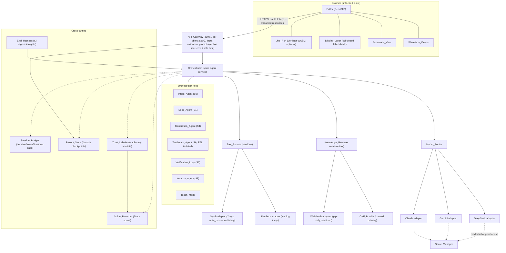

# Design Document

## Overview

The HDL Creation Loop is the thin end-to-end "hero" slice of the ECE Creation Copilot, covering only Milestones M0 (spine skeleton) and M1 (single-module hero loop).
It carries one student-authored Verilog module from natural-language intent to a deterministically verified, visualized artifact, and it does so under a single non-negotiable invariant: the language model proposes and the deterministic oracle (Icarus Verilog plus an independently derived testbench) decides correctness.

This design realizes the S0-S9 product spine (`product-ece/ECE-PHILOSOPHY.md`) for the subset of stages in scope (S0, S1, S4, S6, S7, S8, S9-as-iteration, plus teach-mode), grounds verification in the anti-circular methodology (`product-ece/ECE-VERIFICATION-METHODOLOGY.md`), routes models per `product-ece/ECE-TECH-DECISIONS.md` (DeepSeek V4 generation, Gemini Flash orchestration, Claude fallback), and inherits the security, quality, and resilience constraints from `product-ece/ECE-SECURITY-PERFORMANCE-RESILIENCE.md`, `product-ece/ECE-CODE-QUALITY-STANDARDS.md`, and `product-ece/ECE-RELIABILITY-SELFHEALING.md`.

Everything M2-M5 (multi-module decomposition, make-real/FPGA/Tiny Tapeout, embedded, assisted PCB) is explicitly out of scope and becomes separate specs.

### Design goals

- Prove the oracle path end-to-end (browser to sandboxed simulator and back) before layering the full agentic loop on top.
- Make it structurally impossible to present an unverified artifact as `Verified`: the `Verified` label is a claim bound to a recorded oracle verdict and its provenance, checked again at the display boundary and failing closed.
- Keep the testbench agent physically incapable of ever seeing the generated RTL, so verification can never become circular.
- Contain all generated-code execution in an ephemeral, secret-free, network-isolated, resource-capped sandbox.
- Stay within pennies-per-session economics through hard Session_Budget caps and cheap-model-plus-simulation routing.

### How the design maps to the 17 requirements

| Requirement | Primary components that satisfy it |
|---|---|
| 1 Spine skeleton (editor, API layer, oracle path) | Editor, API_Gateway, Orchestrator, Tool_Runner |
| 2 Sandboxed tool-runner (Icarus oracle) | Tool_Runner, Simulator adapter |
| 3 Action recorder (replayable trace) | Action_Recorder, Trace store |
| 4 Intent capture and clarification (S0) | Intent_Agent, Model_Router |
| 5 Spec and architecture approval (S1) | Spec_Agent, Project_Store |
| 6 Agentic Verilog generation (S4) | Generation_Agent, Model_Router, Verification_Loop |
| 7 Independent testbench generation (S6) | Testbench_Agent (RTL-isolated), Knowledge_Retriever |
| 8 Simulation and verification loop (S7) | Verification_Loop, Tool_Runner, Trust_Labeler |
| 9 Visualization (waveform, schematic, live-run) | Waveform_Viewer, Schematic_View, Live_Run, Display_Layer |
| 10 Conversational iteration (S9) | Iteration_Agent, Verification_Loop, Trust_Labeler |
| 11 Teach-mode explanation | Teach_Mode, Knowledge_Retriever, Trust_Labeler |
| 12 Model router | Model_Router, vendor adapters, secret manager |
| 13 Knowledge grounding (OKF-first) | Knowledge_Retriever, OKF_Bundle, web-fetch adapter |
| 14 Trust tiers and labeling | Trust_Labeler, Display_Layer, Action_Recorder |
| 15 Eval harness as CI gate | Eval_Harness, Tool_Runner, CI pipeline |
| 16 Project persistence and durability | Project_Store, API_Gateway (per-object authz) |
| 17 Cross-cutting non-functional constraints | API_Gateway, Session_Budget, Model_Router, all components |

## Architecture

### Component topology

The system is a layered service with a browser client, a single trusted server-side gateway, an orchestrator that runs the spine, and a sandboxed tool-runner that is the only place generated code ever executes.
Vendor SDKs (model providers, EDA tools, web fetch, datastore) are isolated behind adapters so a vendor change touches only the adapter, per `ECE-CODE-QUALITY-STANDARDS.md` section 3.

Dependencies flow inward only: `web` -> `api` -> `agent` -> (`knowledge`, `tools`) -> `core`.
No inner layer imports an outer layer.



### Trust and security boundaries

- Browser to API_Gateway: every request is forged-able, replayable, and throttle-able.
  The gateway authenticates, authorizes per object, validates every payload, and never uses client state or model output as a security control (`ECE-SECURITY-PERFORMANCE-RESILIENCE.md` sections 1-3).
- Orchestrator to Model_Router to adapters: model output is untrusted data, never a judge and never executed directly.
  Each provider credential is confined to its own adapter and resolved from the secret manager at the point of use.
- Orchestrator to Tool_Runner: the only arbitrary-code-execution surface, fully sandboxed (isolated, no secrets, no default network, resource-capped).
- Tool_Runner to Simulator: the deterministic oracle; its recorded verdict is the sole source of the `Verified` label.
- Display_Layer at the browser: a final fail-closed integrity check that a `Verified` label carries valid oracle provenance before it is allowed the `Verified` treatment.

### End-to-end hero loop (sequence)

```mermaid
sequenceDiagram
  actor S as Student
  participant E as Editor
  participant GW as API_Gateway
  participant ORC as Orchestrator
  participant MR as Model_Router
  participant KR as Knowledge_Retriever
  participant TR as Tool_Runner (sandbox)
  participant TL as Trust_Labeler
  participant AR as Action_Recorder
  participant PS as Project_Store

  S->>E: describe single-module idea (S0)
  E->>GW: POST /intent (auth token, validated payload)
  GW->>ORC: intent request (Session_Budget opened)
  ORC->>MR: Intent_Agent clarify (Gemini Flash)
  MR-->>ORC: restated intent + clarifying questions
  ORC->>AR: record spans (Not_Applicable)
  ORC-->>E: stream restated intent + questions
  S->>E: confirm intent (blocking precondition)

  E->>GW: POST /spec (idempotency key)
  GW->>ORC: spec request
  ORC->>MR: Spec_Agent build spec + architecture
  ORC->>KR: retrieve (OKF-first) for grounding
  MR-->>ORC: Spec (goal, constraints, Module_Interface, acceptance criteria)
  ORC-->>E: stream Spec for approval (Not_Applicable)
  S->>E: approve Spec
  ORC->>PS: persist approved Spec (durable checkpoint)

  par Generation (S4)
    ORC->>MR: Generation_Agent generate RTL (DeepSeek V4)
    MR-->>ORC: candidate RTL
  and Independent testbench (S6)
    ORC->>MR: Testbench_Agent from Spec ONLY (no RTL)
    MR-->>ORC: Testbench (source attributed = Spec)
  end
  ORC->>AR: record testbench span (source = Spec)

  loop Verification_Loop until pass or Session_Budget
    ORC->>TR: compile + simulate RTL + Testbench
    TR-->>ORC: verdict {pass|fail|error}, stdout/stderr, VCD, exit code
    ORC->>AR: record oracle verdict span
    alt fail and budget remains
      ORC->>MR: Generation_Agent repair from simulator output
      MR-->>ORC: revised RTL
    end
  end

  alt oracle pass
    ORC->>TL: request Verified (with oracle span ref)
    TL->>AR: bind label to passing span provenance
    ORC->>TR: Yosys write_json -> netlistsvg (Verified only)
    ORC-->>E: stream RTL + VCD + schematic + Verified label + provenance
    E->>E: Display_Layer validates provenance (fail-closed)
    ORC->>PS: persist Verified checkpoint
  else budget exhausted, no pass
    ORC->>TL: label Unverified
    ORC-->>E: stream last failing candidate + failing case (Unverified)
    ORC->>MR: Teach_Mode coach on failing case
  end

  S->>E: request change (S9 iterate)
  E->>GW: POST /iterate
  GW->>ORC: Iteration_Agent applies change
  ORC->>TL: demote edited module to Unverified immediately
  Note over ORC,TR: re-run full Testbench; interface change -> update Spec + regenerate Testbench
  ORC-->>E: stream diff + new verdict + teach explanation
```

## Components and Interfaces

Interface signatures below are shown in TypeScript, which is the settled runtime for the `web`/`api`/`agent` layers (OD-1); the only Python is the thin worker glue inside the Tool_Runner, reached across the language-neutral job/result schema at the sandbox boundary.
All are contracts, not implementations.
Every vendor SDK sits behind one of these interfaces.

### Editor (web)

Responsibility: the browser code and conversation surface.
It never calls a model or tool provider directly; it talks only to the API_Gateway (Req 1.1).

```typescript
interface EditorClient {
  submitIntent(description: string): AsyncIterable<StreamEvent>;
  confirmIntent(sessionId: string): Promise<void>;
  submitSpecApproval(sessionId: string, spec: Spec): AsyncIterable<StreamEvent>;
  requestIteration(sessionId: string, change: string, idempotencyKey: string): AsyncIterable<StreamEvent>;
  openProject(projectId: string): Promise<ProjectSnapshot>;
}
```

### Display_Layer (web)

Responsibility: apply the per-Trust_Tier visual treatment and perform the fail-closed provenance check before ever showing the `Verified` treatment (Req 14.13-14.15, 9.4, 9.12).
It validates a label's oracle provenance reference; it never re-derives correctness.

```typescript
interface DisplayLayer {
  // Returns the treatment actually applied. If label is Verified but provenance
  // is missing/malformed/unvalidatable, returns "Unverified" (fail closed) and
  // emits a discrepancy event for the Trace.
  resolveTreatment(artifact: LabeledArtifact): {
    treatment: TrustTier;              // never "Verified" without valid provenance
    discrepancy?: ProvenanceDiscrepancy;
  };
}
```

### API_Gateway (api)

Responsibility: the single trusted boundary.
Authenticates the Student, authorizes per object (IDOR/BOLA), validates every inbound payload by schema, filters prompt injection, enforces rate limits and the Session_Budget, sanitizes every outbound error, and proxies all model and tool calls (Req 1.2-1.3, 1.6, 16.5, 16.9, 17.4).

```typescript
interface ApiGateway {
  authenticate(request: HttpRequest): Promise<AuthenticatedPrincipal>;   // rejects with sanitized error
  authorizeObject(principal: AuthenticatedPrincipal, objectId: string): Promise<void>; // per-object, every request
  validatePayload<T>(raw: unknown, schema: Schema<T>): Result<T, ValidationError>;
  sanitizeError(err: unknown): ClientSafeError;   // strips hosts, IPs, paths, stack traces, secrets
}
```

### Orchestrator (agent) and its roles

Responsibility: run the in-scope spine stages and invoke tools; the roles are stages of one service, not separate deployables in this slice.
The Orchestrator holds no provider credentials (Req 12.7).

```typescript
interface Orchestrator {
  runIntent(sessionId: string, description: string): AsyncIterable<StreamEvent>;    // Intent_Agent, S0
  runSpec(sessionId: string): AsyncIterable<StreamEvent>;                           // Spec_Agent, S1
  runGeneration(sessionId: string): AsyncIterable<StreamEvent>;                     // Generation_Agent, S4
  runTestbench(sessionId: string): Promise<Testbench>;                             // Testbench_Agent, S6
  runVerification(sessionId: string): AsyncIterable<StreamEvent>;                   // Verification_Loop, S7
  runIteration(sessionId: string, change: string): AsyncIterable<StreamEvent>;      // Iteration_Agent, S9
  explain(sessionId: string, target: ArtifactRef): AsyncIterable<StreamEvent>;      // Teach_Mode
}
```

- Intent_Agent (Req 4): produces a structured restatement, asks bounded clarifying questions, proposes a single-module reduction if scope is exceeded, and gates generation on explicit confirmation.
  Its output is always Trust_Tier `Not_Applicable`.
- Spec_Agent (Req 5): produces the Spec (goal, constraints, Module_Interface, testable acceptance criteria) plus a block-level architecture, validates every interface signal has a positive bit width, flags unmeasurable acceptance criteria, and gates generation on explicit Spec approval.
- Generation_Agent (Req 6): generates candidate Verilog implementing the Module_Interface exactly, routes through the Model_Router, and reads compiler errors to revise within the Session_Budget.
- Testbench_Agent (Req 7): generates the Testbench from the Spec and intent only.
  It is architecturally denied the RTL (see Verification loop design).
- Verification_Loop (Req 8): compiles and simulates candidate plus testbench, treats the Simulator verdict as sole authority, and iterates generate-simulate-fix under budget.
- Iteration_Agent (Req 10): applies a requested change, demotes the edited module to `Unverified` immediately, re-runs the full testbench, and offers revert on regression.
- Teach_Mode (Req 11): explains in plain language grounded per claim (verified tool output for design-specific claims, cited source for general facts) and labels ungrounded claims `Unverified`.

### Model_Router (agent) and vendor adapters

Responsibility: one provider-abstracted interface for all model calls; route by task, fall back and retry under budget, and confine each credential to its own adapter (Req 12).

```typescript
type ModelTask = "generation" | "repair" | "orchestration" | "teaching" | "hard-planning";

interface ModelRouter {
  // Selects the configured model for the task; records outcome (redacted) in the Trace.
  invoke(task: ModelTask, request: ModelRequest, budget: SessionBudgetHandle): Promise<ModelResult>;
  // Diagnosis and model switching use redacted credential references only (Req 12.10).
  describeRouting(): RoutingDiagnostics;   // no credential values
}

interface ProviderAdapter {
  readonly provider: "deepseek" | "gemini" | "claude";
  // Resolves its own single credential from the secret manager at point of use only.
  call(request: ModelRequest): Promise<ModelResult>;
}
```

Routing defaults: generation and repair -> DeepSeek V4; orchestration and teaching -> Gemini Flash; escalated hard planning -> Claude class.

### Knowledge_Retriever (knowledge)

Responsibility: the single `retrieve` tool.
Consults the curated OKF_Bundle before any web search, performs a targeted gap-only web search otherwise, sanitizes all web content against prompt injection, and returns citations (Req 13).

```typescript
interface KnowledgeRetriever {
  retrieve(query: KnowledgeQuery): Promise<RetrievalResult>;   // OKF-first, gap-only web
}

interface RetrievalResult {
  passages: KnowledgePassage[];
  citations: Citation[];        // attribution for anything surfaced to the Student
  source: "okf" | "web";
  sanitized: true;              // web content is neutralized before it reaches the Orchestrator
}
```

Retrieved knowledge only improves proposals; it never overrides the Simulator verdict and never affects a Trust_Tier label (Req 13.6, 13.8).

### Tool_Runner (tools) and EDA adapters

Responsibility: the sandbox; the only place generated code executes.
See the dedicated Tool_Runner sandbox design section.

```typescript
interface ToolRunner {
  run(job: SandboxJob): Promise<SandboxResult>;   // ephemeral, isolated, capped
}

interface SimulatorAdapter {   // iverilog + vvp
  simulate(rtl: SourceFile[], testbench: SourceFile, limits: ResourceLimits): Promise<SimulationVerdict>;
}

interface SynthAdapter {       // Yosys write_json -> netlistsvg
  netlistSvg(rtl: SourceFile[], limits: ResourceLimits): Promise<SvgArtifact | UnavailableStatus>;
}
```

### Cross-cutting components

- Action_Recorder (Req 3): appends ordered, sanitized, PII-redacted spans; persists the Trace for replay.

```typescript
interface ActionRecorder {
  appendSpan(span: TraceSpan): void;    // secrets and PII excluded before persistence
  getTrace(sessionId: string): Promise<Trace>;
}
```

- Trust_Labeler (Req 14): the only component that can assign `Verified`, and only from a recorded passing oracle verdict for the artifact's current version, binding the label to that Trace span.

```typescript
interface TrustLabeler {
  // Returns Verified only if a passing oracle verdict span exists for artifact.version.
  label(artifact: ArtifactRef, trace: Trace): LabeledArtifact;   // {tier, oracleSpanRef?}
}
```

- Project_Store (Req 16): durable, per-object-authorized persistence of Spec, sources, Testbench, latest result, and Trace; restores the last consistent checkpoint after a crash and never auto-re-executes.
- Eval_Harness (Req 15): runs a fixed VerilogEval/RTLLM subset through the loop inside the sandbox and reports pass@k, iterations-to-pass, and cost; gates CI.
- Session_Budget (Req 17): the shared cap object threaded through every model and tool call.

## Data Models

Structured data uses immutable types (TypeScript `readonly`, Python `@dataclass(frozen=True)`) per `ECE-CODE-QUALITY-STANDARDS.md` section 5.
Identifiers are ULIDs (unguessable, defense-in-depth for IDOR, sortable for keyset pagination).
Derived state (such as a module's trust tier) is computed from its causes, never stored as an independent second copy of the truth.

```typescript
type TrustTier = "Verified" | "Unverified" | "Not_Applicable";
type Verdict = "pass" | "fail" | "error";      // error = tool/infra failure, distinct from functional fail
type PortDirection = "input" | "output" | "inout";

interface Project {
  readonly id: string;                 // ULID
  readonly ownerId: string;            // authz is by this claim, server-side, every request
  readonly createdAt: string;
  readonly updatedAt: string;
  readonly specId: string | null;
  readonly currentModuleVersionId: string | null;
}

interface Spec {
  readonly id: string;
  readonly projectId: string;
  readonly goal: string;
  readonly constraints: readonly string[];
  readonly moduleInterface: ModuleInterface;
  readonly acceptanceCriteria: readonly AcceptanceCriterion[];
  readonly architecture: string;       // block-level description
  readonly approved: boolean;          // generation is blocked until true
  readonly version: number;
}

interface ModuleInterface {
  readonly moduleName: string;
  readonly ports: readonly Port[];
  readonly clocking: ClockingContract;  // clock/reset contract
}

interface Port {
  readonly name: string;
  readonly direction: PortDirection;
  readonly width: number;               // MUST be a positive integer (Req 5.3, 5.9)
}

interface AcceptanceCriterion {
  readonly id: string;
  readonly text: string;
  readonly measurable: boolean;         // unmeasurable criteria are flagged for replacement (Req 5.4)
  readonly method: "simulation" | "formal" | "manual-inspection";
}

interface Testbench {
  readonly id: string;
  readonly specId: string;
  readonly specVersion: number;
  readonly source: string;              // Verilog stimulus + per-check pass/fail signalling
  readonly sourceAttribution: "spec";   // ALWAYS spec; never "rtl" (Req 7.2, 7.7)
  readonly coversCriteria: readonly string[];   // AcceptanceCriterion ids exercised
}

interface ModuleVersion {
  readonly id: string;
  readonly projectId: string;
  readonly specVersion: number;
  readonly rtl: string;
  readonly createdAt: string;
}

interface VerificationResult {
  readonly id: string;
  readonly moduleVersionId: string;
  readonly testbenchId: string;
  readonly verdict: Verdict;
  readonly allChecksPassed: boolean;    // pass verdict requires this true (Req 8.10)
  readonly failingCase?: FailingCase;
  readonly iterations: number;
  readonly costCents: number;
  readonly oracleSpanId: string;        // the Trace span that IS the ground truth
  readonly stopReason?: BudgetStopReason;
}

interface TraceSpan {
  readonly id: string;
  readonly sessionId: string;
  readonly seq: number;                 // ordering; stale updates (seq <= current) discarded
  readonly stageOrTool: string;
  readonly sanitizedInputs: Json;       // secrets + PII excluded before persistence
  readonly outputs: Json;
  readonly exitCode: number | null;
  readonly startedAt: string;
  readonly durationMs: number;
  readonly retryCount: number;
  readonly costCents: number;
  readonly failureClass?: FailureClass;
  readonly recoveryOf?: string;         // span id this span attempts to recover
}

interface Trace {
  readonly sessionId: string;
  readonly spans: readonly TraceSpan[]; // ordered, replayable
}

interface LabeledArtifact {
  readonly artifactRef: ArtifactRef;
  readonly tier: TrustTier;
  readonly oracleSpanRef?: string;      // REQUIRED and present iff tier === "Verified" (Req 14.8, 14.12)
}

interface Citation {
  readonly claim: string;
  readonly sourceUrl: string;
  readonly sourceTitle: string;
  readonly presentation: "cited";       // distinct from the TrustTier scale (Req 13.7, 13.10)
}

interface SessionBudget {
  readonly sessionId: string;
  readonly maxIterations: number;
  readonly maxTokens: number;
  readonly maxWallClockMs: number;
  readonly maxCostCents: number;
  readonly consumedIterations: number;
  readonly consumedTokens: number;
  readonly consumedMs: number;
  readonly consumedCostCents: number;
}
```

Key data-model invariants (enforced in `core`, verified by the property tests below):

- A `VerificationResult.verdict === "pass"` requires `allChecksPassed === true` and a real `oracleSpanId` (Req 8.10).
- A `LabeledArtifact.tier === "Verified"` requires a non-empty `oracleSpanRef` pointing at a passing oracle span for the artifact's current version (Req 14.2, 14.8).
- `Testbench.sourceAttribution` is always `"spec"`; there is no code path that sets it to the RTL (Req 7.2).
- `Port.width` is a positive integer or the Spec cannot be approved (Req 5.3, 5.9).

## Tool_Runner sandbox design

The Tool_Runner is the single arbitrary-code-execution surface and is treated as existential per `ECE-SECURITY-PERFORMANCE-RESILIENCE.md` section 6.
Every generated artifact and every student-supplied source is untrusted input.

- Isolation and tenancy: each invocation runs in an ephemeral, per-run gVisor-wrapped isolated container (OD-1, OD-3), created fresh and destroyed after the run, with VM-level isolation (Kata Containers or Firecracker) reachable via the same adapter as a near-term roadmap upgrade.
  One tenancy boundary per run; no container is shared across users or across runs; artifacts are wiped after capture.
- No secrets: no credentials, tokens, or environment secrets are mounted; the sandbox has no path to the secret manager or to provider keys.
- No default network: outbound network is denied by default; the simulation and synthesis jobs need none, so none is allowlisted for this slice.
- Resource and time caps: CPU, memory, process count, disk, and wall-clock limits are enforced per invocation; a breach kills the run (this also defeats the fork-bomb class).
  A wall-clock overrun returns a `timeout` result classified as `error`, distinct from a functional `fail` (Req 2.4, 8.7).
- Reproducibility: given identical source inputs and limits, the Simulator produces the same pass/fail verdict; simulation is deterministic and seed-free for the digital designs in scope, so the oracle result is reproducible (Req 2.8).
- Path validation: file names and paths derived from the Spec, model output, or student input are validated and confined to the sandbox workspace before any write; a traversal or absolute-path attempt is rejected and recorded (Req 2.7, 2.6).
- Capture-all-or-error: the runner captures exit code, stdout, stderr, and the expected VCD artifact; if any required output cannot be captured, the entire invocation is classified `error` rather than returning a partial result (Req 2.5, 2.9).
- Least privilege: runs as non-root, drops capabilities, read-only filesystem except the workspace, kernel and runtime kept patched (container escape is the top-severity risk).

```typescript
interface SandboxJob {
  readonly kind: "simulate" | "synthesize";
  readonly workspaceFiles: readonly SourceFile[];   // names + paths validated before write
  readonly limits: ResourceLimits;                  // cpu, memMb, procs, diskMb, wallMs
  readonly requiredOutputs: readonly ("stdout" | "stderr" | "exitCode" | "vcd" | "netlistJson")[];
}

interface SandboxResult {
  readonly verdict: Verdict;              // error if any required output missing or timed out
  readonly exitCode: number | null;
  readonly stdout: string;
  readonly stderr: string;
  readonly artifacts: Readonly<Record<string, ArtifactBlobRef>>;
  readonly deniedOperations: readonly DeniedOperation[];  // recorded in the Trace
  readonly resourceUsage: ResourceUsage;
}
```

## Verification loop design

This section makes the anti-circular guarantee concrete (`ECE-VERIFICATION-METHODOLOGY.md`).

### Keeping the testbench agent from ever seeing the RTL

- Separate inputs by construction: the Testbench_Agent's request type carries only the Spec and the intent.
  There is no field on its request that can hold RTL, and the Orchestrator constructs that request before any RTL exists (testbench generation and RTL generation run in parallel from the approved Spec).
- No shared mutable context: the Generation_Agent and Testbench_Agent do not share a conversation or context object.
  The Model_Router call for testbench generation is passed a context assembled solely from the Spec, the intent, and OKF retrieval; the generated RTL is never placed in that context, including during development and debugging (Req 7.2).
- Attribution recorded: the testbench span records `sourceAttribution: "spec"` and the Spec version it was derived from (Req 7.7).
- This is a testable invariant: the property tests assert that for every testbench-generation call, the serialized model input contains none of the generated RTL.

### Deriving `Verified` solely from a recorded oracle verdict plus provenance

- The Simulator verdict is the sole authority (Req 8.2).
  The Verification_Loop compiles and simulates the candidate with the independent Testbench in the sandbox and records the verdict as a Trace span.
- A `pass` verdict is only recorded when every testbench check derived from the Spec acceptance criteria passes; a merely completed or partially passing run is never recorded as `pass` (Req 8.10).
- The Trust_Labeler assigns `Verified` if and only if such a passing oracle span exists for the artifact's current version, and it binds the label to that span id (Req 14.2, 14.8).
- No non-oracle component (Model_Router, Generation_Agent, or any model output) can set or influence a verified state; there is no writable `verified` flag anywhere except the Trust_Labeler's oracle-derived output (Req 14.7, 14.9).
- A pass discovered at the end of the budget still yields `Verified`, because the label depends on the recorded verdict, not on budget status at the start of the run (Req 8.9).

### Display_Layer fail-closed check

- Before applying the `Verified` treatment, the Display_Layer confirms the label is `Verified` and its `oracleSpanRef` is present and validates against the Trace (Req 14.13).
- If the label is missing, malformed, or its provenance cannot be validated, the Display_Layer fails closed and renders the artifact as `Unverified`, never `Verified` (Req 14.14).
- A rejected `Verified` label is recorded as a discrepancy in the Trace so a Trust_Labeler defect is surfaced rather than masked (Req 14.15).
- This check is an integrity check on the label's evidence, not a re-derivation of correctness; the Display_Layer never runs a simulator.

### Iteration demotion

- When a Student edits a `Verified` module, the module is demoted to `Unverified` immediately and stays there until a fresh passing oracle verdict exists for the changed design (Req 10.7).
- An interface-changing iteration updates the Spec and regenerates the Testbench from the updated Spec before re-verification, preserving independence (Req 10.2).

## Correctness Properties

A property is a characteristic or behavior that should hold true across all valid executions of a system, essentially a formal statement about what the system should do.
Properties serve as the bridge between human-readable specifications and machine-verifiable correctness guarantees.

The properties below were derived from the acceptance-criteria prework and then consolidated to remove redundancy.
Many acceptance criteria (rendering quality, natural-language restatement quality, streaming/UX, infrastructure configuration) are validated by example, snapshot, integration, or smoke tests instead and are listed in the Testing Strategy rather than here.

### Property 1: Verified iff a recorded passing oracle verdict exists, with provenance

*For any* artifact and session Trace, the Trust_Labeler labels the artifact `Verified` if and only if the Trace contains a passing Simulator verdict span for that artifact's current version, and every `Verified` label carries a reference to that span; an artifact with no such span is labeled `Unverified`, and an input or pedagogy artifact is labeled `Not_Applicable`; no model-produced or non-oracle "verified" signal can produce a `Verified` label.

**Validates: Requirements 4.7, 6.5, 6.6, 8.2, 8.3, 8.5, 8.6, 8.9, 13.8, 13.9, 14.1, 14.2, 14.3, 14.4, 14.7, 14.8, 14.9, 14.12**

### Property 2: Display_Layer fails closed on Verified labels

*For any* labeled artifact reaching the Display_Layer, the `Verified` visual treatment is applied only when the label is `Verified` and its oracle-provenance reference is present and validates against the Trace; if the label is missing, malformed, or its provenance cannot be validated, the artifact is rendered as `Unverified` and a discrepancy is recorded in the Trace.

**Validates: Requirements 14.13, 14.14, 14.15**

### Property 3: Trust-tier visual treatments are mutually distinct and Verified is exclusive

*For any* set of artifacts, the mapping from Trust_Tier to visual treatment is injective (each of `Verified`, `Unverified`, `Not_Applicable` is unmistakable), the `Verified` treatment is applied only to `Verified` artifacts, and a `Not_Applicable` pedagogy artifact that references a `Verified` artifact keeps its own `Not_Applicable` treatment.

**Validates: Requirements 14.6, 14.10, 14.11**

### Property 4: The testbench generation input never contains the RTL

*For any* Testbench_Agent invocation, the serialized model input contains none of the generated RTL for the module under test, and the recorded testbench span is attributed to the Spec (source = spec) and the Spec version it was derived from.

**Validates: Requirements 7.1, 7.2, 7.7**

### Property 5: A pass verdict requires all spec-derived checks to pass

*For any* Verification_Loop run, a recorded verdict of `pass` implies every Testbench check derived from the Spec acceptance criteria passed; a merely completed or partially passing run never yields a `pass` verdict.

**Validates: Requirements 8.10**

### Property 6: The testbench covers every acceptance criterion

*For any* approved Spec, the generated Testbench exercises every acceptance criterion that is verifiable by simulation defined in that Spec.

**Validates: Requirements 7.3**

### Property 7: Runner outcomes classify to exactly one verdict, with error reserved for tool/infra failure

*For any* invocation outcome, the reported result is exactly one of `pass`, `fail`, or `error`, and `error` is used if and only if the failure is a tool or infrastructure failure (including a wall-clock timeout) rather than a functional check failure.

**Validates: Requirements 1.4, 1.5, 8.7**

### Property 8: Capture-all-or-error

*For any* sandbox invocation, if every required output (exit code, stdout, stderr, and the expected artifact) is captured the verdict reflects the run, and if any required output is missing or the wall-clock limit is exceeded the entire invocation is classified `error` rather than returning a partial or functional result.

**Validates: Requirements 2.4, 2.5, 2.9**

### Property 9: Generated code stays inside its sandbox workspace

*For any* file name or path derived from the Spec, model output, or student input (including traversal, absolute, encoded, or symlink-style paths), a write is either confined to the sandbox workspace or rejected, and any out-of-workspace file-system or network operation is denied and recorded in the Trace.

**Validates: Requirements 2.6, 2.7**

### Property 10: Oracle results are reproducible

*For any* identical source inputs and resource limits, two Simulator invocations produce the same pass or fail verdict, and eval-harness runs with fixed seeds, temperature, and sample count produce the same pass@k.

**Validates: Requirements 2.8, 15.10**

### Property 11: No secret ever appears outside its vendor adapter

*For any* Trace span, prompt, log line, client-facing error, or cross-component or inter-service payload, no provider credential value and no other secret appears; each provider adapter can access only its own provider's credential, resolved at the point of use, and routing diagnosis uses redacted credential references only.

**Validates: Requirements 3.2, 12.6, 12.7, 12.8, 12.9, 12.10, 17.7**

### Property 12: Traces are ordered, complete, and PII-redacted

*For any* sequence of stage and tool events, the persisted Trace preserves their order (monotonic sequence), every span carries the required fields (stage or tool name, sanitized inputs, outputs, exit code, start time, duration, retry count, and cost), a failed invocation records its failure classification and any recovery attempt in the same Trace, and personally identifiable information is redacted before persistence.

**Validates: Requirements 3.1, 3.3, 3.4, 3.5, 8.8**

### Property 13: Generation is gated on intent confirmation and spec approval

*For any* session state in which the intent is unconfirmed or the Spec is unapproved, the Generation_Agent is never invoked.

**Validates: Requirements 4.5, 4.6, 5.5, 5.6**

### Property 14: Clarification rounds are bounded

*For any* intent dialog, the number of clarification rounds never exceeds the configured maximum, after which a default scope is proposed.

**Validates: Requirements 4.3**

### Property 15: Spec approval requires positive-width ports

*For any* Module_Interface, the Spec can be approved only if every port has a positive integer bit width, and any zero-width or non-positive width is rejected with a request for a positive width.

**Validates: Requirements 5.3, 5.9**

### Property 16: Unmeasurable acceptance criteria are flagged

*For any* Spec, every acceptance criterion that is not verifiable by simulation, formal verification, or manual inspection is flagged with a request for a measurable replacement.

**Validates: Requirements 5.4**

### Property 17: Generated module implements exactly the spec interface

*For any* approved Spec and any accepted generated module, the module's port list equals the Spec Module_Interface port set, with no port absent from the Spec introduced.

**Validates: Requirements 6.1, 6.4**

### Property 18: The Session_Budget always terminates the loop

*For any* loop run, when any Session_Budget cap (iterations, tokens, wall-clock, or cost) is reached the loop stops, the best available result is presented with its Trust_Tier, and the stop reason is recorded in the Trace; consumption never exceeds a cap by more than one in-flight step.

**Validates: Requirements 6.3, 8.4, 17.1, 17.2**

### Property 19: Model routing selects the configured model per task and records fallback

*For any* task type, the Model_Router selects the configured model for that task (generation and repair to the generation model, orchestration and teaching to the orchestration model, escalated hard planning to the fallback model), and any routed call failure or timeout triggers the configured fallback or retry bounded by the Session_Budget with the outcome recorded in the Trace.

**Validates: Requirements 12.2, 12.3, 12.4, 12.5**

### Property 20: Editing a Verified module demotes it until re-verified

*For any* edit to a `Verified` module, the module is immediately labeled `Unverified` and remains so until a fresh passing oracle verdict exists for the changed version.

**Validates: Requirements 10.7, 10.5**

### Property 21: Iteration re-verifies with a spec-consistent testbench

*For any* iteration, the full Testbench is re-run against the changed design before any pass is reported, and if the iteration changes the Module_Interface the Spec is updated and the Testbench is regenerated from the updated Spec rather than reusing the old-interface Testbench; a change that turns a previously passing module failing is reported with an offer to revert to the last `Verified` state.

**Validates: Requirements 10.1, 10.2, 10.3, 10.4**

### Property 22: Visualizations inherit the trust tier of their source artifact

*For any* visualization (waveform or schematic), its Trust_Tier equals the Trust_Tier of the artifact it is derived from, it is derived from an actual simulator or netlist artifact, and a visualization derived from an `Unverified` or absent artifact is never given the `Verified` treatment.

**Validates: Requirements 9.3, 9.4, 9.12**

### Property 23: Waveform and schematic are delivered independently, with explicit unavailable status

*For any* combination of waveform-artifact and schematic-artifact availability, each visualization is delivered as soon as its own source artifact is available, the failure or absence of one never blocks delivery of the other, and a visualization that cannot be produced surfaces an explicit `unavailable` status with a sanitized reason rather than being silently omitted.

**Validates: Requirements 9.7, 9.10, 9.11**

### Property 24: Live-run is exactly enabled or deferred and never the verdict

*For any* slice configuration, the Live_Run is in exactly one of the states enabled or deferred (never both and never neither); when deferred the design is never compiled to WASM; when enabled compilation is lazy and cached and never runs on the verification path; and in no case is a Live_Run result treated as the correctness verdict.

**Validates: Requirements 9.6, 9.8, 9.9**

### Property 25: Teach-mode grounds each claim by its type

*For any* explanation, each design-specific claim references verified tool output from the session and each general domain fact references a citation, both grounding types may appear together in one explanation, and any claim lacking its appropriate grounding is labeled `Unverified` or is not taught.

**Validates: Requirements 11.2, 11.3, 11.6, 11.7, 11.8, 11.9**

### Property 26: Retrieval is OKF-first and gap-only for web, with sanitized untrusted content

*For any* `retrieve` call, the OKF_Bundle is consulted before any web search, a web search is performed only for a declared gap the OKF_Bundle does not cover, and all retrieved web content is sanitized against prompt injection before it reaches the Orchestrator.

**Validates: Requirements 13.2, 13.3, 13.4**

### Property 27: Facts are Cited iff they have a citation, independent of usefulness

*For any* external fact surfaced to the Student, it is presented as `Cited` when it has a citation and as `Unverified` when it does not, its citation status is tracked independently of whether it influenced any proposal, and a cited fact is never presented as oracle-`Verified`; knowledge surfaced to the Student always carries its citation.

**Validates: Requirements 13.5, 13.7, 13.10, 13.11, 13.12**

### Property 28: The eval-gate block decision follows the ratcheting rule

*For any* measured pass@k, baseline, noise tolerance, absolute floor, and armed state, the CI eval gate blocks the merge if and only if the gate is armed and (the measured pass@k is strictly below baseline minus tolerance, or the measured pass@k is at or below the absolute floor); a measured pass@k equal to the baseline never blocks, an unarmed gate never blocks on this criterion, and the baseline only ever increases except by an explicit reviewed lowering.

**Validates: Requirements 15.4, 15.7, 15.8, 15.9, 15.11**

### Property 29: Project state round-trips through persistence

*For any* project state, persisting it and then restoring it yields an equal state for the Spec, sources, Testbench, latest verification result, and Trace.

**Validates: Requirements 5.7, 16.2, 16.3**

### Property 30: Crash restore loads only the last consistent checkpoint and never auto-re-executes

*For any* crash at any point in a run, the restored state is the most recent durable checkpoint that passes its integrity check (never a partial mid-run state); if that checkpoint fails integrity the previous valid checkpoint is restored and the unrecoverable part is surfaced; the interrupted run is never auto-re-executed, the crash Trace is preserved separately, and any side-effectful re-run requires explicit approval with an idempotency key.

**Validates: Requirements 16.4, 16.6, 16.7, 16.8, 16.10**

### Property 31: Per-object authorization on project access and restore

*For any* principal and project, access or automatic restore succeeds only if the principal owns or is authorized for that specific project, decided server-side from a validated token claim on every request.

**Validates: Requirements 16.5, 16.9**

### Property 32: External input and model output are validated at the boundary, and errors are sanitized

*For any* inbound payload the API_Gateway validates its size, type, and schema before forwarding, any model output is validated as untrusted before it is executed or presented as correct, and any error returned to the Editor is sanitized to exclude internal hosts, IP addresses, file paths, stack traces, and secrets.

**Validates: Requirements 1.3, 1.6, 17.4, 17.5**

## Error Handling

Error handling follows `ECE-CODE-QUALITY-STANDARDS.md` section 6 (no silent swallow, typed results for expected failures, fail fast on corrupt state) and the resilience controls in `ECE-SECURITY-PERFORMANCE-RESILIENCE.md` section 9 and `ECE-RELIABILITY-SELFHEALING.md`.

- Sanitized errors: one error-mapper utility at the API_Gateway converts any internal error into a `ClientSafeError` with a stable code and a safe message; internal hosts, IPs, ports, file paths, stack traces, and secrets never cross the boundary (Req 1.3, 17.4).
- Typed results vs exceptions: expected failures (validation, not-found, permission-denied, functional simulation `fail`) are typed result values; truly exceptional conditions (sandbox capture failure, corrupt checkpoint) fail fast and are classified `error`.
- Verdict discipline: a functional `fail` (testbench check failed) is never conflated with an `error` (tool or infra failure, including timeout); the distinction is preserved end to end and recorded (Req 8.7).
- Self-healing loop: on a failure signal the Orchestrator classifies the failure (syntax error, simulation timeout, tool crash, malformed model output), selects a targeted recovery (fix-and-retry, backoff, fallback model, re-plan, or escalate), operates under the Session_Budget, verifies via the oracle, and records the trajectory (`ECE-RELIABILITY-SELFHEALING.md`).
- Budgets bound every loop: iteration, token, wall-clock, and cost caps prevent the "burn tokens looping on a malformed response" failure; reaching a cap stops the loop and presents the best available result with its tier (Req 17.1, 17.2).
- Idempotency: side-effectful actions (in this slice, principally re-running an interrupted step and any future export) require an idempotency key and an approval gate and never blind-retry on timeout (Req 16.8).
- Streaming and cancellation: long runs stream progress and are cancellable via an `AbortController`/cancellation token threaded through downstream calls; an unmount-abort is silent, a timeout-abort surfaces a sanitized toast (Req 6.7, 17.6).
- Durable checkpoints and auto state-restore: checkpoints are written on spec approval and on reaching `Verified`; after a crash the last integrity-checked checkpoint is restored automatically, but the interrupted run is never auto-re-executed; the crash Trace is preserved for diagnosis (Req 16.1, 16.4, 16.6, 16.7, 16.10).
- Fail closed on trust: any ambiguity about a `Verified` label (missing or invalid provenance) resolves to `Unverified` at the Display_Layer, never the reverse (Req 14.14).
- Visualization degradation: a visualization tool failure yields an explicit `unavailable` status with a sanitized reason and never blocks the other visualization or the verdict (Req 9.11).

## Testing Strategy

The strategy is dual: property-based tests verify the universal invariants above, and example, edge-case, integration, and smoke tests cover concrete behaviors, boundaries, external services, and configuration.
Unit tests stay fast (well under a second) and mock interfaces; slow tests are labeled and run separately (`ECE-CODE-QUALITY-STANDARDS.md` section 9).

### Property-based testing

- PBT applies here because the core is rich in pure-logic invariants: trust labeling, verdict derivation, secret and PII redaction, path confinement, budget termination, routing, eval-gate arithmetic, and persistence round-trips are all "for all inputs" statements over our own code.
- Library: fast-check is used for the TypeScript `web`/`api`/`agent`/`core` layers (the settled runtime, OD-1) and is not reimplemented; Hypothesis covers any property tests over the thin Python Tool_Runner workers.
- Each of the 32 properties above is implemented by a single property-based test, run at a minimum of 100 iterations.
- Each property test is tagged with a comment referencing its design property, in the format: `Feature: hdl-creation-loop, Property {number}: {property_text}`.
- Generators cover the edge cases surfaced in prework: whitespace and unicode identifiers, traversal/absolute/encoded file paths, zero and negative port widths, empty and oversized payloads, injection-marker-laden web content, secret-shaped tokens embedded in inputs, and partial output-capture states.
- The oracle-dependent properties (5, 7, 8, 10) use a mocked Simulator adapter for the logic-level assertions to keep 100+ iterations cheap, with a small number of real Icarus runs in integration tests for end-to-end confidence.

### Example and edge-case unit tests

- Intent restatement and scope-reduction prompts (Req 4.1, 4.2, 4.4), Spec and architecture production (Req 5.1, 5.2, 5.8), and teach-mode phrasing including the simulation-vs-silicon limit statement on `Verified` results (Req 11.1, 11.4, 11.5).
- Testbench per-check pass/fail signalling format and known-answer checks for standard blocks (Req 7.4, 7.5, 7.6).
- Trust-tier visibility wherever an artifact is displayed (Req 14.5) and the intermediate `verifying` transient treatment (Req 10.6, 10.8).

### Integration tests

- The real Icarus Verilog oracle path end to end (skeleton compile-and-simulate, Req 1.4) with 1-3 representative designs.
- Yosys `write_json` to netlistsvg schematic generation on a verified netlist (Req 9.2).
- Eval_Harness running the fixed VerilogEval/RTLLM subset through the loop inside the sandbox under student-session caps, reporting pass@k, iterations-to-pass, and cost (Req 15.1, 15.2, 15.5, 15.6), wired into CI as the ratcheting gate (Req 15.4, 15.7-15.9).
- IDOR regression suite: a user cannot access or restore another user's project (Req 16.5, 16.9).

### Smoke tests

- Sandbox configuration: containers start with no secrets mounted, no default outbound network, and enforced CPU/memory/process/disk/wall-clock caps (Req 2.1, 2.2, 2.3).
- Model_Router starts with each adapter resolving only its own credential from the secret manager.

### CI gates

- Lint, type-check, unit, and property tests run on every change and block merges on failure.
- The eval pass@k gate is armed only after a non-zero baseline is established at or after M1; while unarmed the other gates are the merge authority so bootstrapping merges are not deadlocked (Req 15.7).
- Generated code (in eval runs) passes the same lint/type/SAST/secret-scan gates and is oracle-verified before any "works" claim, per `ECE-CODE-QUALITY-STANDARDS.md` section 12.

## Monorepo layout and stack choices

### Proposed layout under `app/`

The layout mirrors the architectural layers from `ECE-CODE-QUALITY-STANDARDS.md` section 3; dependencies flow inward only (`web` -> `api` -> `agent` -> {`knowledge`, `tools`} -> `core`).

```
app/
  core/                  # domain types + pure logic; no external deps
    trust/               # Trust_Labeler, tier -> treatment mapping (Properties 1, 3)
    verdict/             # verdict classification + pass integrity (Properties 5, 7)
    budget/              # Session_Budget accounting (Property 18)
    eval-gate/           # ratcheting pass@k decision (Property 28)
    models/              # Project, Spec, Testbench, VerificationResult, Trace, ...
  knowledge/             # Knowledge_Retriever, OKF traversal, web-fetch adapter (Property 26)
    okf-bundle/          # curated markdown+frontmatter knowledge (HDL patterns, verification recipes, toolchain notes)
  tools/                 # Tool_Runner sandbox + EDA adapters
    sandbox/             # isolation, caps, path validation, capture-all-or-error (Properties 8, 9)
    simulator/           # iverilog + vvp adapter (oracle)
    synth/               # Yosys write_json -> netlistsvg adapter
  agent/                 # Orchestrator + roles + Model_Router
    orchestrator/        # spine stages, gates (Property 13), self-healing loop
    roles/               # intent, spec, generation, testbench (RTL-isolated), verification, iteration, teach
    model-router/        # provider abstraction + per-provider adapters (Properties 11, 19)
    action-recorder/     # Trace spans, redaction (Properties 11, 12)
  api/                   # API_Gateway: authN, per-object authZ, validation, sanitized errors, streaming
    project-store/       # durable checkpoints, restore, per-object authz (Properties 29, 30, 31)
  web/                   # Editor (React/TS), Display_Layer, Waveform_Viewer, Schematic_View, Live_Run
  eval/                  # Eval_Harness + VerilogEval/RTLLM subset fixtures
  test/                  # shared property generators + integration fixtures
```

### Recommended stack

These follow from the settled decisions in `ECE-TECH-DECISIONS.md`, the standards docs, and the resolved design decisions (OD-1 through OD-7) recorded below; all are concrete and settled for this slice.

- Orchestrator and control plane: Node/TypeScript across `web`/`api`/`agent`, with thin Python workers only inside the Tool_Runner (settled: OD-1); the sole TS-to-Python seam is the Tool_Runner boundary, defined by a language-neutral job/result schema (JSON Schema or protobuf).
- Client-to-API contract: tRPC for end-to-end TypeScript types, with runtime Zod schema validation on every inbound payload at the API_Gateway because tRPC types are erased at runtime (settled: OD-7).
- Frontend: React + TypeScript (strict), boundary validation with Zod, heavy panels (waveform, schematic, WASM live-run) lazy-loaded and run off the main thread.
- Streaming: Server-Sent Events over HTTP/2, with Last-Event-ID for resumable streams and discrete POSTs for client-to-server actions; WebSocket reserved for future bidirectional features (settled: OD-6).
- Models: DeepSeek V4 for generation and repair, Gemini Flash for orchestration and teaching, Claude class as escalation fallback, all behind the Model_Router (settled: `ECE-TECH-DECISIONS.md` Decision 1).
- Simulation oracle: Icarus Verilog (`iverilog` + `vvp`) in backend sandboxed containers; Yosys `write_json` to netlistsvg for schematics; Verilator-to-WASM only as the optional live view (settled: Decision 2, Req 9).
- Waveform rendering: WaveDrom with a VCD-to-WaveJSON adapter behind the Waveform_Viewer interface, with a scalable web VCD viewer (Surfer or WASM-class) preferred over custom for future large dumps (settled: OD-5).
- Knowledge: OKF-first curated bundle behind a single `retrieve` tool, gap-only web fetch, embeddings deferred beyond this slice (settled: Decision 3).
- Persistence: Postgres on Neon behind a storage adapter, for projects, specs, results, and traces with per-object authorization and keyset pagination; a Neon region consistent with India DPDP and GDPR is chosen because the store holds student PII (settled: OD-2).
- Authentication: a managed auth provider (strong OIDC + SAML for future campus SSO and LMS/LTI) behind an auth adapter, with PII residency handled as in OD-2 (settled: OD-4).
- Sandbox: gVisor-wrapped ephemeral per-run isolated containers with dropped capabilities and no default network, behind the Tool_Runner adapter, with VM-level isolation (Kata Containers or Firecracker) as a near-term roadmap upgrade path (settled: OD-3).

## Resolved design decisions

These are the choices that `ECE-TECH-DECISIONS.md` did not settle and that were surfaced for founder input in `.kiro/specs/hdl-creation-loop/design-questions.md`.
All seven were pressure-tested and decided; the founder's reasoning and recorded caveats are captured in `.kiro/specs/hdl-creation-loop/design-answers.md`, which is retained as the decision record.
Each entry below states the chosen option as DECIDED and folds in the additions, caveats, and revisit triggers the founder asked to record.

### OD-1: Orchestrator and agent-service runtime - DECIDED

- Decision: Node/TypeScript hosts the Orchestrator, Model_Router, and control plane; thin Python workers exist only inside the Tool_Runner.
- Rationale: a language boundary is unavoidable, so the design places it where it costs least; with TypeScript across `web`/`api`/`agent` the only language seam coincides with the sandbox isolation boundary, which already requires a strict, narrow, validated job/result contract, and end-to-end shared types (tRPC) remove client-contract drift on the chatty streaming trust-labeling control plane.
- Recorded additions and caveats:
  - The only TS-to-Python seam is the Tool_Runner boundary, defined by a language-neutral job/result schema (JSON Schema or protobuf; see OD-7).
  - Python workers stay minimal (EDA glue only: invoke `iverilog`/`vvp`/Yosys, parse VCD), so all trust-boundary logic stays in one typed language.
  - `pyverilog` and `cocotb` remain available inside the sandbox for later tracks, but this slice uses Verilog testbenches (`iverilog` plus `vvp`), so the "Python is closer to EDA" argument applies only to the already-Python Tool_Runner.

### OD-2: Primary datastore - DECIDED

- Decision: Postgres on Neon, behind a storage adapter.
- Rationale: per-object authorization, keyset pagination, and durable checkpoints depend on relational integrity, which is Postgres's strength; the Trace is well-structured ordered spans, so a document store's flexible shape adds no benefit and weakens the integrity that authz and joins need; Neon adds scale-to-zero (cheap idle for a free student tier) and branch-per-PR (a fit for CI eval fixtures) while staying standard Postgres so the adapter keeps migration low-friction.
- Recorded additions and caveats:
  - Data residency: choose a Neon region consistent with India DPDP and GDPR-style expectations, because the store holds student PII.
  - Keep Trace-span persistence behind the storage adapter so high-volume spans can move to an append-optimized store later without touching callers.

### OD-3: Sandbox isolation technology - DECIDED

- Decision: start on gVisor-wrapped ephemeral containers, behind the existing Tool_Runner adapter.
- Rationale: this is the arbitrary-code-execution surface and container escape is the top-severity risk, so plain hardened Docker (shared host kernel) is the one clear rejection for running arbitrary public-user code; gVisor's user-space kernel materially shrinks the host syscall attack surface at acceptable overhead while keeping the simple container-image workflow, and the CPU-plus-file, no-network EDA workloads are unlikely to hit its syscall-compat edge cases.
- Recorded additions and caveats:
  - Because the free tier is designed to grow into hostile multi-tenancy, treat VM-level isolation as a near-term roadmap item, not a distant maybe.
  - Record Kata Containers (VM isolation with container ergonomics) as an upgrade path alongside raw Firecracker, both reachable via the Tool_Runner adapter.
  - The layered controls (no default network, no secrets mounted, non-root, read-only rootfs, dropped capabilities, seccomp, and CPU/memory/process/disk/wall-clock caps) provide most of the protection regardless of the isolation technology.

### OD-4: Authentication provider - DECIDED

- Decision: a managed auth provider behind an auth adapter.
- Rationale: roll-your-own is correctly discouraged because sessions, rotation, and MFA are exactly where self-built security fails (OWASP A07); managed auth delivers short-lived tokens, refresh rotation, MFA, and social/edu login built by specialists, and the adapter preserves portability so a later move to self-hosted OSS stays localized.
- Recorded additions and caveats:
  - Prefer a provider with strong OIDC and SAML support, because the institutional GTM will later need campus SSO and possibly LMS/LTI, and self-hosting SAML is painful.
  - Mind PII residency for student emails (the same DPDP and GDPR consideration as OD-2).
  - Revisit trigger: if free-tier per-MAU auth cost approaches per-session compute cost, migrate to a self-hosted OSS identity server (Ory or Supabase-class) via the same adapter.

### OD-5: Waveform rendering library - DECIDED

- Decision: WaveDrom with a VCD-to-WaveJSON adapter, behind the Waveform_Viewer interface.
- Rationale: student-scale single-module dumps are small, so WaveDrom's large-dump weakness is out of scope for this slice; WaveDrom is mature, HDL-community-standard, and emits clean SVG that suits both the teaching goal (curated, annotated waveforms) and the "this is my chip" sharing loop, and building a custom renderer now would spend build cost on something that is not the moat.
- Recorded additions and caveats:
  - Keep the Waveform_Viewer behind an interface so a future swap is localized.
  - For the future large-dump case (M2 and beyond), prefer an existing scalable web VCD viewer (a Surfer or WASM-class viewer) over building custom, consistent with reuse-first.

### OD-6: Streaming transport - DECIDED

- Decision: Server-Sent Events (SSE) for this slice.
- Rationale: the hero loop is server-to-client progress streaming (generation progress, simulation results, teach explanations), which is SSE's sweet spot, while client-to-server actions (intent, approve, iterate) stay discrete POSTs; SSE runs over plain HTTP with auto-reconnect and simple token auth and pairs with resumable streams via checkpoints, whereas WebSocket's full duplex is only needed for future interactive or collaborative features and adds infrastructure, reconnection, and an auth handshake this slice does not need.
- Recorded additions and caveats:
  - Run SSE over HTTP/2 so concurrent SSE streams plus normal requests do not hit the HTTP/1.1 six-connection-per-domain limit.
  - Support Last-Event-ID for resumable streams, tying into the Action_Recorder and durable checkpoints.
  - Reserve WebSocket for genuinely bidirectional future features.

### OD-7: Client-to-API contract style - DECIDED

- Decision: tRPC, because OD-1 resolves to TypeScript end to end.
- Rationale: with TypeScript on both `web` and `api`, tRPC gives end-to-end types with no schema duplication and no client-type drift, a direct correctness and velocity win; REST plus OpenAPI's main advantage (language-agnostic) buys little with no non-TS consumer and an action-oriented streaming surface, and GraphQL is overkill for this small surface.
- Recorded additions and caveats:
  - Critical: tRPC types are erased at runtime, so the API_Gateway still performs runtime schema validation (Zod) on every inbound payload; tRPC plus Zod gives both static types and runtime validation, satisfying validate-untrusted-input-at-the-boundary.
  - tRPC v11 SSE subscriptions compose with the OD-6 streaming choice.
  - The TS-to-Python Tool_Runner seam is a separate internal contract, not part of OD-7; define it with a language-neutral schema (JSON Schema or protobuf), since tRPC cannot span the language boundary.
