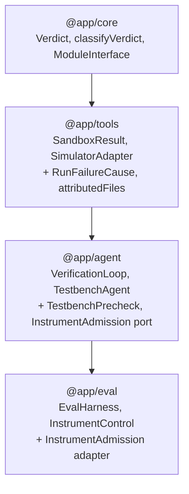
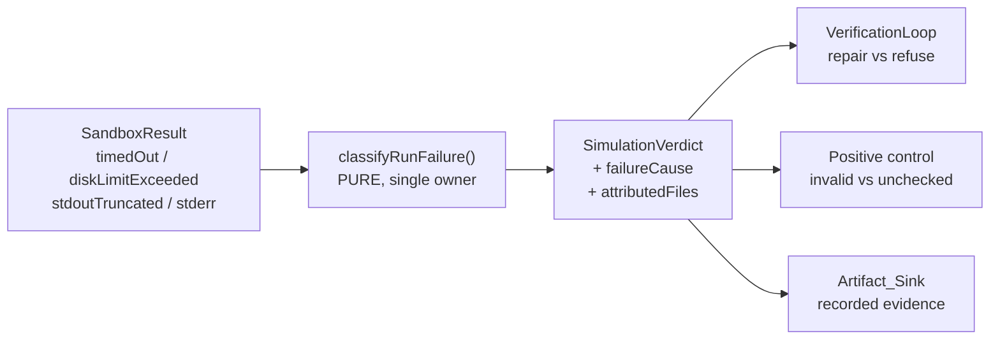
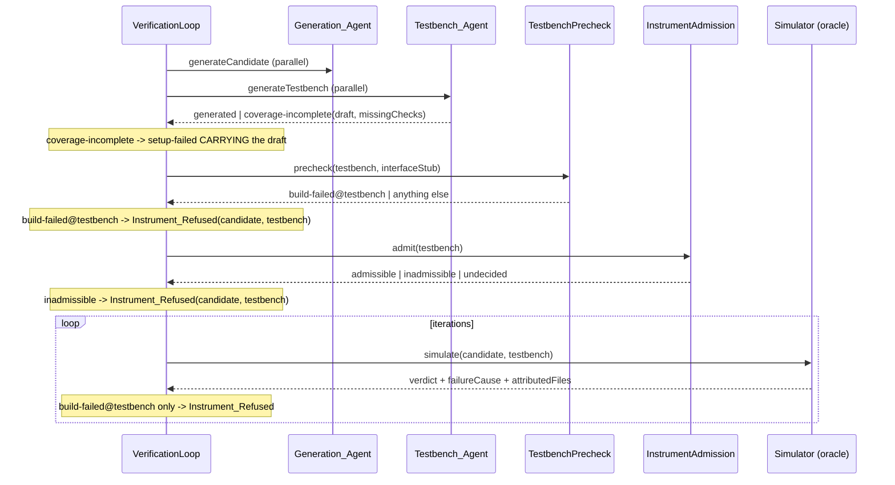

# Design Document

## Overview

Four defects, one shared root cause: **a failure's CAUSE is thrown away at the seam where it is known, and re-derived (or guessed) at the seam where it is needed.**

- `SandboxResult` knows `timedOut`, `diskLimitExceeded`, and `stdoutTruncated`. `SimulationVerdict` drops all three, so the loop sees a bare `error` and repairs RTL against a testbench that never compiled.
- `iverilog` names the failing file. Nothing reads the name, so a testbench defect is charged to the RTL.
- A disk-cap kill writes one diagnostic line. `classifyNonPass` reads stderr only for emptiness, so "we killed this run" reads as "the testbench does not build".
- The Testbench_Agent knows the rejected draft and the unmet check names. Neither leaves the process, so 3 samples in 15 are undiagnosable.

So the design is not four features. It is one narrowing of the simulate seam (a `RunFailureCause` plus the files a build diagnostic named), and then three consumers reading it: the loop's repair decision, the positive control's classification, and the recorded artifact.

On top of that narrowing sit two orderings, both of which spend less before learning more:

- a **Testbench_Precheck** builds the generated testbench against a Spec-derived interface stub the instant the testbench exists - no model call, no reference design, no candidate RTL;
- an **Instrument_Admission** port lets the eval layer answer "is this testbench a measuring stick?" before the repair loop starts, rather than after the budget is gone.

Both are refusals, never verdicts. Neither can produce a pass, neither can make an invalid instrument valid, and every failure path in both degrades to *today's behaviour* rather than to a refusal.

### What the measured numbers say this is worth

On `tbslice-v1`: 11 of 15 samples were instrument-invalid and consumed 52 of the run's 53 iterations and 197,901 of its 223,034 tokens. 6 of those 11 held candidate RTL the independent judge passes. The Testbench_Precheck alone closes 2 of the 11 (`adder_8bit`, `multi_booth_8bit` - independently reproduced with `iverilog -t null`, both the same illegal mid-block declaration). The Instrument_Admission reordering closes all 11, because every one of them was falsified by the positive control.

### One finding that changes the shape of the solution

Stopping the loop early nearly broke the number this whole harness exists to produce.

`candidateRtlOf` returns `null` for `setup-failed`, and the Golden_Judge reads the candidate through that same function. So if a refused sample returned `setup-failed`, it would surrender no candidate, the independent judge would have nothing to score, and the **golden denominator would shrink from 10 to 3** - trading a budget saving for the destruction of the capability metric.

That is why `Instrument_Refused` is a new terminal outcome that CARRIES the candidate and the testbench, rather than a new `setup-failed` reason. The saving is in the iterations, not in the evidence.

### Two decisions taken from the evidence rather than asked about

**The negative control is not reordered, and it costs nothing to leave it where it is.** `RtllmInstrumentControl.#probeMutants` already returns `null` whenever the positive control did not report `valid`, so a mutant set runs for exactly the positive-valid samples in either ordering. Moving the whole control earlier therefore changes the ORDER of the same work, not its amount. `InstrumentControl.check` is left intact and is simply called earlier, which also keeps `combineInstrumentControls` with its single existing owner.

**The coverage gate's matching rule is not touched.** 3 samples died at `iterations: 0` on `coverage-incomplete`, and the artifacts cannot say whether the model mangled a 44-character `ac<n>_<slug>` token or omitted a check entirely - `missingCheckNames` goes only to the Trace and the draft is not persisted at all. Changing the rule now would be specifying a fix for a cause nobody has measured. This spec persists the evidence; the rule change waits for it.

## Architecture

### Dependency direction is unchanged



No new edge. The `InstrumentAdmission` PORT is declared in `@app/agent` (where the loop consults it) and IMPLEMENTED in `@app/eval` (the only layer that holds reference designs), which is the role-local-port shape the repository already uses to keep the orchestrator free of its callers.

### Where the cause is decided, once



`classifyVerdict` in `@app/core` keeps sole ownership of pass/fail/error. `classifyRunFailure` adds no verdict; it explains one. Property 1 pins that separation.

### The new setup sequence



The precheck and the admission check sit between the parallel setup and the first iteration, in that order: the precheck is free and needs nothing external, so a testbench that cannot compile is refused before a reference design is ever loaded.

### Where the harness's control moves

Today: `#runSample` awaits `#drive` (the whole loop) then `#controlInstrument`.
After: `#runSample` builds a per-sample memoizing `InstrumentAdmission`, hands it to the loop through `EvalSampleRequest`, and afterwards reads the memo. `#controlInstrument` keeps its current body as the fall-back for any runner that ignored the port, so every existing fake loop runner and every existing test keeps working unchanged.

The two load-bearing constraints from `#runSample`'s own docstring survive by construction:

- **no budget handle.** `InstrumentAdmissionRequest` is `{ testbench: string }` and nothing else. There is no field a `SessionBudgetHandle` could occupy, the same way `GenerateTestbenchRequest` has no field RTL could occupy.
- **total and fail-safe.** `admit` returns a closed three-member union; a throw is caught by the loop and treated as `undecided`; `undecided` proceeds. The only behaviour an admission check can cause is a refusal that removes a sample from a denominator it was already excluded from.

## Components and Interfaces

### 1. `app/tools/simulator/failure-attribution.ts` (new, pure)

```ts
/** Why a run's verdict is `error`; `none` for a run that reached a functional verdict. */
export type RunFailureCause =
  | 'none'
  | 'build-failed'      // the toolchain named a submitted file at a source location
  | 'timed-out'         // SandboxResult.timedOut
  | 'disk-capped'       // SandboxResult.diskLimitExceeded
  | 'output-incomplete' // stdout truncated, or a required output missing
  | 'tool-failed';      // error with no cause we can name

/** The cause, plus the submitted files a build diagnostic named. */
export interface RunFailureAttribution {
  readonly cause: RunFailureCause;
  /** A subset of `submittedPaths`, in submission order; empty unless `build-failed`. */
  readonly attributedFiles: readonly string[];
}

export function classifyRunFailure(
  result: SandboxResult,
  submittedPaths: readonly string[],
): RunFailureAttribution;
```

Ordering of the classification, and why:

1. `timedOut` -> `timed-out`. 2. `diskLimitExceeded` -> `disk-capped`. Resource kills rank first for the same reason `classifyVerdict` ranks them at rules 1-2: a run we terminated part-way says nothing about the design, and its residue (a sentinel exit code, one stderr line) is *plausible enough to be misread*, which is exactly the `multi_16bit` defect.
3. verdict not `error` -> `none`.
4. `stdoutTruncated` -> `output-incomplete`.
5. diagnostics name at least one `submittedPaths` entry at a source location -> `build-failed` with those files.
6. otherwise -> `tool-failed`.

Attribution is a scan of at most `MAX_ATTRIBUTION_LINES` (256) diagnostic lines for `<path>:<line>`, where `<path>` must equal a submitted path (basename compared, because the toolchain prints the workspace-relative name). **Membership, never extraction:** the result is a filter of the caller's own list, so a diagnostic cannot introduce a path, and no untrusted text reaches the returned value. That is what makes `attributedFiles` safe to put in a record and a progress line, and it is pinned by Property 3.

### 2. `app/tools/simulator/adapter.ts` (changed)

`SimulationVerdict` gains two readonly fields (`failureCause`, `attributedFiles`). `interpretSandboxResult` calls `classifyRunFailure` with the paths `assembleSimulateJob` submitted and spreads the result into the returned verdict. **`verdict` itself is computed exactly as before** - `classifyVerdict` is untouched and is still the only owner of pass integrity (Property 2).

`SimulatorAdapter.simulate` is unchanged in signature, so every existing caller compiles.

### 3. `app/agent/orchestrator/testbench-precheck.ts` (new)

```ts
/** The stub DUT a generated testbench is built against: ports, no behaviour. */
export function buildInterfaceStub(moduleInterface: ModuleInterface): SourceFile;

export type PrecheckOutcome = 'testbench-build-failed' | 'undecided';

export class TestbenchPrecheck {
  constructor(simulator: SimulatorAdapter);
  run(testbench: SourceFile, moduleInterface: ModuleInterface, limits: ResourceLimits):
    Promise<PrecheckOutcome>;
}
```

`buildInterfaceStub` is the deliberate MIRROR of the existing `buildCompileHarness`: that one derives a testbench stand-in from the Spec so the candidate can be compiled; this one derives a DUT stand-in from the Spec so the testbench can be compiled. Both read `expectedInterfacePorts(moduleInterface)` - already exported from the generation role - so the clocking ports the Spec declares separately are present in both, and a testbench that connects `clk` cannot be refused for a port the Spec does in fact declare.

Measured on the committed artifacts, and the reason the stub is required rather than compiling the testbench alone:

```
iverilog -t null <testbench>.v alone
  rtllm_arithmetic_adder_16bit  -> error: Unknown module type: adder_16bit   (a CLEAN testbench)
  rtllm_arithmetic_adder_8bit   -> testbench.v:49: syntax error              (the real defect)

iverilog -t null stub.v <testbench>.v
  adder_16bit + correct stub    -> exit 0
  adder_16bit + stub missing Co -> error: port ``Co'' is not a port of uut.  (exit 1)
```

Compiling the testbench alone would refuse 10 of 12 sound testbenches. The stub makes the check both sound and strictly stronger: it catches the syntax class AND the interface-mismatch class (`TESTBENCH_REFERENCE_UNBUILDABLE`, 3 of 11 recorded) before any candidate exists.

`run` drives `simulator.simulate([stub], testbench, limits)` and maps the result:

| result | outcome | why |
| --- | --- | --- |
| `failureCause: 'build-failed'` and `attributedFiles` holds the testbench path | `testbench-build-failed` | the toolchain named our testbench |
| `failureCause: 'build-failed'` and it names only the stub | `undecided` | our own stub is the suspect, never the testbench |
| any other `failureCause`, including `output-incomplete` | `undecided` | a testbench that builds and writes no waveform is an incomplete capture, not a build defect (Req 1.12) |
| the simulate call throws | `undecided` | a precheck must never fail the thing it checks |

The stub emits no `$dumpfile`, so a testbench that omits one yields `output-incomplete` rather than a refusal - which is precisely why the table's third row exists and why `output-incomplete` had to be a separate cause rather than folded into `tool-failed`.

A `testbench-build-failed` row ends the run: regenerating the Testbench once and re-running the precheck against the same stub is a deferred follow-on rather than part of this design, for the reason recorded in `requirements.md` under what this spec does not change.

### 4. `app/agent/orchestrator/instrument-admission.ts` (new port, no implementation)

```ts
export type InstrumentAdmissionDecision = 'admissible' | 'inadmissible' | 'undecided';

/** Structurally incapable of carrying a budget handle or any RTL. */
export interface InstrumentAdmissionRequest {
  readonly testbench: string;
}

export interface InstrumentAdmission {
  admit(request: InstrumentAdmissionRequest): Promise<InstrumentAdmissionDecision>;
}
```

### 5. `app/agent/orchestrator/verification-loop.ts` (changed)

- `VerificationLoopDeps` gains one optional field, `instrumentAdmission?: InstrumentAdmission`. The precheck needs no injection: the loop already holds `#simulator`, so it constructs its own `TestbenchPrecheck` and the gate is unconditional.
- `#admitInstrument`'s gate condition consults the admission port only when `precheckOutcome !== 'testbench-build-failed'` (equivalently, `=== 'undecided'`, given the two-outcome decision table) - never on a `'built'` branch, which the decision table does not produce.
- `VerificationSetupFailed` gains two optional fields, `rejectedTestbench?: string` and `missingCheckNames?: readonly string[]`, populated on the `coverage-incomplete` path. Optional rather than required so the `generation-unavailable` path and the eval runner's own sanitized refusals are unchanged.
- `VerificationOutcome` gains `InstrumentRefusedModule` (see Data Models).
- `#setup` returns the rejected draft alongside its detail.
- `#iterate`'s non-pass branch consults `refusedByTestbenchBuild(simulation, testbenchPath, rtlPaths)` before requesting a repair. Everything that is not a testbench-only build failure takes the existing path byte for byte.

### 6. `app/eval/instrument-control.ts` (changed)

`InstrumentUncheckedReason` gains `'control-resource-exhausted'`, with its operator wording in the existing total `UNCHECKED_DESCRIPTIONS` record - so the wording is a compile error to omit. `countsInPassAtK` is untouched: a new `unchecked` reason is excluded by the existing rule, with no edit to the invariant (Property 8).

### 7. `app/eval/corpus/rtllm-instrument-control.ts` (changed)

`classifyControlRun` reads `simulation.failureCause` FIRST:

```
failureCause 'timed-out' | 'disk-capped'  -> unchecked('control-resource-exhausted')
verdict 'pass'                            -> VALID_INSTRUMENT
failureCause 'build-failed'               -> invalid('TESTBENCH_REFERENCE_UNBUILDABLE')
otherwise                                 -> classifyNonPass(...) as today
```

`classifyNonPass` keeps its single owner and its current rule; it simply stops being asked about runs whose cause is already known structurally. That closes the `multi_16bit` misclassification at the layer that caused it, and it is the upgrade path the existing vault note on the collapsed verdict prescribed for exactly this trigger.

### 8. `app/eval/instrument-admission.ts` (new adapter)

```ts
export class MemoizingInstrumentAdmission implements InstrumentAdmission {
  constructor(control: InstrumentControl, request: Omit<InstrumentControlRequest, 'testbench'>);
  admit(request: InstrumentAdmissionRequest): Promise<InstrumentAdmissionDecision>;
  /** The result the admission decision was taken from, or `null` if `admit` never ran. */
  recorded(): InstrumentControlResult | null;
}
```

One instance per sample, built by the harness. `admit` runs `control.check` at most once and memoizes the whole `InstrumentControlResult` - streams, exit code, mutation report and all - so the harness records exactly what the loop decided on and the control never runs twice (Req 4.12). Decision mapping: `invalid` -> `inadmissible`; `valid` -> `admissible`; `unchecked` and `null` and any throw -> `undecided`.

### 9. `app/eval/harness.ts` (changed)

`#runSample` builds the admission, threads it through `EvalSampleRequest`, and then:

```
const recorded = admission.recorded();
const control = recorded ?? await this.#controlInstrument(problem, outcome);
```

`#controlInstrument` keeps its existing body verbatim, including all five `unchecked` degradations. So a run whose loop runner ignores the port measures exactly what it measures today, and the reordering is additive.

### 10. `app/eval/loop-runner.ts`, `verification-loop-runner.ts` (changed)

`EvalSampleRequest` gains `readonly instrumentAdmission?: InstrumentAdmission`; the production runner forwards it into `VerificationLoopDeps`. No other change - the runner already builds the loop per sample.

### 11. Records, artifacts, summary

| module | change |
| --- | --- |
| `app/eval/sweep/results-log.ts` | `RESULTS_SCHEMA_VERSION` 9 -> 10; new required `instrumentUncheckedReason` field for `unchecked` records; `instrument-refused` joins `OUTCOME_STATUSES`; `STALE_SCHEMA_ADVICE` gains the v9 -> v10 paragraph |
| `app/eval/sweep/results-log.ts` | `instrumentVerdictOf` reads the persisted reason instead of flattening every `unchecked` to `control-unavailable` |
| `app/eval/sweep/artifact-layout.ts` | `ARTIFACT_DOCUMENT_SCHEMA_VERSION` 6 -> 7; new filenames `rejected-testbench.v` and `precheck-stderr.txt` |
| `app/eval/artifact-sink.ts` | captures `failureCause`, `attributedFiles`, `rejectedTestbench`, `missingCheckNames` |
| `app/eval/no-verdict-cause.ts` | new cause for `instrument-refused`, distinct from `blocked`/`setup-failed`/`runner-error` |
| `app/eval/golden-judge.ts` | denominator predicate admits `instrument-refused`; `candidateRtlOf` reads the refused outcome's candidate |
| `app/eval/sweep/summary.ts` | per-arm `instrument-refused` count; per-`unchecked`-reason counts; the not-comparable note of Req 5.12 |
| `app/agent/orchestrator/instrument-policy-version.ts` | new `INSTRUMENT_POLICY_VERSION = 1` |
| `app/eval/sweep/config-identity.ts` | folds it in under the reserved key `__instrumentPolicyVersion`, read directly from the import |
| `app/eval/sweep/manifest.ts` | records it, read from the same constant |

The identity carrier follows the `TESTBENCH_PROMPT_VERSION` precedent exactly, for the same stated reason: `sweepConfigHash`'s signature stays unchanged, so `cli.ts` needs no edit and a manifest cannot claim a policy the running code does not have. It is a SECOND constant rather than a bump of the prompt version, because the prompt did not change and `prompt-version.test.ts` pins that constant against a digest of the assembled prompt - bumping it would make that pin assert something false.

Folding it in re-hashes `SMOKE_RUN_CONFIG_HASH` and `TBSLICE_RUN_CONFIG_HASH`. That is the same predicted, deliberate cost the prompt-version fold-in paid, and Req 7.9 schedules the pin update rather than letting it surface as a surprise failure.

## Data Models

### `InstrumentRefusedModule` (new terminal outcome)

```ts
export type InstrumentRefusalReason =
  | 'testbench-build-failed'   // the precheck, or an iteration, attributed a build failure to it
  | 'instrument-inadmissible'; // the Instrument_Admission port refused it

export interface InstrumentRefusedModule {
  readonly status: 'instrument-refused';
  readonly reason: InstrumentRefusalReason;
  /** `Unverified`, always: the artifact exists and no oracle passed it. */
  readonly label: ArtifactLabel;
  /** The candidate Loop_Setup produced - the field that keeps the golden denominator whole. */
  readonly candidate: GeneratedCandidate;
  /** The instrument that was refused, carried so the artifact names what was rejected. */
  readonly testbench: Testbench;
  /** Submitted files a build diagnostic named; a subset of the run's own paths. */
  readonly attributedFiles: readonly string[];
}
```

`reason` is a closed enum and there is no free-text field, so the outcome is structurally incapable of carrying a host, a path from a diagnostic, or a stack trace - the same discipline `RecordedInstrumentVerdict` already applies (Req 5.3).

It carries no `VerificationResult`, no `simulation`, and no `oracleSpanId`. `reachedOracleVerdict` therefore continues to read the positive set `['verified', 'unverified']` **with no edit**, and `instrument-refused` is excluded by the rule that is already there. Adding the status to `SampleOutcomeStatus` is a compile error in every exhaustive table that must decide about it - which is the point.

The blast radius of widening the union was checked rather than assumed: `VerificationOutcome` is named in `app/agent/orchestrator`, `app/agent/roles/iteration`, and `app/eval` only. **No `app/web` module reads it**, so adding a status does not reach the Display_Layer or the trust-label rendering, and no product UI decision is part of this spec.

### Denominator membership, after the change

| outcome status | oracle verdict? | in golden denominator? | in pass@k denominator? |
| --- | --- | --- | --- |
| `verified` | yes | iff golden `passed`/`failed` | iff instrument `valid` |
| `unverified` | yes | iff golden `passed`/`failed` | iff instrument `valid` |
| `instrument-refused` | **no** | **iff golden `passed`/`failed`** | **no** |
| `setup-failed` | no | no (no candidate) | no |
| `blocked`, `runner-error` | no | no (no candidate) | no |

The `instrument-refused` row is the whole point of Requirement 5: a sample can be worth nothing to the self-graded number and still be worth a full data point to the independent one.

### `SimulationVerdict` delta

```ts
export interface SimulationVerdict {
  readonly verdict: Verdict;              // unchanged, still from classifyVerdict
  readonly checks: readonly CheckResult[];
  readonly vcd: ArtifactBlobRef | null;
  readonly stdout: string;
  readonly stderr: string;
  readonly exitCode: number | null;
  readonly resourceUsage: ResourceUsage;
  readonly failureCause: RunFailureCause;          // new, required
  readonly attributedFiles: readonly string[];     // new, required; empty unless build-failed
}
```

Both new fields are REQUIRED, not optional. An optional `failureCause` would let a caller construct a verdict that silently means "cause unknown", which is the defect being fixed. Required means every fixture and every arbitrary must produce one, which is the loud outcome.

### Record delta (`RESULTS_SCHEMA_VERSION` 9 -> 10)

| field | change |
| --- | --- |
| `outcomeStatus` | `'instrument-refused'` joins the closed set |
| `instrumentUncheckedReason` | new; required when `instrumentValidity` is `unchecked`, else `null` |
| `iterations` | meaning changed: an instrument-refused sample records 0 where a v9 record for the same sample recorded up to 6 |

A v9 file is refused wholesale, with no migration and no default, on the established grounds: a default for `instrumentUncheckedReason` would invent a reason, and a v9 `iterations` value describes a flow that no longer exists.

## Correctness Properties

_A property is a characteristic or behavior that should hold true across all valid executions of a system - essentially, a formal statement about what the system should do. Properties serve as the bridge between human-readable specifications and machine-verifiable correctness guarantees._

### Property 1: The failure cause never moves the verdict

*For any* `SandboxResult`, the `verdict` field of the `SimulationVerdict` that `interpretSandboxResult` returns is equal to the `verdict` the same function returned before `failureCause` and `attributedFiles` were added, so adding an explanation can never change a pass/fail decision.

**Validates: Requirements 2.10, 8.4**

### Property 2: A resource-bound kill outranks every other cause

*For any* `SandboxResult` whose `timedOut` or `diskLimitExceeded` flag is set, the reported `RunFailureCause` is `timed-out` or `disk-capped`, whatever that result's exit code, stderr text, or submitted paths hold.

**Validates: Requirements 2.2, 2.3, 3.3**

### Property 3: Attribution is a filter of the caller's own paths

*For any* `SandboxResult` and any list of submitted paths, every entry of the reported `attributedFiles` is an element of that submitted list, and `attributedFiles` is empty whenever the reported cause is not `build-failed`.

**Validates: Requirements 2.4, 2.5, 2.6**

### Property 4: A testbench-only build failure never asks for an RTL repair

*For any* simulation whose cause is `build-failed` and whose attributed files hold the testbench path and no RTL path, the Verification_Loop returns `instrument-refused` and requests no revision; and *for any* simulation whose cause is anything else, the loop takes the same branch it took before attribution existed.

**Validates: Requirements 2.7, 2.8, 2.9**

### Property 5: The interface stub declares exactly the Spec's interface

*For any* `ModuleInterface`, the stub `buildInterfaceStub` produces declares the Spec's module name, declares one port for every entry of `expectedInterfacePorts` with that entry's direction and width, and contains no procedural block.

**Validates: Requirements 1.1, 1.2, 1.3**

### Property 6: Every precheck outcome other than a testbench build failure proceeds

*For any* precheck simulation result, the Verification_Loop refuses the testbench only where the cause is `build-failed` and the attributed files hold the testbench path, and proceeds to the first iteration in every other case, including a thrown simulate call and an `output-incomplete` result.

**Validates: Requirements 1.8, 1.9, 1.10, 1.12**

### Property 7: The only difference an admission port can make is a refusal

*For any* admission decision, running the Verification_Loop with that port wired yields either the identical terminal outcome and the identical consumed budget it yields with no port wired, or an `instrument-refused` outcome at zero iterations - and never a third thing. An `undecided` decision and a thrown `admit` always take the first branch.

Stated as an equivalence against the no-port trajectory rather than as six per-branch claims, because the equivalence is the whole safety argument: it makes "no verdict was moved" and "no budget was consumed" fall out of one statement instead of being asserted separately and possibly inconsistently.

**Validates: Requirements 4.3, 4.5, 4.6, 4.7, 4.8, 4.9, 4.16**

### Property 8: The denominator truth table

*For any* triple of outcome status, instrument validity, and golden outcome, the pass@k denominator predicate reports the sample counted exactly when the status is verdict-bearing AND the validity is `valid`, and the golden denominator predicate reports the sample a member exactly when the status carries a candidate AND the golden outcome is `passed` or `failed`. An `instrument-refused` status is therefore never counted in pass@k and is a golden member whenever it was judged.

**Validates: Requirements 3.4, 5.7, 5.8, 5.9, 8.2, 8.3**

### Property 9: A refused outcome surrenders its candidate

*For any* `instrument-refused` outcome, the candidate RTL the artifact capture and the Golden_Judge read is the RTL of the candidate that outcome carries, and is never absent.

**Validates: Requirements 5.1, 5.2, 5.5, 5.6**

### Property 10: An unchecked reason survives the round trip

*For any* `RecordedInstrumentVerdict`, encoding it into a sample record and decoding that record back yields an equal verdict, so no `unchecked` reason is flattened on the way to the summary.

**Validates: Requirements 3.5, 3.6**

### Property 11: A resource-bound kill is never charged to the instrument

*For any* positive-control simulation whose cause is `timed-out` or `disk-capped`, the reported instrument validity is `unchecked` under the resource-exhausted reason, and is never `invalid` under any defect code, whatever that run's diagnostics text holds.

**Validates: Requirements 3.1, 3.2, 3.3**

### Property 12: The capture derives exactly what the outcome carries, bounded

*For any* terminal outcome, the captured artifacts hold the rejected testbench draft, the unmet check names, the run failure cause, and the attributed files exactly when that outcome carries them, each bounded by its cap, and hold no value the outcome does not carry - an absent field yields an absent artifact rather than a blank one.

**Validates: Requirements 2.11, 6.3, 6.4, 6.6**

### Property 13: The policy version changes the experiment identity

*For any* sweep config, the config hash computed with one `INSTRUMENT_POLICY_VERSION` differs from the hash computed with any other value of that constant, and the manifest reports the same value the hash was computed from.

**Validates: Requirements 7.5, 7.6, 7.7, 7.8**

### Property 14: A stale record is refused, never repaired

*For any* sample record encoded under a schema version below 10, the results-log reader reports it as a stale-schema line and aggregates nothing from the file that holds it.

**Validates: Requirements 7.1, 7.2**

### Property 15: The control runs at most once, and refuses only on `invalid`

*For any* sequence of `admit` calls on one `MemoizingInstrumentAdmission` and any `RecordedInstrumentVerdict` the underlying control returns, the control is invoked at most once, every call reports the same decision, the result the harness records is identical to the result that decision was taken from, and the decision is `inadmissible` exactly when the verdict's validity is `invalid`.

**Validates: Requirements 4.1, 4.11, 4.12, 4.13**

### Coverage note

Requirement 6.5 (the draft's filename differs from the accepted testbench's) and Requirement 5.10 (the refused no-verdict cause is distinct from the other three) are distinctness claims over fixed constants, so each is a single assertion rather than a property. The three slice measurements in Requirements 8.6 to 8.8 are deliberately NOT tests: they are one live campaign re-run compared against the recorded `tbslice-v1` numbers, and writing them as assertions would mean pinning a number nobody has measured.

## Error Handling

Every new failure path degrades to the behaviour that existed before this spec. That direction is chosen once and applied everywhere: a mechanism added to save money must never be able to cost a measurement.

| failure | handling | why this direction |
| --- | --- | --- |
| the precheck's simulate call throws | caught; `undecided`; loop proceeds | an unavailable precheck must not refuse a sound testbench |
| the precheck names only the stub | `undecided`; loop proceeds | our own stub is the suspect, and refusing on it would charge our defect to the model |
| the testbench builds and writes no waveform | `output-incomplete`; loop proceeds | an incomplete capture is not a build defect |
| `admit` throws | caught; `undecided`; loop proceeds | a broken control may never end a campaign with hours in it |
| `admit` reports `undecided` | loop proceeds; verdict recorded `unchecked` | "unproven" is not "unsound", and `unchecked` already leaves the denominator |
| `InstrumentControl.check` returns `null` | `undecided`; loop proceeds | a problem with no reference design is a legitimate configuration |
| no admission result reached the harness | harness runs the control after the loop, as today | the reordering is additive; a runner that ignores the port loses nothing |
| a build diagnostic names an unknown path | that path is dropped | membership, not extraction; nothing untrusted enters a record |
| diagnostics exceed the line cap | the scan stops at the cap | bounded work on an unbounded stream |
| a v9 results file is read | whole file refused, advice printed | a default would invent a measurement |
| an artifact write throws | already caught by the harness | observability must never fail what it observes |

Sanitization, unchanged in kind: `InstrumentRefusalReason` and `RunFailureCause` are closed enums; `attributedFiles` is a subset of paths the caller submitted, all of which are derived from the trusted Spec module name (`${moduleName}.v`, `${moduleName}_tb.v`) and never from model output. Raw toolchain text continues to go only to artifact files under the run directory, beside the source that caused it.

## Testing Strategy

Property-based testing applies here: every rule this spec adds is a pure total function over structured input (`classifyRunFailure`, `buildInterfaceStub`, the precheck decision table, the two denominator predicates, the record codec, the memoizer), and input variation is exactly what exposes the defects being fixed - a plausible-looking residue, a diagnostic naming an unexpected path, a verdict with an unusual flag combination.

- **Library**: `fast-check` (already the repository's PBT library; nothing new is added).
- **Iterations**: at least 100 per property test.
- **Tagging**: each property test carries `// Feature: instrument-precheck-and-attribution, Property N: <property text>`.
- **One property, one test.** Each of the 15 properties above is implemented by a single property-based test.

Non-vacuity, since three of these properties can pass trivially if an arbitrary is too narrow:

- The full arbitraries for `SandboxResult` must GENERATE `timedOut`, `diskLimitExceeded`, and `stdoutTruncated` rather than pin them, or Properties 1-3 stop being able to see the signal at all. The subspace arbitraries that isolate the pass/fail split keep pinning them `false`, with the reason stated. This is the exact trap the repository already recorded when `diskLimitExceeded` was introduced, and it recurs here for the same reason.
- Property 7's budget claim must be asserted against a metered budget over a trajectory with at least one refusal AND one admission, or "identical budget" is trivially true on an empty trajectory.
- Property 3 must generate diagnostics that name paths NOT in the submitted list, or the filter is never exercised.

Example-based unit tests, for the specific measured cases property tests would not pin:

- `adder_8bit`'s and `multi_booth_8bit`'s real headers (the mid-block `initial` declaration) refused by the precheck.
- `adder_16bit`'s real testbench built clean against its stub, and refused against a stub with a port removed - the pair that proves the check is not vacuous in either direction.
- `multi_16bit`'s real `workspace reached its 134217728-byte disk cap` stderr classified `disk-capped` -> `unchecked`, and NOT `TESTBENCH_REFERENCE_UNBUILDABLE`.
- `adder_8bit`'s real `adder_8bit_tb.v:49: syntax error` stderr attributed to the testbench path and not the RTL path.
- The `STALE_SCHEMA_ADVICE` text naming both changed meanings.

Integration tests, kept to a handful because they cost real toolchain runs:

- One real-`iverilog` precheck (a clean testbench, a syntactically broken one) under the existing skip harness, so the gate is exercised against the real compiler rather than only against a fake.
- One end-to-end harness run over a fake loop runner asserting that an inadmissible instrument yields `iterations: 0`, a recorded golden verdict, and a pass@k denominator unchanged.

Regression pins:

- `SMOKE_RUN_CONFIG_HASH` and `TBSLICE_RUN_CONFIG_HASH` updated to the values the folded-in policy version produces, each with the reason appended to that constant's history comment.
- The existing 1613-passing / 6-skipped gate holds, and the 6 skips remain the same environmental ones.
