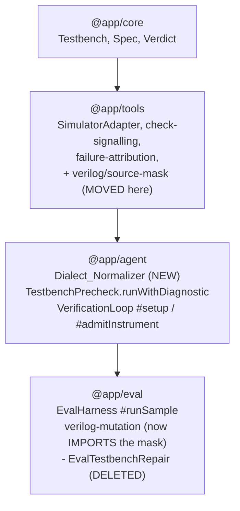
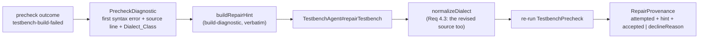

# Design Document

## Overview

Three defects and one mechanism, sharing one root cause: **a fact is known at the seam that produced it and thrown away before the seam that needs it.**

The campaign that motivates this spec (`.eval-runs/stage1-screen-repair-v1`, 495 samples, 11 arms, n=3) recorded 259 repair attempts, 2 accepted, and 0 net verified artifacts recovered.
Three of those four numbers are artefacts of discarded facts rather than measurements of the repair loop.

- A declined control-path repair returned `wasRepaired: false`, and `#runSample` wrote `repairProvenance: wasRepaired ? {...} : precheckProvenance`, so the attempt was persisted as `attempted: false`.
  The 211 is a count of admissible revisions produced, not of attempts made.
- `#repairPrecheckFailure` built its `Repair_Hint` as a local and returned only `repairProvenance`, so all 48 precheck-arm samples persist `repairHint: null`.
  The 48 had to be classified by hand, out of `control-stderr.txt`.
- Neither call site recorded the STAGE a decline happened at, although both already branch on exactly those stages and then collapse them: `#repairPrecheckFailure` returns one `attemptedButDeclined` value from four branches, and `#repairIfTriggered` returns one `declined` value from five.

The classification of the 48 is what changed the answer.
29 are a declaration inside an unnamed `begin` block and 7 are a malformed sized literal, and iverilog 13.0 with `-g2012` already passed accepts a block-item declaration placed FIRST in its block and accepts `-16'd15` where it rejects `16'd(-15)`.
**28 of the 40 committed fixtures are MEASURED fixed**, which is 28 of the 45-sample classified population: `unnamed-begin-declaration` at 25 of 29 fixed with 4 declined (3 `unbalanced-block`, 1 `declaration-not-relocatable`), `malformed-sized-literal` at 3 of 7 with 4 declined `value-not-determinable`, and `prose-as-statement` at 0 of 4, which is correct and permanent because that class is reported and never rewritten.
Every figure is MEASURED against the real toolchain and is written with its residue throughout this document; see "The label was never the discriminator" below.
Two superseded figures are kept on the record so they are not restored: **32 of 48** rested on the unverified 24 / 8 / 6 hand count, and **36 of 45** assumed ALL 29 plus ALL 7 would be fixed.
The measured 28 is 8 short of 36 because 4 unnamed-begin fixtures and 4 sized-literal fixtures decline for reasons no meaning-preserving rewrite can reach, so 36 was optimistic by 8 and 28 is the number a campaign should be predicted against.

Those counts are CORRECTED, and the correction is stated here so a future reader does not restore the old ones.
The original 24 / 8 / 6 of 48 came from one unverified hand count.
The verified 29 / 7 / 4 of 45 was derived by running the real compiled `normalizeDialect` over the real captured artifacts and reading every unclassified residue by hand at its exact iverilog error line.
The classified population is the 45 samples whose `control-stderr.txt` contains `syntax error`; the other 3 of the 48 captured no `control-stderr.txt` at all, so no classification is derivable for them.
The residue is 5 samples in none of the three classes: a bit-select on a sized literal `8'b00000000[7:1]`, a stray bare identifier statement `rst_n;`, a forward-referenced `disable` block label, a stray extra `end`, and a bit-select on a parenthesized expression `(i + 1)[7:0]`.
`prose-as-statement` caps at 4 in the whole 495-sample corpus: a corpus-wide search for the bare `CHECK <name> PASS|FAIL;` shape found exactly 4 sample directories, so 6 is unreachable at any tie-break rule.
`DIALECT_RULE` at prompt v3 already instructs both of those things in words, and the campaign ran with that rule active, so a prompt rule for this class is a measured dead end rather than an untried cheap fix.

So this design adds one mechanism and repairs three accounting seams:

1. A **Dialect_Normalizer**: a pure, model-free desugaring of every generated Testbench source, applied once, before the Testbench_Precheck builds it.
2. A **Precheck_Diagnostic** that names the FIRST `syntax error` and the source line it points at, rather than returning `verdict.stderr` whole and letting an iverilog cascade (`Malformed statement`, 54 occurrences, reported at line 72 for a defect at line 66) be what a reader and a Repair_Hint both receive.
3. A widened **Repair_Provenance** that makes `attempted` a returned value rather than a re-derivation, carries the **Repair_Hint** out of the loop, and names the **Repair_Decline_Reason** at both trigger points.
4. The **retirement** of control-triggered repair, which cannot ship (the Positive_Control needs the benchmark's reference design) and cannot recover a verified artifact (both accepted repairs still recorded `passed: false`).

### The overlap between Requirement 1 and Requirement 7, stated rather than hidden

Requirement 1's defect lives entirely in `#repairIfTriggered`, which Requirement 7 then deletes.
That is not a contradiction and it is not a reason to skip either.
`clarification-answers.md` Q1 orders the accounting requirements FIRST precisely so the records stay interpretable independently of whether the retirement lands, and the durable half of Requirement 1 survives the deletion: `#runSample` must stop deriving provenance from whether a revision was accepted (Req 1.6), the precheck path must keep reporting `attempted: true` with a reason (Req 1.2, 3.2), and the Sweep_Summary must count declined attempts (Req 1.7).
So the design implements the accounting at BOTH points, then deletes one point, and leaves no merge function behind whose second argument is a constant (see "Requirement 1.5's union, after retirement").

### The explicit non-goals, restated because every component below is scoped by them

This design does not touch the 229 `TESTBENCH_FAILED_REFERENCE` samples.
It does not normalize candidate RTL, because rewriting the artifact under test would break the oracle.
It adds no retrieval, no ReAct iteration, and no blind-resampling arm.
It does not amend `testbench-repair-loop` Req 2.4-2.6, and does not reword `DIALECT_RULE`.

### Comments are lexically whitespace, and two adjacency scans did not know it

This is recorded as a design fact rather than as an implementation detail, because it decides the shape of every adjacency scan in `dialect/` and it was found violated after the rules had already landed.

**The language ground truth.**
In Verilog a comment is lexically equivalent to whitespace: it is stripped before the parser sees the token stream.
Confirmed directly against Icarus Verilog 13.0 with `-g2012`: `begin // c` newline `: blk` compiles at exit 0, and `begin /* c */ : blk` compiles at exit 0.
So a comment span is TRANSPARENT to any question of the form "what is the nearest code character on this side", and a scan that stops at a comment is asking a different question than the parser answers.

**Three defects, one root cause.**
An adjacency scan that treats a comment span as an opaque barrier rather than as whitespace.

| site | what it does | verified consequence |
| --- | --- | --- |
| `prose-as-statement.ts` `precedingNonWhitespaceOffset`, read by `sitsWhereStatementExpected` | walks the RAW source, lands on the comment's last character, and the `mask.code[precedingOffset] !== 1` guard then returns `false` | the Prose_As_Statement site is MISSED whenever a comment intervenes. Report-only, so the cost is a missed finding. LIVE in captured data: 4 samples in `stage1-screen-repair-v1` (9 across all of `.eval-runs`), all `qwen.qwen3-coder-30b-a3b-instruct`, each a `// Final check` line immediately before a bare `CHECK <name> PASS;` |
| `unnamed-begin.ts` `isAlreadyNamed` | uses `mask.code[index] === 1` as a LOOP CONJUNCT, so the walk exits at the first non-code offset and an already-named block is judged unnamed | CONFIRMED FALSE REWRITE. The rule inserts ` : tbnorm_blk_N` after `begin`, producing `begin : tbnorm_blk_1 // c` newline `: blk`. Input iverilog exit 0, normalizer output iverilog exit 2 (`syntax error` plus `Malformed statement`); the block-comment variant is identical. This violates the module's own "false declines only, never false rewrites" invariant and Requirement 5.3's token preservation. Zero occurrences in the captured corpus, but the campaign generates NEW testbenches |
| `declaredNamesAfter`, in TWO near-duplicate copies at `unnamed-begin.ts` and `normalizer.ts` | both forward-scan to the terminating `;` correctly skipping non-code, then `source.slice(keywordEnd, end)` the RAW body and take the declared name with an unmasked identifier regex | `reg /*x*/ a;` yields the declared name `x` rather than `a`, which DEFEATS the Requirement 5.4 `would-shadow-module-scope` decline. Verified: module-scope `reg a;` plus block `reg a;` correctly declines; the same with `reg /*x*/ a;` in the block returns `changed: true, action: 'rewritten'`. Zero occurrences in the captured corpus |

**The correct pattern already exists four times over, so the fix is a copy rather than an invention.**
`sized-literal.ts`'s `precedingCodeCharacter` is CORRECT: it uses `continue` on non-code, which makes a comment transparent.
So are all three scans in `app/eval/corpus/verilog-mutation.ts` (`precedingOperandCharacter`, `conditionOpenParen`, `matchingCloseParen`).
Only the two sites above deviate.
The fix copies the existing `continue`-on-non-code walk and shares it where one helper can serve, rather than adding a fifth spelling of the same walk.

**Why `declaredNamesAfter` gets one owner.**
The rejected alternative "Duplicate the scanner into `app/agent` instead of moving it" below argues that two owners for one safety claim means the copy not currently being debugged is the one that drifts.
`declaredNamesAfter` is that case exactly: it is the reader the Requirement 5.4 meaning-preservation decline depends on, and it existed twice.
It is collapsed to one owner that takes the declared name from CODE offsets only.

**What this costs in identity.**
The set of rewrites changes: an already-named block carrying a comment is no longer rewritten, and a shadowing declaration written with an interior comment is now declined rather than rewritten.
Requirement 8.7 therefore requires `NORMALIZER_VERSION` to move 1 -> 2, and the two pinned config hashes to be re-pinned from observed values.

**The ordering this forces.**
The fix lands BEFORE the Dialect_Fixtures are copied.
A fixture encodes expected behaviour, so a fixture generated by a normalizer that turns a compiling source into a non-compiling one converts a confirmed bug into a passing regression test that defends it.

**What is deliberately left alone.**
The per-module `moduleScopeNames` over-approximation is DEFERRED and is safe as documented: its ceiling is false declines only, never false rewrites, which is the correct direction for a meaning-preservation gate.

### The label was never the discriminator - position is, and the move is the fix

This is the third premise in this spec to fail verification, after the 24 / 8 / 6 hand count and the comment-as-whitespace invariant.
It is recorded here in full, because it changes what the `unnamed-begin-declaration` rule DOES and it amends Requirement 5.3.

**What task 14.2 measured.**
With the label alone, the `unnamed-begin-declaration` rule fixed **0 of 29** of its committed fixtures.
It FIRED on 25 of the 29 - it inserted its `: tbnorm_blk_<n>` label and reported `changed: true` - and the first `syntax error` landed on the identical line before and after.
That 0 of 29 is the historical record of the label-only state, superseded by group 15's declaration move, which MEASURES at 25 of 29; it is kept here because it is the fail-before half of the fix.

**Why the original calibration said otherwise.**
It was a confounded experiment.
It compared a declaration in an unnamed block against a declaration at the top of a NAMED block, varied the label and the position together, and credited the label.
Measured with `iverilog -g2012`, one file per row, compiled alone so the reading is a pure PARSE fact:

| construct | result |
| --- | --- |
| unnamed `begin`, declaration FIRST | accepted |
| named `begin : blk`, declaration FIRST | accepted |
| unnamed `begin`, declaration AFTER a statement | `syntax error` |
| named `begin : blk`, declaration AFTER a statement | `syntax error` |
| declaration hoisted to module scope | accepted |

Rows 1 and 2 differ only in the label and agree; rows 3 and 4 differ only in the label and agree.
The discriminator is the declaration's POSITION relative to the first statement of its block, and the campaign captured the after-a-statement case.

**The transform, verified by a second probe.**
KEEP naming the block, and ADDITIONALLY move that block's declarations to the top of the same block, preserving their relative source order.

Effectiveness is **25 of 29**, now MEASURED against the real toolchain over the committed fixtures rather than predicted, and the 4-fixture residue is fully explained rather than unexplained:

- 3 fixtures whose first error is not this class at all - two use C-style `}` braces instead of `end`, one is a bare prose `CHECK` line. These are exactly the 3 the production rule already declines as `unbalanced-block`, because the brace or the prose means a `begin` never finds its `end`.
- 1 fixture with `genvar i;` inside a function body. `genvar` is rejected as a block-item declaration at ANY position, so position is irrelevant and this is a hard ceiling, not a near miss.

Against the fixtures this class can actually own it is 25 of 25.

**Naming buys nothing from the oracle, and that is said plainly.**
Move-only also fixes 25 of 29, with zero disagreement fixture by fixture.
The label's only remaining justification is IEEE 1364 conformance, which requires a named block for block-item declarations where iverilog is lenient.
It is NOT justified by acceptance under our deterministic oracle, which is iverilog.

**The shadow hazard does not reproduce.**
A block-local declaration inside an UNNAMED `begin` does not leak to the enclosing scope: an outside reference fails with `Unable to bind wire/reg/memory` identically whether the block is named or unnamed, and with `integer i;` declared at both module and block scope, the module-scope `i` reads `x` after simulation in both variants.
So naming never created the risk `would-shadow-module-scope` was built to guard, and the move keeps the declaration block-local, so scope is unchanged either way.
The decline is retained unamended: its ceiling is false declines only, which is the correct direction.

**Initializers are position-independent, which removes a guard that looked necessary.**
`integer i = 0;` is accepted as the FIRST item of a block and rejected after a statement, exactly like a bare declaration.
Static initialization happens BEFORE any procedural code rather than at the declaration's textual position: an `integer c = 0;` inside a `for` body initialized ONCE across three iterations (printing c=1, c=2, c=3), and `integer i = src;` read `x` even though another `initial` had already assigned `src = 9` at t=0.
So moving an initialized declaration within its own block cannot change when initialization happens, and no decline is needed for it.
8 of the 29 fixtures carry such a declaration, 19 declarations in total, each with the iverilog warning `Static variable initialization requires explicit lifetime in this context`.

**Token preservation survives as a MEASURED property rather than a free one.**
With the move applied, the code-token multiset of output equals input for 29 of 29, the sole addition being the inserted labels, and the comment multiset is unchanged for 29 of 29.
A same-line trailing comment travels with its declaration.
A comment line PRECEDING a declaration does not travel, and can end up describing whatever statement now follows - cosmetic only, with no parse effect.
This is why Requirement 5.3 is restated as an asserted multiset claim: it no longer holds "by construction" from insert-only editing.

**Two shapes MUST be declined, and one of them was found by breaking the transform.**

| shape | why | evidence |
| --- | --- | --- |
| a declaration inside a `for` HEADER | `for (integer i = 0; i < 3; i = i + 1)` is LEGAL under `-g2012` and the `integer` is not a block item | lifting it produced `for ( i < 86400; i = i + 1)`, a destructive false rewrite that dropped effectiveness from 25 to 20. Four fixtures use this shape. The production scan counts these into `declaredNames` with NO paren-depth guard - harmless while the rule only inserts, destructive the moment it moves. A code-paren-depth-greater-than-zero exclusion fixes it |
| `genvar` | rejected as a block-item declaration at any position | the 1-fixture residue above |

**Two detection hazards that must be fixed for the move to be correct.**

| hazard | why | evidence |
| --- | --- | --- |
| "is this declaration preceded by a statement" cannot be decided from identifier-shaped tokens | `#10;`, `@(posedge clk);`, `->ev;` and a bare `;` are all statements that carry no `[A-Za-z_$][A-Za-z0-9_$]*` token | token-stream reading wrongly judged declarations "already first" and left them alone. Deciding it over CODE CHARACTERS not covered by an earlier declaration span of the same block raised effectiveness from 24 to 25 |
| a genuine bug in the production `declaredNamesAfter` (`app/agent/orchestrator/dialect/unnamed-begin.ts`) | a parameterized range bound IS identifier-shaped, contradicting that function's own doc comment, which claims range dimensions "are not identifier-shaped and are skipped by the regex itself" | `reg [7:0] a;` returns `[a]` correctly, but `reg [WIDTH-1:0] a;` returns `[WIDTH]`, `reg [ADDR_WIDTH:0] a, b;` returns `[ADDR_WIDTH, b]`, and `reg [WIDTH-1:0] a = b;` returns `[WIDTH]`. This causes a FALSE `would-shadow-module-scope` decline on `deepseek.v3.2__rtllm_memory_asyn_fifo__sample-1.v`, whose `reg [WIDTH-1:0] saved_last_data` reads as declaring `WIDTH`, a module-scope parameter. The same reader builds `moduleScopeNames`, so the error sits on both sides of the comparison. Effectiveness is 25 of 29 only if this is fixed, and 24 of 29 if it is left |

**What the move has to handle, counted.**
26 blocks need a move, across 25 fixtures.
19 blocks carry more than one declaration.
3 declarations sit in a NESTED block inside an outer block and must move to the top of THEIR OWN block, not the outer one.
3 blocks already have their declarations first and must be left completely alone, verified by diff at zero changed lines.

**One toolchain fact worth recording.**
`iverilog`'s exit code for a rejected parse is NOT stably 2 - values 1, 2, and 4 were all observed.
The presence of a `syntax error` line is the reliable signal, and every assertion in this spec reads that rather than the exit code.

**The ordering this forces.**
The fixture suite lands FIRST, pinning the measured 0 of 29 as a documented known-failing state, and the rule fix flips that pin - which it has now done, to a measured 25 of 29.
That is the reverse of the group 13 ordering, and for a different reason: group 13 had a confirmed FALSE REWRITE, which a fixture would have frozen as expected behaviour, whereas this is a confirmed NO-OP, which a pinned count expresses honestly and which makes the suite the regression test for the fix instead of a claim about it.

## Where each component landed on the reuse ladder

The workspace rule is to climb before writing, and the most consequential rung this design reached is rung 2 for the hardest part of the problem.

| what was needed | rung reached | what was reused, or why not |
| --- | --- | --- |
| a span classifier that keeps `begin`/`end`/declarations inside comments and strings out of reach | **2 - already exists in this codebase** | `scanSource` / `SourceMask` in `app/eval/corpus/verilog-mutation.ts` is exactly this scanner, private today. It is EXTRACTED to a shared layer, not rewritten. See Component 1. |
| mapping a diagnostic line number to the source line's text | **2 - same module** | `SourceMask.lineStarts` already records every line's start offset. |
| "does this source emit check `<name>`?" | **2** | `sourceEmitsCheck` (`app/agent/roles/testbench/signalling.ts`), already the coverage gate's predicate. |
| "which checks did the control's stdout report?" | **2** | `readCheckSignals` (`@app/tools` check-signalling), the oracle's own grammar owner. |
| bounding a diagnostic scan | **2** | `MAX_ATTRIBUTION_LINES` (256), already exported from `app/tools/simulator/index.ts`. |
| a distinct artifact file for the pre-normalization source | **2** | the `pre-repair-testbench.v` precedent, and the RESERVED-but-unwritten `ARTIFACT_FILENAMES.precheckStderr` slot, finally populated. |
| recording a decline reason | **7, but as a widening** | `RepairProvenance` already exists and is already threaded through three outcomes, a record, a summary, and the sink. It is widened IN PLACE into a discriminated union rather than joined by a second parallel field. |
| the two rewrite rules themselves | **7 - write the minimum** | No Verilog rewriter exists anywhere in the tree, and no dependency is added (see "Alternatives considered and rejected"). |

The one place the ladder ran out is the rewriting itself, which is the whole content of this spec.
Everything the rewriting stands on was already in the repository.

## Architecture

### Dependency direction, with the one new shared module



No new edge, and one edge is removed by deletion.
The scanner moves DOWN to `@app/tools`, the lowest layer above `@app/core` that both `@app/agent` and `@app/eval` already import, so the normalizer can use it without `@app/agent` importing `@app/eval` (Req 4.15, 10.6) and `verilog-mutation.ts` keeps using the identical code rather than a copy.

### Why the scanner lands in `@app/tools` and not `@app/core`

`@app/core` holds the domain's own vocabulary: budgets, verdicts, trust labels, models.
It carries no knowledge of Verilog surface syntax, and putting a Verilog lexer there would make the layer that defines `Spec` and `Verdict` also the layer that knows what a block comment looks like.
`@app/tools` already owns exactly this kind of knowledge in two places: `check-signalling.ts` owns the `CHECK <name> PASS` line grammar the oracle parses, and `failure-attribution.ts` owns the `<path>:<line>` diagnostic grammar.
A per-character classification of Verilog source is the third member of that set.

### The new setup sequence

```mermaid
sequenceDiagram
    participant S as VerificationLoop #setup
    participant T as TestbenchAgent
    participant N as normalizeDialect (PURE)
    participant P as TestbenchPrecheck
    participant I as #iterate

    S->>T: generateTestbench(spec, budget)
    T-->>S: generated(testbench, checks)
    S->>N: normalizeDialect(testbench.source)
    N-->>S: { source, report }
    Note over S: the ONE Testbench value for this sample is built here,<br/>from the NORMALIZED source; the pre-normalization text<br/>leaves as separate evidence, not as a second Testbench
    S-->>I: SetupResult { testbench (normalized), normalization }
    I->>P: runWithDiagnostic(testbenchFile, stub, limits)
    P-->>I: { outcome, diagnostic: PrecheckDiagnostic }
```

The normalizer runs inside `#setup`, at the single point where a `Testbench` is constructed from the agent's reply.
It is desugaring, not repair: no trigger, no dependence on any prior build outcome, and no place in the repair path (Req 4.2, 4.16).

### The precheck-path repair, after this spec



Every one of the five decline branches now names its stage, and the hint every branch was built from rides out on the provenance rather than dying as a local.

### Where the harness's control path goes

Today: `#runSample` awaits `#drive`, reads `repairProvenanceOf(outcome)`, takes `admission?.recorded()` or `#controlInstrument`, then calls `#repairIfTriggered`, then reads the budget, then builds the record with a `wasRepaired ? ... : ...` ternary.

After this spec: `#runSample` awaits `#drive`, takes `admission?.recorded()` or `#controlInstrument`, reads the budget, and COPIES `repairProvenanceOf(outcome)` into the record.
`#repairIfTriggered`, `withRevisedTestbench`, `#buildTestbenchRepair`, and the ternary are all gone.
The only addition is one pure call that computes the Check_Name_Visibility_Signal from two values the method already holds.

## Components and Interfaces

### 1. `app/tools/verilog/source-mask.ts` (new location for existing code)

**Why it exists.**
The central design problem of this spec is rewriting Verilog without a parser and without ever changing meaning.
A naive regex over raw text is unsafe in a specific, measurable way: `begin`, `end`, and declaration-shaped text all appear inside `//` comments, `/* */` comments, and string literals, and `$display("...begin...")` is common in exactly the testbenches this transform will process.
An offset-preserving per-character classification removes that whole failure class structurally rather than by tightening a pattern.

**Why it is moved rather than written.**
`app/eval/corpus/verilog-mutation.ts` already contains this scanner, written for the identical reason and stating it in its own header: "no operator may fire on an offset inside a `//` comment, a `/* */` comment, a `"..."` string literal, or a backtick compiler directive."
It is a single left-to-right pass, linear, allocation-bounded, honours `\"` escapes inside strings, and records `lineStarts`.
Duplicating it would give two owners to one safety claim: the mutation generator's guard 1 and this spec's Requirement 5.3 are the same sentence about the same text.
So the scanner moves to `@app/tools` and both callers import it.

**Data flow.**
`source: string` in, `SourceMask` out, no other input and no I/O.
`verilog-mutation.ts` drops its private copy and imports the moved one; nothing else about the mutation generator changes.

```ts
/** What the scanner is currently inside. */
export type ScanMode = 'code' | 'line-comment' | 'block-comment' | 'string' | 'directive';

/**
 * Per-character classification of a Verilog source, offset-for-offset.
 *
 * Offsets are PRESERVED, unlike a strip-comments pass: a rewrite planned against
 * this mask can be spliced back into the original text by index, which is what
 * makes "every token outside the rewritten spans is byte-identical" (Req 5.3)
 * achievable without reassembling the source.
 */
export interface SourceMask {
  /** `1` at offsets that are ordinary code; `0` inside a comment, string, or directive. */
  readonly code: Uint8Array;
  /** `[...]` nesting depth at each offset, saturating at 255. */
  readonly bracketDepth: Uint8Array;
  /** Offset of the first character of each line, so a site reports line and column. */
  readonly lineStarts: readonly number[];
  /**
   * The mode the scan ENDED in.
   *
   * NEW, and the whole reason this is safe for a transform rather than only for a
   * mutation generator: `'code'` means every span closed, and anything else means
   * the source has an unterminated comment or string literal - a lexically
   * malformed input the normalizer DECLINES on wholesale (Req 5.7) rather than
   * rewriting under a classification it cannot trust.
   */
  readonly endMode: ScanMode;
}

/** Classify every character of the source in one left-to-right pass (pure, linear). */
export function scanSource(source: string): SourceMask;

/**
 * The text of one 1-based line of `source`, without its terminator, or `null`.
 *
 * The single owner of "line N of this source", used by the Precheck_Diagnostic
 * (Req 6.2, 6.8) so the line a diagnostic names is read from the source THIS
 * process submitted rather than from any path the diagnostic text mentions.
 */
export function sourceLineAt(source: string, lineNumber: number): string | null;
```

`endMode` is the one field added by this spec.
Everything else is the existing implementation with `export` in front of it.

### 2. `app/agent/orchestrator/dialect/normalizer.ts` (new, pure)

**Why it exists.**
It is the single entry point and the single owner of the Normalizer_Report, so "what may this transform ever change" is answerable by reading one file rather than by auditing three rules and their call sites.

**Why a subfolder and not flat in `orchestrator/`.**
`app/agent/orchestrator/` already holds twelve files, and this transform is four of them.
A subfolder keeps the loop's own modules (`verification-loop.ts`, `testbench-precheck.ts`, `instrument-admission.ts`) readable and makes the boundary greppable: everything that may rewrite Verilog text lives under one directory.

**Why not `app/agent/roles/testbench/`.**
That folder is the model-facing agent: `prompt.ts`, `testbench-agent.ts`, `coverage.ts`.
A deterministic transform placed beside the prompt builder invites a future edit that reads the Spec, retrieves from OKF, or calls the router, all of which Requirement 4.4 forbids.
Requirement 4.16 forbids it being a repair step, and a `roles/testbench` home would suggest exactly that.

**Data flow.**
`source: string` in; `scanSource` once; each rule proposes edits as `(start, end, replacement)` spans over the ORIGINAL offsets; the edits are applied in a single right-to-left splice so no edit shifts another's offsets; `{ source, report }` out.
No other input, no injected collaborator, no budget, no router.

```ts
/** The closed vocabulary of mechanical defect classes this spec names (Req 4.11-4.14, 6.9). */
export type DialectClass =
  | 'unnamed-begin-declaration'
  | 'malformed-sized-literal'
  | 'prose-as-statement';

/** One thing the normalizer did, or refused to do, at one place in the source. */
export interface DialectFinding {
  readonly dialectClass: DialectClass;
  /** 1-based line of the site, from `SourceMask.lineStarts`. */
  readonly line: number;
  /**
   * Whether the site was rewritten or deliberately left alone.
   *
   * `declined` is a first-class outcome, not a failure: Req 5.7 requires a
   * rewrite the normalizer cannot perform without changing meaning to be
   * reported rather than attempted, and Req 9.11 requires a declined fixture to
   * read as declined rather than as a broken test.
   */
  readonly action: 'rewritten' | 'declined';
  /** Why a declined site was declined; absent on a rewritten one. */
  readonly declinedBecause?: DialectDeclineCause;
}

/** Why one site was left alone; closed, so a new reason cannot arrive as prose. */
export type DialectDeclineCause =
  | 'value-not-determinable' //  `9'di`, `{1'b0, 64{1'b1}}`
  | 'would-shadow-module-scope' //  Req 5.4
  | 'unbalanced-block' //  `begin` with no matching `end` inside the scanned region
  | 'declaration-not-relocatable' //  `genvar`: rejected as a block item at ANY position
  | 'rewrite-context-not-established' //  `#8'd-1`: the VALUE is plain, the ADJACENCY is not cleared
  | 'reported-only'; //  prose-as-statement: detected by contract, never rewritten

/** What the transform did to one source, under which version (Req 4.14). */
export interface NormalizerReport {
  readonly normalizerVersion: number;
  /** `true` iff the output source differs from the input source. */
  readonly changed: boolean;
  readonly findings: readonly DialectFinding[];
  /**
   * Set when the whole source was refused: lexically malformed (an unterminated
   * comment or string, `SourceMask.endMode !== 'code'`) or longer than
   * `MAX_NORMALIZED_CHARS`. `findings` is then empty and the source is returned
   * byte-identical (Req 5.7).
   */
  readonly refusedWholeSource: 'lexically-malformed' | 'source-too-long' | null;
}

export interface NormalizerOutcome {
  /** The post-normalization source; byte-identical to the input when nothing fired. */
  readonly source: string;
  readonly report: NormalizerReport;
}

/**
 * Desugar one generated Testbench source (pure, total, model-free).
 *
 * Never throws: a shape this transform cannot classify is DECLINED and reported,
 * because the only fail-safe direction for a rewriter of the measuring instrument
 * is to hand back exactly what it was given.
 */
export function normalizeDialect(source: string): NormalizerOutcome;
```

**Why `rewrite-context-not-established` is a separate cause and cannot be collapsed into `value-not-determinable`.**
The two answer different questions, and collapsing them would make the report say something false.
`value-not-determinable` is a claim about the SITE'S OWN TEXT: `9'di` carries no intended value, so no rewrite exists to perform at all.
A `#`-preceded `8'd-1` carries an entirely plain value - it is `-1` - and what the rule has not established is that emitting the parenthesized form is safe in THAT ADJACENCY.
Filing the second under the first would report "we could not tell what this meant" about a literal whose meaning is unambiguous, and the per-reason decline counts Requirements 1 through 3 exist to make trustworthy would then mis-attribute why the transform stood down.
The name is "not established" rather than "would create an ambiguity" because the hazard is what this transform has not cleared, not a property the toolchain was measured to have; Component 4's measurement table is what settles that, and it does NOT support an ambiguity claim.

**Every decline rides an edit, because a decline that returns nothing is not counted.**
A `DialectFinding` is only ever produced by a returned `SpanEdit`, so a rule that returns `null` for a site it recognised and chose not to rewrite declines SILENTLY and the per-class decline count undercounts - structurally the same accounting defect Requirements 1 through 3 remove one layer up.
A recognised-but-declined site therefore rides a ZERO-WIDTH `SpanEdit` with an empty replacement, which leaves the source byte-identical while still reaching the report, and `null` means strictly "this is not a site".
The two are not interchangeable, because only one of them is counted.

**What this deliberately does not understand, and what it does about it.**

| construct | behaviour | why that is the safe answer |
| --- | --- | --- |
| `` `define `` macro bodies and `` ` `` invocations | the mask classifies a backtick directive as non-code, so a macro body is never rewritten, and a macro that EXPANDS to a declaration inside a `begin` is invisible | the transform neither rewrites nor claims to have fixed it; the sample fails the precheck exactly as it does today |
| `` `include `` | never followed; the normalizer performs no file read at all (Req 4.6) | a transform whose output depends on the filesystem is not a pure function of its input |
| `generate` / `endgenerate` | treated as ordinary code; an unnamed `begin` inside a generate block carrying a declaration is named like any other | naming is legal there too, and a `generate for` already requires a named block, so there is usually nothing to do |
| multiple modules in one file, nested scopes | the module-scope shadow check (Req 5.4) uses the UNION of module-scope declarations across the whole file | an over-approximation DECLINES more than strictly necessary and admits nothing extra, which is the correct direction for a meaning-preservation gate |
| `task` / `function` bodies | ordinary code; the same rule applies | a declaration inside an unnamed `begin` is illegal there for the same reason |
| an unterminated comment or string | the whole source is refused, unchanged, with `refusedWholeSource: 'lexically-malformed'` | if the span classification is untrustworthy then every rewrite that depends on it is untrustworthy |
| anything else it cannot classify | declined and reported (Req 5.7) | the transform may desugar what the model meant and may never invent what the model failed to write |

`ponytail:` the module-scope shadow check over-approximates by taking every module-scope declaration in the file rather than only the enclosing module's, so a file declaring two modules can decline a block that would have been safe.
The ceiling is false declines, never false rewrites.
The upgrade path is to track `module` / `endmodule` boundaries in the scan and scope the declaration set per module, which is worth doing only if a measured campaign shows the declined residue is dominated by cross-module false positives.

### 3. `app/agent/orchestrator/dialect/unnamed-begin.ts` (new, pure)

**Why it exists.**
This is the 29-sample class, the largest single cause in the measured 45, and the one whose fix carries Council B's biggest named risk.
(29 of 45, not the 24 of 48 an earlier hand count stated; the corrected figures were derived by running the real compiled normalizer over the real artifacts.)

**What this rule does, after the correction.**
It names the block AND moves that block's declarations to the top of the same block, preserving their relative source order.
The label alone fixes 0 of 29 fixtures, measured; the move is what fixes 25 of 29.
The full measurement, the confounded calibration it replaces, the two shapes that must be declined (`for`-header declarations and `genvar`), and the two detection hazards are in the Overview subsection "The label was never the discriminator - position is, and the move is the fix", and are not repeated here.

**Why the label is kept even though it buys nothing from the oracle.**
IEEE 1364 requires a named block for block-item declarations, and iverilog is lenient about it.
That conformance argument is the label's ONLY remaining justification; a move-only transform fixes the same 25 of 29 with zero disagreement fixture by fixture.

**Why the move stays INSIDE the block and the declaration is never hoisted out.**
Both compile: the calibration table records that iverilog 13.0 with `-g2012` accepts a declaration placed first in its block, named or not, and accepts it hoisted to module scope.
Compilation is not the bar; Requirement 5 is.

Hoisting moves an identifier INTO a wider scope.
That has three effects the transform cannot bound from the text alone.
It can collide with an existing module-scope name of the same identifier.
It can CAPTURE references in other blocks that previously resolved elsewhere, and be captured by them, because every other procedural block in the module now sees the hoisted name.
And it changes lifetime: a declaration the model wrote inside a block, intending a block-local, becomes shared state across every `initial` and `always` in the module, so two loops that each wrote `integer i;` locally would alias one counter after hoisting.
That last one is a silent behaviour change in a testbench that still compiles and still prints check lines, which is exactly the failure mode Requirement 5 exists to forbid.

Naming the block ADDS a scope and moves nothing.
Every identifier reference in the file still resolves to what it resolved to before, with exactly one possible exception: a reference to the block-local name from OUTSIDE the block.
That exception splits cleanly into two cases, and this is the whole meaning-preservation argument:

- If module scope already declares an identifier of the same name, an outside reference would silently REBIND from the module-scope declaration to nothing (or, for a hierarchical reference, to a different object).
  That is the case Requirement 5.4 names, and the rule DECLINES on it.
- If module scope does not declare that name, an outside reference cannot rebind to anything, so the output fails to elaborate.
  A failure to elaborate is the pre-transform outcome: the precheck reports `testbench-build-failed`, the sample is refused, and no pass is manufactured.

So the transform either preserves meaning or fails to build, and it never compiles into a different meaning.
That is a strictly smaller risk surface than hoisting, whose risk surface is every other block in the module, and it is why both councils' framing survives this choice.

**Block-name generation that provably collides with nothing (Req 5.5).**
The candidate is `tbnorm_blk_<n>` for `n = 1, 2, 3, ...`, and `n` advances until the candidate is absent from the input's identifier set.
The identifier set is every `[A-Za-z_$][A-Za-z0-9_$]*` occurrence anywhere in the INPUT TEXT, code spans and non-code spans alike.
Including comments and strings is deliberate: a superset of the real identifier set is cheap to compute and trivial to prove over, whereas an exact scope analysis is the parser this design refuses to write.
Termination is bounded: the set is finite in the source length, so at most `|set| + 1` candidates are tried.
Non-collision is then immediate - the chosen name appears nowhere in the input text at all, so it can collide with no declaration, no hierarchical reference, and no name mentioned in a comment.

Assignment is in source order, so the same input always produces the same names (Req 4.7).

```ts
/** A declaration keyword that makes an unnamed `begin` illegal in this dialect. */
const DECLARATION_KEYWORDS: ReadonlySet<string>; // reg, integer, real, time, realtime, wire, localparam, parameter, event, genvar

/** One planned edit over the ORIGINAL source offsets. */
export interface SpanEdit {
  readonly start: number;
  readonly end: number;
  readonly replacement: string;
  readonly finding: DialectFinding;
}

/**
 * Plan a label insertion for every unnamed `begin` block that carries a
 * declaration (Req 4.9), plus the relocation of that block's declarations to the
 * top of the SAME block (Req 5.13, 5.14), declining any block whose declared
 * names are already declared at module scope (Req 5.4), any declaration at
 * code-paren depth greater than zero, and any `genvar`.
 *
 * `moduleScopeNames` and `takenIdentifiers` are both computed once by the caller
 * from the same mask, so this rule performs no scan of its own and every rule in
 * this folder sees one classification of one source.
 */
export function planUnnamedBeginLabels(input: {
  readonly source: string;
  readonly mask: SourceMask;
  readonly moduleScopeNames: ReadonlySet<string>;
  readonly takenIdentifiers: ReadonlySet<string>;
}): readonly SpanEdit[];
```

The label edit itself is minimal: insert the four tokens `: tbnorm_blk_<n>` (preceded by one space) immediately after the `begin` keyword's last character.

The declaration edit is a MOVE, and it is the one place this rule does more than insert.
Each declaration that a statement of the same block already precedes is relocated ahead of that block's first executable statement, with the relative source order of the relocated declarations preserved (Req 5.13), and it stays inside the block it was declared in (Req 5.14).
Requirement 5.3's token preservation therefore no longer holds "by construction" from insert-only editing; it is an ASSERTED multiset claim, measured at 29 of 29 for code tokens and 29 of 29 for comments, and Property 2 states it in that form.
Three blocks in the fixture set already have their declarations first and must come out byte-identical at zero changed lines, which is the case that distinguishes "moves when it must" from "rewrites whenever it fires".

The move needs three exclusions, each measured rather than anticipated:

- a declaration at code-paren-depth greater than zero is NOT a block item, because `for (integer i = 0; i < 3; i = i + 1)` is legal under `-g2012`; lifting it produced `for ( i < 86400; i = i + 1)`, which is a destructive false rewrite. Such a declaration is not a site at all, so it yields neither an edit nor a decline.
- `genvar` is excluded, because iverilog rejects it as a block-item declaration at any position, and a block whose only block-item declaration is a `genvar` is DECLINED under `unnamed-begin-declaration` with the cause `declaration-not-relocatable`, so a fixture that still fails is never reported as rewritten.
- "is a statement already before this declaration" is decided over CODE CHARACTERS not covered by an earlier declaration span of the same block, never over identifier-shaped tokens, because `#10;`, `@(posedge clk);`, `->ev;` and a bare `;` are statements that carry no word token at all.

Block matching is depth-counted over code spans only: `begin`, `case`/`casex`/`casez`, `fork`, and `function`/`task` open, and `end`, `endcase`, `join`, `endfunction`/`endtask` close.
A `begin` whose matching `end` is not found before the end of the source is DECLINED with `unbalanced-block`, because a rule that cannot see a block's extent cannot know what the block declares.

### 4. `app/agent/orchestrator/dialect/sized-literal.ts` (new, pure)

**Why it exists.**
This is the 7-sample class, and it is the one where "preserve the value and the width exactly" (Req 5.6) has to be a textual guarantee rather than an arithmetic one.

**The literal shape.**
A sized Verilog literal is `<size> ' <signed?> <base> <digits>`.
The rule reads only code spans, and only literals whose base is a decimal base (`d` or `D`); every other base is left alone, because a malformed `h`/`b`/`o` literal was not in the measured population and inventing rewrites for it would widen the transform beyond Requirement 4.12.

**The rewrites, and the exact output form.**

| input | output | why |
| --- | --- | --- |
| `16'd(-15)` | `(-16'd15)` | the parenthesized sign is the measured form; the size `16` and the magnitude `15` are copied character for character |
| `8'd-1` | `(-8'd1)` | same rewrite, unparenthesized input form |
| `16'sd-1` | `(-16'sd1)` | the signed-base marker is part of the copied text, not an incidental capture; see below |
| `9'di` | unchanged, reported | `i` is not a digit in any base, and `x`/`z` ARE legal digits, so "not a digit" is a decidable test and "what the model meant" is not in the text |
| `{1'b0, 64{1'b1}}` | unchanged, reported | see below |
| `#8'd-1` | unchanged, reported | declined under `rewrite-context-not-established`, and counted; see the `#` guard below |

`(-W'dV)` denotes the W-bit two's-complement negation of V under the toolchain's numeric semantics, which is exactly what the malformed forms were reaching for, and the width is preserved because the size token `W` is copied, not recomputed.
Value preservation is therefore textual: `W` and `V` appear in the output as the identical character runs they were in the input, and the only added characters are `(`, `-`, `)`.

**The signed-base marker is preserved, and dropping it was a meaning change rather than a cosmetic one.**
The size-prefix pattern is `<size> ' [sS]? [dD]`, and the optional `[sS]` run is RE-EMITTED, not merely matched: `16'sd-1` becomes `(-16'sd1)`, not `(-16'd1)`.
Measured under `vvp`, `(-16'sd1) < 0` is 1 and `$signed(-16'sd1)` prints -1, while `(-16'd1) < 0` is 0 and the value reads as 65535.
A signed literal silently becoming unsigned can therefore flip a check's verdict, which is exactly the failure mode a transform on the measuring instrument must not have, so this is a Requirement 5.6 violation and not a formatting detail.
The captured run is re-emitted VERBATIM rather than canonicalised: all four spellings of `[sS][dD]` were measured legal and measured signed, so verbatim is safe and is the only spelling that preserves the input's character runs.
The marker is copied, never invented - `16'd-1` still becomes `(-16'd1)` with no `s`.

**Why the output is parenthesized rather than the bare `-16'd15` the calibration table recorded.**
A bare unary minus binds tighter than every operator except `**`, so `8'd-1 ** 2` would rewrite to `-8'd1 ** 2`, which parses as `-(8'd1 ** 2)` and is a different value from the `(8'hFF) ** 2` the input meant.
Parentheses are legal wherever a primary is legal - in a range, in a concatenation, as a case item, as a port connection, as a parameter default - so the parenthesized form is accepted everywhere the original token sequence could have appeared, and it is precedence-proof.
The one context the rule declines in is immediately after `#`, so the guard removes the only hazard the parenthesized form was thought to introduce, which is why parentheses are the cheaper of the two risks.

**The `#` guard declines where a rewrite would CREATE `#(`, which is not the same rule as "inside a parameter override" - and the original rationale did not survive measurement.**
The preceding-code-character read happens at the LITERAL'S start, so the guard fires on `#8'd-1`, where the rewrite's output `#(-8'd1)` would create a `#(` the input did not have, and does NOT fire on `dut #(8'd-1) u0();`, where `#(` is already present and the rewrite only nests a paren inside it.
An earlier version of this section described the guard as declining because `#(...)` is ambiguous with a parameter override.
`iverilog -g2012` (Icarus 13.0) does not exhibit that, and the re-measurement is recorded here rather than left as an assumption - each case compiled ALONE, and run under `vvp` wherever meaning rather than syntax was the question:

| source | context | verdict |
| --- | --- | --- |
| `#8'd-1 acc = 1;` | delay | REJECTED (`Syntax in assignment statement l-value`) |
| `#(-8'd1) acc = 1;` | delay | compiles; DELAYS, simulation time 0 -> 255. NOT read as an override |
| `#(8'd-1) acc = 1;` | delay | REJECTED |
| `dut #(8'd-1) u0();` | override | REJECTED (`Syntax error in parameter value assignment list`) |
| `dut #((-8'd1)) u0();` | override | compiles; parameter receives -1 |
| `dut #(-8'd1) u0();` | override | compiles; parameter receives -1 - IDENTICAL to the rewritten form |
| `dut #8'd1 u0();` | instantiation | REJECTED - no legal bare `#<sized literal>` instantiation form |
| `and #8'd1 g0(y,a,b);` | gate delay | REJECTED - nor a legal bare gate delay |

So an override only follows a module name, which makes `#(` after a statement boundary unambiguously a delay control, and there is no legal bare `#<sized literal>` in ANY position - so the input the guard declines never compiles today and no working meaning can be flipped by rewriting it.
The guard's BEHAVIOUR is retained anyway, on the conservative side of what is now a measured-but-undecided question: removing it would change the SET OF REWRITES, which is its own Normalizer_Version decision with its own config-hash consequence, and it is recorded in the rejected-alternatives table as MEASURED BUT NOT DECIDED rather than as rejected.
What did change is that the decline is now REPORTED, under `rewrite-context-not-established` rather than under a cause that would claim the value was undeterminable when it is `-1` in the plainest possible text.
The guard's non-firing side was already right and repairs rather than disturbs: `dut #(8'd-1) u0();` is rejected today, and the rewritten `dut #((-8'd1)) u0();` compiles and delivers the same -1 the hand-written `dut #(-8'd1) u0();` does, because the extra paren nests inside an override that was already there rather than creating one.
The generalizable rule this adds: when a guard's comment and its code disagree, MEASURE before believing either - here the code was on the defensible side and the comment named a mechanism the toolchain does not exhibit, so the resolution was documentation plus reporting rather than the behaviour change the comment seemed to invite.

**`{1'b0, 64{1'b1}}` is out of scope for rewriting, and that is a decision, not an omission.**
Both literals in it are well-formed; the defect is a missing `{` around the replication.
Repairing it means deciding where a brace belongs, which is a structural edit rather than a literal desugaring, and the text supports two readings: a 64-wide replication `{64{1'b1}}`, or a concatenation of the value `64` with `{1'b1}`.
The intended value is therefore not determinable from the text, so Requirement 4.11 and 5.7 require a report and no rewrite.
It IS detectable - a decimal number immediately followed by `{`, not itself immediately preceded by `{`, is illegal Verilog outside a replication - so it is reported under `malformed-sized-literal`, the class the campaign filed it under, with `declinedBecause: 'value-not-determinable'`.

```ts
/**
 * Plan the sign-normalizing rewrites, and report the literals whose intended
 * value is not determinable from their own text (Req 4.10, 4.11, 5.6, 5.7).
 *
 * Reads only code offsets from `mask`, so a literal-shaped string inside
 * `$display("got 8'd-1")` is never a site.
 */
export function planSizedLiteralRewrites(input: {
  readonly source: string;
  readonly mask: SourceMask;
}): readonly SpanEdit[];
```

### 5. `app/agent/orchestrator/dialect/prose-as-statement.ts` (new, pure, detector only)

**Why it exists.**
This is the 4-sample class: our own check-description prose emitted as a bare Verilog statement, `CHECK ac1_..._produces PASS;`.
It is mechanically detectable, and it is deliberately never rewritten.
2 of those 4 were undetected until the group 13 comment-adjacency fix, because the detection rule's preceding-character scan must treat an intervening comment span as whitespace rather than stop at it.

**Why detection without rewriting is the correct asymmetry.**
Synthesizing a `$display` from that prose would fabricate a check the model never wrote, and a fabricated check that prints `PASS` is precisely the manufactured evidence the instrument exists to prevent.
Emitting prompt prose as code is a model output-format failure, so it is reported by name and left to fail the build.
The distinction this whole spec turns on is stated once, here: the normalizer may DESUGAR what the model meant and may never INVENT what the model failed to write.

**Detection rule.**
A code span holding the `CHECK` keyword (reused from `signalling.ts`, not re-spelled) followed by a whitespace-free token and `PASS` or `FAIL`, where that span is a bare statement rather than an argument to `$display`/`$write`.
"Bare statement" is decided lexically: the `CHECK` keyword is not inside a string literal (the mask already says so) and the nearest preceding non-whitespace code character is `;`, `begin`, `end`, or the start of the source.
Every finding is `action: 'declined'`, `declinedBecause: 'reported-only'`.

```ts
/** Report Prose_As_Statement sites; returns findings only, never an edit (Req 4.13, 6.9, 6.10). */
export function findProseAsStatements(input: {
  readonly source: string;
  readonly mask: SourceMask;
}): readonly DialectFinding[];
```

The return type is the enforcement: this module cannot produce a `SpanEdit`, so no future change to the normalizer can accidentally start rewriting this class.

### 6. `app/agent/orchestrator/normalizer-version.ts` (new)

**Why it exists, and why a fourth constant.**
`clarification-answers.md`, Council B, Executor item 3: the normalizer version must be folded into the sweep config identity alongside `TESTBENCH_PROMPT_VERSION`, or campaigns either side are not comparable.
It cannot be a bump of `TESTBENCH_PROMPT_VERSION`, because `prompt-version.test.ts` pins a digest of the assembled prompt against that constant and the prompt does not change here (Req 8.12).
It cannot be a bump of `INSTRUMENT_POLICY_VERSION` or `TESTBENCH_REPAIR_POLICY_VERSION`, because neither the admission policy nor the repair policy is what changed.

It sits FLAT in `orchestrator/` beside its two siblings (`instrument-policy-version.ts`, `testbench-repair-policy-version.ts`) rather than in the `dialect/` subfolder, because the fold-in pattern, the reserved-key convention, and the pinned-hash history comments all read as a set of three today and a set of four after this spec.

```ts
export const NORMALIZER_VERSION = 1;
```

`TESTBENCH_REPAIR_POLICY_VERSION` also moves, 1 -> 2, and that is not optional: its own stated contract is that a change to whether a repair is attempted makes a sample answer a different question, and Requirement 7 removes one of the two trigger points.
Both constants therefore contribute to the re-pinned config hashes.

### 7. `app/agent/orchestrator/testbench-precheck.ts` (changed)

**Why it changes.**
`runWithDiagnostic` today returns `verdict.stderr` whole, so whatever ordering and cascade the toolchain emitted is what a reader and a Repair_Hint both receive.
Across the measured 48, `Malformed statement` appears 54 times and is an iverilog CASCADE: in the first sample the real defect is at line 66 and the cascade is reported at line 72.
A hint that points six lines past the defect is a defective hint, and RTLFixer's own ablation makes retrieval gain depend on diagnostic quality, which is why Council B made this the change to buy instead of retrieval.

**Data flow.**
`verdict.stderr` (our own toolchain's text, trusted) plus `testbench.contents` (the source THIS call submitted) in; a closed `PrecheckDiagnostic` out.
`run`'s signature and every existing caller stay untouched, exactly as they did when `runWithDiagnostic` was first added.

```ts
/** The source line a diagnostic named, read from the source this process submitted. */
export interface DiagnosticSourceLine {
  readonly lineNumber: number;
  /** The line's text, capped at `MAX_DIAGNOSTIC_FIELD_CHARS`. */
  readonly text: string;
}

/**
 * What the Testbench_Precheck can say about a build failure, as a closed shape.
 *
 * Closed rather than a string so Req 6.11 is a compile-time fact: there is no
 * field here a reference observation, a diff, or an expected-versus-observed
 * comparison could occupy, so this diagnostic introduces no class of fact
 * `testbench-repair-loop` Req 2.4-2.6 forbid.
 */
export interface PrecheckDiagnostic {
  /**
   * The FIRST `syntax error` line naming the Testbench file, or - when the
   * captured diagnostics hold no `syntax error` at all - the first line naming
   * it (Req 6.1, 6.4). `null` only when nothing was captured.
   */
  readonly firstError: string | null;
  /** The Testbench source line `firstError` names (Req 6.2), or `null`. */
  readonly sourceLine: DiagnosticSourceLine | null;
  /**
   * Dialect_Classes detected in the submitted source, `[]` when none.
   *
   * Carried so a `prose-as-statement` source is reported by name (Req 6.9) even
   * though the toolchain's own message for it is an ordinary syntax error.
   */
  readonly dialectClasses: readonly DialectClass[];
  /**
   * `true` when the outcome was `testbench-build-failed` and NO diagnostics were
   * captured (Req 6.5), so a reader can tell "the build failed and said nothing"
   * from "the precheck never ran" - which an empty string cannot.
   */
  readonly noDiagnosticCaptured: boolean;
}

export class TestbenchPrecheck {
  /** Unchanged. */
  async run(testbench: SourceFile, moduleInterface: ModuleInterface, limits: ResourceLimits): Promise<PrecheckOutcome>;

  /** Same build, now surfacing a shaped diagnostic instead of raw stderr. */
  async runWithDiagnostic(
    testbench: SourceFile,
    moduleInterface: ModuleInterface,
    limits: ResourceLimits,
  ): Promise<{ outcome: PrecheckOutcome; diagnostic: PrecheckDiagnostic }>;
}
```

**Selection rule, and why it is membership rather than extraction.**
The scan reads at most `MAX_ATTRIBUTION_LINES` lines of the captured text (Req 6.7), reusing the constant `failure-attribution.ts` already exports rather than declaring a second bound that could drift.
A line "names the Testbench file" only when the `<path>` before its first `:` has the same basename as `testbench.path`, which is the identical comparison `attributedFiles` already performs - so the result is a decision about a path THIS call constructed, and no untrusted path text ever reaches the returned value.
The `<line>` number is parsed from that same line and used only as an INDEX into `sourceLineAt(testbench.contents, n)` (Component 1), so Requirement 6.8 holds structurally: the reported source text comes from the submitted source, and a diagnostic naming some other file yields `sourceLine: null` rather than a line read from anywhere else.
`firstError` and `sourceLine.text` are each capped (Req 6.6).

**Rendering it for the model and for disk.**
One owner, `describePrecheckDiagnostic(diagnostic): string`, lives next to `buildRepairHint` in `repair-hint.ts` and is used for BOTH the `BuildDiagnosticHint.diagnostic` text and the persisted artifact, so the artifact can never drift from what the model saw.
That is the same discipline `describeRepairHint` already establishes for the hint itself.

### 8. `app/agent/orchestrator/repair-hint.ts` (changed, narrowed)

**Why it narrows.**
Requirement 7.4 leaves exactly one Repair_Trigger, `precheck-build-failed`.
With the control path retired, `ClassifiedFunctionalHint`, `DefectClass`, `ruleFamilyFor`, and the `reference-unbuildable` and `failed-reference` members of `RepairTrigger` have no constructor and no caller.
Deletion over addition: a vocabulary nothing can build is exactly the dead seam "retire" means, so they go.
`RepairHint` collapses to `BuildDiagnosticHint`, kept as a single-member union so the field name and `describeRepairHint`'s signature stay stable and a second hint kind remains a widening rather than a rewrite.

```ts
export interface BuildDiagnosticHint {
  readonly kind: 'build-diagnostic';
  /** The rendered Precheck_Diagnostic; our own toolchain text plus our own source line. */
  readonly diagnostic: string;
}

/** One member today; still a union so a future second kind is additive. */
export type RepairHint = BuildDiagnosticHint;

export type RepairTrigger = {
  readonly kind: 'precheck-build-failed';
  readonly diagnostic: string;
};

/** Unchanged in shape; now total over a one-member trigger set. */
export function buildRepairHint(trigger: RepairTrigger): RepairHint;

/** The single owner of "how a Precheck_Diagnostic reads as text" (Req 6.11, 6.12). */
export function describePrecheckDiagnostic(diagnostic: PrecheckDiagnostic): string;
```

**The honest cost of this deletion.**
`testbench-repair-loop`'s Property 2 and Property 3 tests lose their classified-functional half, and their arbitraries narrow.
That reduces the test count, which Requirement 10.4 measures.
The Dialect_Fixture suite adds far more cases than retirement removes, so the gate holds in aggregate, but the accounting is stated here rather than discovered as a surprise failure: the task that performs the retirement must record the before and after counts, and the net must be positive because of the fixtures, not because nothing was deleted.

### 9. `app/agent/orchestrator/verification-loop.ts` (changed)

**Why it changes.**
Three of this spec's four jobs land in this one file: the normalizer's single call site, the Repair_Hint's escape route, and the Repair_Decline_Reason at the precheck trigger point.

**`RepairProvenance`, widened in place (Requirements 1, 2, 3).**
The existing shape is `{ attempted: boolean; accepted: boolean }`, frozen as `NO_REPAIR`, exported from `@app/agent`, and read by the harness, the artifact sink, the record encoder, and the summary.
Rather than adding two parallel optional fields and validating their combinations, the type becomes a discriminated union in which the illegal states have no representation:

```ts
export type RepairDeclineReason =
  | 'no-admissible-revision'
  | 'coverage-validation-failed'
  | 'recheck-failed'
  | 'port-threw'
  | 'port-unavailable';

/**
 * Whether this sample's testbench reached a Testbench_Repair attempt, what hint
 * that attempt was built from, and either the source it replaced or the stage at
 * which it declined.
 *
 * `attempted` and `accepted` stay readable on EVERY member, so `artifact-sink.ts`,
 * `summary.ts`, and the record encoder keep their existing reads verbatim. The two
 * new facts are reachable only after narrowing, which is what makes Req 3.3 and
 * Req 3.4 compile-time facts rather than validations: an accepted attempt has no
 * `declineReason` field to set, and a not-attempted provenance has neither that nor
 * a `hint`.
 */
export type RepairProvenance =
  | { readonly attempted: false; readonly accepted: false }
  | {
      readonly attempted: true;
      readonly accepted: false;
      readonly hint: RepairHint;
      readonly declineReason: RepairDeclineReason;
    }
  | {
      readonly attempted: true;
      readonly accepted: true;
      readonly hint: RepairHint;
      /** The pre-repair source the accepted revision replaced (Req 2.4). */
      readonly replacedSource: string;
    };

/** The unrepaired baseline every outcome starts from; unchanged in value. */
export const NO_REPAIR: RepairProvenance = Object.freeze({ attempted: false, accepted: false });

/** The only way to build a declined provenance: a reason is not optional (Req 3.2). */
export function repairDeclined(hint: RepairHint, reason: RepairDeclineReason): RepairProvenance;

/** The only way to build an accepted one (Req 3.3). */
export function repairAccepted(hint: RepairHint, replacedSource: string): RepairProvenance;

/** Total reader for the record encoder; `null` for both non-declined members (Req 3.11). */
export function repairDeclineReasonOf(provenance: RepairProvenance): RepairDeclineReason | null;
```

Putting the hint ON the provenance rather than beside it is what closes Requirement 2 structurally.
Requirement 2.1 and 2.2 (a hint on both the refusal and the accepted path) become "the type has no attempted member without a hint", and Requirement 2.6 (no hint for an outcome carrying none) becomes "the not-attempted member has no such field".
It also DELETES a seam: `ArtifactCaptureInput.repairHint`, `ArtifactCaptureInput.preRepairTestbenchSource`, and the two matching `#captureArtifacts` parameters exist today only because the control path built its hint outside the outcome.
With one trigger point inside the loop, both facts ride the outcome and the extra parameters go away, so a hint and a provenance can no longer disagree.
Requirement 2.5 is then exactly satisfied: the hint reaches the sink as a closed-shape field on a terminal outcome, and is rendered to text only at the disk boundary, by `describeRepairHint`.

**The five decline branches, each supplying its own reason.**
`#repairPrecheckFailure`'s single `attemptedButDeclined` local is replaced by five constructions, one per branch, which is the distinction the code already made and then discarded:

```
repairTestbench threw                         -> repairDeclined(hint, 'port-threw')
status 'generation-failed'                    -> repairDeclined(hint, 'no-admissible-revision')
status 'coverage-incomplete'                  -> repairDeclined(hint, 'coverage-validation-failed')
re-check still testbench-build-failed          -> repairDeclined(hint, 'recheck-failed')
#testbench exposes no repairTestbench          -> repairDeclined(hint, 'port-unavailable')
re-check passes                                -> repairAccepted(hint, testbench.source)
```

`port-unavailable` is reachable here because `IndependentTestbenchGenerator` is an injected port: a caller may supply a generator without the repair method, and the loop declines rather than throwing.
`repairTestbench` is called at most once, so the single-call guarantee (`testbench-repair-loop` Req 1.5, restated as Req 7.5) is a property of this one call site, unchanged.

**The normalizer's single call site, and the single post-normalization source (Req 4.17).**
This is the place a two-testbenches-per-sample bug would enter, so the trace is explicit.

Today the source flows: `#setup` returns `SetupResult.testbench: Testbench`; `#iterate` computes `testbenchFile = toTestbenchFile(testbench, moduleName)`; the precheck builds `testbenchFile`; the oracle simulates against `testbenchFile`; every terminal outcome carries `testbench`; the harness's control, judge, and sink all read `outcome.testbench.source` through the one function `testbenchSourceOf`.

The change is to normalize at the SINGLE point where the `Testbench` value is constructed, inside `#setup`:

```ts
type SetupResult =
  | {
      readonly ok: true;
      readonly firstCandidate: CandidateEval;
      /** The ONE Testbench for this sample, built from the NORMALIZED source. */
      readonly testbench: Testbench;
      readonly requiredCheckNames: readonly string[];
      /** Evidence about the transform; read by no measuring path. */
      readonly normalization: NormalizationProvenance;
    }
  | { readonly ok: false; readonly outcome: VerificationSetupFailed; readonly detail: string };

/** What the Dialect_Normalizer did to this sample's testbench (Req 4.14, 4.18, 5.8). */
export interface NormalizationProvenance {
  readonly report: NormalizerReport;
  /** The pre-normalization source, present only when `report.changed` (Req 4.18). */
  readonly preNormalizationSource: string | null;
  /**
   * Check names the PRE-normalization source emitted, for the
   * Check_Name_Visibility_Signal (Req 5.8).
   *
   * Computed here because this is the only place the pre-normalization text
   * exists, using the existing `sourceEmitsCheck` predicate over the required
   * check names Loop_Setup already holds - no new parser, and no second read of
   * a source that is about to be discarded.
   */
  readonly preNormalizationCheckNames: readonly string[];
}
```

The normalized `Testbench` is built as `{ ...testbench, source: normalized.source }` rather than through `makeTestbench`, so the id, `specId`, `specVersion`, `coversCriteria`, and the `sourceAttribution: 'spec'` stamp are all preserved - the Trace has already recorded that id, and a new one would make the recorded testbench and the measured testbench two different objects.

The guarantee is then structural rather than procedural: the pre-normalization string is never stored on a `Testbench`, so there is no second `Testbench` for any reader to pick up.
`#iterate` derives `testbenchFile` from the normalized `Testbench` exactly as it does today, so the precheck, the oracle, and every terminal outcome see one value, and the harness's Positive_Control, Negative_Control, golden judge, and Artifact_Sink all reach it through the single existing `testbenchSourceOf(outcome)`.
The pre-normalization text travels only on `NormalizationProvenance`, which the record encoder and the sink read for EVIDENCE and which no simulate call, no control, and no verdict ever reads.

**The revised source is normalized too (Req 4.3).**
`#repairPrecheckFailure` applies `normalizeDialect` to `repaired.testbench.source` before `toTestbenchFile` and before the re-check, and the `revisedTestbench` it hands forward is the normalized one.
The `NormalizationProvenance` for an accepted repair is the revised source's report, because that is the testbench the verdict was decided from; the first draft's report is superseded, and the first draft's own source is already persisted as the repair's `replacedSource`.

**Which source the repair model sees.**
`RepairTestbenchRequest.previousSource` is the POST-normalization source.
That is not incidental: the Precheck_Diagnostic's reported line number and source-line text are derived from the source the precheck submitted, which is the normalized one, so sending the pre-normalization text alongside a diagnostic keyed to the normalized text would reintroduce exactly the off-by-lines defect Requirement 6 exists to remove.

**Outcome shapes.**
`InstrumentAdmissionResult` gains `repairHint` implicitly by carrying the widened `repairProvenance`, and gains nothing else.
`VerifiedModule`, `UnverifiedModule`, and `InstrumentRefusedModule` each gain one required field, `normalization: NormalizationProvenance`, beside the `repairProvenance` they already carry.
`VerificationBlocked` and `VerificationSetupFailed` do NOT gain it, for the same reason they carry no `repairProvenance`: neither reaches a point where a testbench was normalized, and the harness reads both through total functions that return the unnormalized baseline for them.

### 10. `app/eval/harness.ts` (changed, and mostly shrunk)

**Why it changes.**
Requirement 1.6 forbids deciding provenance from acceptance, Requirement 7 removes the control-path repair entirely, and Requirement 5.8 needs one signal computed from two values this method already holds.

**`#runSample`, after the change.**

```ts
async #runSample(problem: EvalProblem, sampleIndex: number): Promise<SampleResult> {
  const seed = sampleSeed(this.#resolved.config, problem.id, sampleIndex);
  const budget = this.#freshBudget();
  const admission = this.#buildAdmission(problem);
  const outcome = await this.#drive(problem, sampleIndex, seed, budget, admission);
  // Req 7.10: read once the loop has returned; no repair-and-recheck sequence is
  // held open, because none can occur.
  const consumed = budget.consumed();
  const stopReason = budget.stopReason();
  // Unchanged: prefer the admission's memoized result, else the after-the-loop control.
  const control = admission?.recorded() ?? (await this.#controlInstrument(problem, outcome));
  const sample: SampleResult = {
    // ... every existing field unchanged ...
    // Req 1.6: COPIED from what the loop returned, never re-derived from a boolean.
    repairProvenance: repairProvenanceOf(outcome),
    // Req 5.8: pure, from two values already in hand.
    checkNameVisibilitySignal: checkNameVisibilitySignalOf(outcome, control),
  };
  await this.#captureArtifacts(problem, sample, outcome, control);
  return sample;
}
```

**Requirement 1.5's union, after retirement.**
During the accounting phase, `#repairIfTriggered` returns a `RepairProvenance` instead of `wasRepaired: boolean` and `#runSample` combines it with the loop's through one pure `mergeRepairProvenance(precheck, control)` whose rule is "an attempted term wins over a not-attempted one, and the precheck term wins a tie", which is what makes a second trigger point structurally unable to overwrite the first.
When Requirement 7 then deletes the control path, the merge has one contributor and is deleted with it: a union over one term is that term, and `repairProvenanceOf(outcome)` IS that term.
No function is left behind whose second argument is always a constant.

**The Check_Name_Visibility_Signal, and why it re-runs nothing (Req 5.8).**
A pure module-level function, not a method, because it reads no `this`:

```ts
/**
 * Whether this sample is the early-warning case Council B named: the transform
 * changed the testbench, the testbench then PASSED the Positive_Control, and at
 * least one check name the PRE-normalization source emitted is absent from the
 * control's own stdout.
 *
 * Both inputs are values `#runSample` already holds. The pre-normalization check
 * names come from `outcome.normalization.preNormalizationCheckNames`, computed
 * once in Loop_Setup where that source existed. The control's stdout comes from
 * the SAME `InstrumentControlResult` the verdict came from - `admission.recorded()`
 * memoizes the whole result, streams included - so this signal costs zero extra
 * control runs and cannot make the control run twice, which Req 4.12 of the
 * precedent spec forbids.
 *
 * The names reported by the control are read with `readCheckSignals`, the oracle's
 * own `CHECK <name> PASS|FAIL` grammar owner, rather than by substring search, so
 * a check name that merely appears inside some other line is not counted as
 * reported.
 */
function checkNameVisibilitySignalOf(
  outcome: DriveOutcome,
  control: InstrumentControlResult,
): boolean;
```

Requirement 5.11 holds because of where this sits: it is computed AFTER every verdict field of `sample` is already decided, it is written only to the record and the artifact, and nothing reads it back.

**What is deleted from this file (Req 7).**
`EvalHarnessDeps.testbenchRepairFor`, its `ResolvedDeps` entry and its default, `#buildTestbenchRepair`, `#repairIfTriggered`, `withRevisedTestbench`, the `wasRepaired ? ... : ...` ternary, the `repairHint` and `preRepairTestbenchSource` parameters of `#captureArtifacts`, and the `TestbenchRepair` / `RepairHint` imports that only those used.
`#controlInstrument` keeps its body verbatim, all five `unchecked` degradations included (Req 7.3, 7.6), and `#buildAdmission` and `MemoizingInstrumentAdmission` are untouched (Req 7.7).

### 11. `app/eval/artifact-sink.ts` (changed)

**Why it changes.**
A sample now carries three new pieces of evidence (the pre-normalization source, the Normalizer_Report, the Precheck_Diagnostic) and two new facts (the decline reason, the visibility signal), and Requirement 4.18 and 6.12 require the first three on disk.

```ts
export const ARTIFACT_CAPS = Object.freeze({
  // ... existing caps unchanged, and the pre-normalization source REUSES the
  // existing `maxSourceChars` rather than declaring a cap of its own: it is the
  // same kind of value as `testbenchSource`, HEAD kept for the same reason.
  /** Longest captured Precheck_Diagnostic text, in characters. */
  maxPrecheckDiagnosticChars: 4_096,
  /** Most Normalizer_Report findings captured from one sample. */
  maxNormalizerFindings: 64,
});

export interface EvalSampleArtifacts {
  // ... existing fields unchanged ...
  /**
   * The source the Dialect_Normalizer rewrote, or `null` when it changed nothing.
   *
   * HEAD-kept like `testbenchSource`, and under a distinct field so a reader can
   * never mistake the pre-normalization draft for the instrument a verdict was
   * decided by (Req 4.18) - the same discipline `rejectedTestbenchDraft` and
   * `rejectedPreRepairTestbench` already apply.
   */
  readonly preNormalizationTestbench: CapturedText | null;
  /** What the transform did, findings capped; `null` when no testbench was produced. */
  readonly normalizerReport: NormalizerReport | null;
  /** The rendered Precheck_Diagnostic, present iff the precheck reported build-failed (Req 6.12). */
  readonly precheckDiagnostic: string | null;
  /** The stage a declined repair declined at, or `null` (Req 3.11). */
  readonly repairDeclineReason: RepairDeclineReason | null;
  /** Council B's early-warning signal for this sample (Req 5.8). */
  readonly checkNameVisibilitySignal: boolean;
}
```

`repairHint` and `rejectedPreRepairTestbench` keep their names and their meanings but change their SOURCE: both are now read off `measured.repairProvenance` after narrowing, rather than from the two `ArtifactCaptureInput` fields this spec deletes.
`captureRepairHint` keeps rendering through `describeRepairHint`, so the artifact still cannot drift from what the model saw.
The derivation stays pure, total, and non-throwing: an unreadable field becomes an absent artifact, because a diagnostic derivation must never be able to fail a measured sample.

### 12. `app/eval/sweep/artifact-layout.ts` (changed, `ARTIFACT_DOCUMENT_SCHEMA_VERSION` 8 -> 9)

**Two new files, and one reserved slot finally populated.**

```ts
export const ARTIFACT_FILENAMES = Object.freeze({
  // ... existing entries unchanged ...
  /**
   * The testbench source the Dialect_Normalizer rewrote; never the measured
   * `testbench.v`, and distinct from both `rejected-testbench.v` (a coverage
   * rejection) and `pre-repair-testbench.v` (a repair replacement), because all
   * three are different reasons a source is not the one a verdict came from.
   */
  preNormalizationTestbench: 'pre-normalization-testbench.v',
  /** The Normalizer_Report: what changed, what was declined, under which version. */
  normalizerReport: 'normalizer-report.json',
  /**
   * The Precheck_Diagnostic (Req 6.12).
   *
   * This REPLACES the reserved-but-never-written `precheckStderr` slot, whose own
   * comment recorded that nothing in the outcome chain carried a precheck-specific
   * diagnostic yet and that the slot awaited a spec that threaded one through.
   * This is that spec. The name changes with the content: the file holds a shaped
   * diagnostic, not raw stderr, and leaving it named `precheck-stderr.txt` would
   * make a reader expect the whole cascade this spec exists to stop reporting.
   */
  precheckDiagnostic: 'precheck-diagnostic.txt',
});
```

`planArtifactFiles` gains three entries, each `null` when the value is absent, so a sample the normalizer did not change has no `pre-normalization-testbench.v` at all - absence is the record, as it already is for every other file here.
`ArtifactDocument` gains `normalizerReport`, `precheckDiagnostic`, `repairDeclineReason`, `checkNameVisibilitySignal`, and the version comment gains a v8 -> v9 paragraph in the established form: a v8 document cannot say whether the testbench it holds was desugared before it was built, so there is no honest default for its absence.

### 13. `app/eval/sweep/results-log.ts` (changed, `RESULTS_SCHEMA_VERSION` 11 -> 12)

| field | type | meaning |
| --- | --- | --- |
| `repairDeclineReason` | `RepairDeclineReason \| null` | the stage a declined attempt declined at; `null` for accepted and for not-attempted (Req 3.11) |
| `checkNameVisibilitySignal` | `boolean` | Council B's early-warning signal (Req 5.10) |

Both required, for the reason every prior bump gives: the concepts did not exist when a v11 record was written, so there is no question a v11 record could have answered.
`decodeSampleRecord` validates `repairDeclineReason` against the closed vocabulary and reports any other value as a malformed record (Req 3.12), by the same `optionalMember` pattern already used for `stopReason`, `goldenVerdict`, and the instrument enums.
It also keeps its existing cross-field refusal (`accepted` without `attempted`) and gains its mirror: a `repairDeclineReason` present on a record whose `repairAccepted` is `true`, or whose `repairAttempted` is `false`, did not come from real code and is refused rather than trusted.

**Why the bump is a refusal and not a migration, in this specific case.**
This is the same KIND of bump as v10 -> v11: no existing field changes meaning.
A v11 `repairAttempted: true` still means an attempt was made.
What v11 cannot express is WHICH STAGE a declined attempt declined at, and defaulting the reason - to any member, or to `null` - would assert something about a decline that was never classified.
The advice text gains a paragraph stating the three facts Requirement 8.10 names: that Repair_Provenance gained a Repair_Decline_Reason, that a recorded repair attempt changed meaning (a declined control-path attempt used to persist as no attempt at all, and the control-path trigger no longer exists), and that a fresh output directory is required.

**What the record deliberately does NOT gain.**
No normalizer field.
The Normalizer_Report is per-sample evidence and lives in the artifacts, and the transform's measured effect size is the change in `testbench-build-failed` refusals between two campaigns, which the summary already reports and which the folded-in Normalizer_Version already makes safe to compare.
Adding a record field nothing in this spec's requirements reads would be a field to maintain for no question.

### 14. `app/eval/sweep/config-identity.ts` and `manifest.ts` (changed)

`config-identity.ts` already folds three build constants in under reserved keys read directly from the import, which is what keeps `sweepConfigHash`'s signature and every call site unchanged (Req 8.4).
`Normalizer_Version` is the fourth, under `__normalizerVersion`, added to `identityBearingFields` in exactly the same two lines the third took.
`manifest.ts` records `normalizerVersion: NORMALIZER_VERSION` beside the three it already records, read from the same constant the hash reads (Req 8.5), so a manifest cannot claim a transform the run did not use.

**The pinned hashes, and how they must be updated.**
`SMOKE_RUN_CONFIG_HASH` was `0e45a8995706a637` and `TBSLICE_RUN_CONFIG_HASH` was `d098398e36cd3095` when this section was written.
Both change, because two constants in the identity change (`NORMALIZER_VERSION` arriving, `TESTBENCH_REPAIR_POLICY_VERSION` going 1 -> 2).
They then change AGAIN on each later `NORMALIZER_VERSION` bump - 1 -> 2 for the comment-as-whitespace fix, 2 -> 3 for the declaration move - so this spec re-pins them three times, and every value written in this document is stale the moment the next bump lands.
Read the file before editing it and read the failure output before pinning; never carry a number forward from any prior report, including this one.

The new values MUST be re-pinned from OBSERVED output and must never be pre-computed or guessed.
They are the first 16 hex characters of a SHA-256 over canonical JSON, so there is no way to derive one by inspection, and a hand-invented value produces a failing test whose obvious "fix" is to paste whatever the code printed - which would pass even if the fold-in had silently not happened.
So the procedure is: run the pin test, read the ACTUAL value from the failure message, pin it, and assert in the same change that it DIFFERS from the value recorded above.
Each constant's history comment gains a line naming this spec and the two constants that moved, following the four entries `TBSLICE_RUN_CONFIG_HASH` already carries.

### 15. `app/eval/sweep/summary.ts` (changed)

| change | requirement |
| --- | --- |
| `testbenchRepairAttempted` keeps its name and now counts every declined attempt, because a declined attempt now persists `repairAttempted: true` | 1.7 |
| a per-reason breakdown of declined attempts, printed only for reasons holding at least one sample, matching this file's existing convention of printing a bucket only when it is non-empty | 3.13 |
| a count of samples carrying the Check_Name_Visibility_Signal, reported separately from `validNoRepair` and `validAfterRepair` so a normalized-and-silently-emptied testbench is never pooled with a normalized-and-intact one | 5.9 |
| no count of Positive_Control-triggered attempts, because no such attempt can occur; the existing `testbenchRepairLines` renderer loses nothing else, since it never distinguished the two trigger points | 7.9 |

### 16. Deletions (Requirement 7), stated exactly

| deleted | why it is dead rather than merely unused |
| --- | --- |
| `app/eval/testbench-repair.ts` in full: `EvalTestbenchRepair`, `RepairingTestbenchGenerator`, `repairTriggerFor`, plus its test file | nothing may consult a repair port for a control result (Req 7.1) |
| the `EvalTestbenchRepair` / `repairTriggerFor` / `RepairingTestbenchGenerator` exports from `app/eval/index.ts` | no implementation left to export |
| `app/agent/orchestrator/testbench-repair.ts` in full: the `TestbenchRepair` port, `TestbenchRepairRequest`, `TestbenchRepairOutcome`, `TestbenchRepairDecision`, and their `@app/agent` exports | a port with no implementer and no caller is the definition of a dead seam |
| `EvalHarnessDeps.testbenchRepairFor`, `#buildTestbenchRepair`, `#repairIfTriggered`, `withRevisedTestbench` | the harness's whole control-path repair |
| `ArtifactCaptureInput.repairHint`, `ArtifactCaptureInput.preRepairTestbenchSource`, and the matching `#captureArtifacts` parameters | both facts now ride the outcome's provenance |
| `SweepRunnerDeps.testbenchRepairEnabled`, `#buildTestbenchRepairFor`, and the `ArmRunner` intersection's repair capability | the sweep's enablement of a capability that no longer exists |
| `cli.ts`'s `testbenchRepairEnabled: true` | same |
| `EvalVerificationLoopRunner.repairTestbench` pass-through | it existed only to serve `EvalTestbenchRepair`; the precheck path calls `TestbenchAgent#repairTestbench` directly |
| `ClassifiedFunctionalHint`, `DefectClass`, `ruleFamilyFor`, and the `reference-unbuildable` / `failed-reference` members of `RepairTrigger` | with one trigger left, nothing can construct them |

**What is KEPT, deliberately.**
The precheck-path repair inside `app/agent`: `#repairPrecheckFailure`, `TestbenchAgent#repairTestbench`, `RepairTestbenchRequest`, `buildRepairHint`, `describeRepairHint`, and `TESTBENCH_REPAIR_POLICY_VERSION` (bumped, not removed).
The Positive_Control and Negative_Control as pure instrument gates, under the identical pass/fail rules, the identical `MutationConfig`, the identical wall-clock cap, and the identical zero-coverage-gap gate (Req 7.6, 7.7).
`MemoizingInstrumentAdmission`, `#controlInstrument`, and `countsInPassAtK`'s denominator predicate, untouched (Req 7.8).

### 17. `app/test/fixtures/dialect/` (new committed evidence)

**Why the artifacts have to be copied rather than referenced.**
`.gitignore` line 45 ignores `/.eval-runs/`, so the 40 classified sources in `.eval-runs/stage1-screen-repair-v1/artifacts` are not in the repository and will not survive a fresh checkout.
`app/test/fixtures/` already holds three campaigns' copied artifacts (`smoke-v2`, `smoke-v3-tbfix`, `smoke-v4`), which is the established precedent for exactly this move, and `app/test/testbench-precheck-measured-cases.integration.test.ts` is the precedent for treating such artifacts as EVIDENCE rather than as broken fixtures to be repaired.

**Layout.**

```
app/test/fixtures/dialect/
  index.json                                  the classification, one entry per fixture
  unnamed-begin-declaration/<arm>__<problem>__sample-<n>.v     29 files
  malformed-sized-literal/<arm>__<problem>__sample-<n>.v        7 files
  prose-as-statement/<arm>__<problem>__sample-<n>.v             4 files
```

These are the VERIFIED counts, replacing an earlier unverified 24 / 8 / 6 hand count; they were derived by running the real compiled `normalizeDialect` over the real captured artifacts, so they are not to be "corrected" back.
All 4 `prose-as-statement` fixtures are reachable only after the comment-as-whitespace fix lands: 2 are detected by the shipped detector and 2 are missed because a `// Final check` line intervenes.

Each `.v` file is the captured `testbench.v` byte for byte, unedited (Req 9.2).
`index.json` records, per fixture, its path, its `DialectClass`, and the first `syntax error` line the campaign captured for it out of that sample's `control-stderr.txt` (Req 9.3).
Nothing else is copied: no reference design source, no golden testbench, no `control-stdout.txt` (Req 9.12), so committing these adds no reference observation to the repository's test inputs.
40 testbenches at a few kilobytes each is a few hundred kilobytes, which is the price of asserting an effect-size claim against measured inputs rather than against sources written to pass.
That price has already paid for itself twice: these fixtures are what turned the conditional 36 of 45 into a measured 3 of 40 with 0 of 29 for the dominant class, and then, once the declaration move landed, into a measured **28 of 40** with 25 of 29 for that class - still 8 short of 36, because 8 fixtures across two classes decline for reasons no meaning-preserving rewrite can reach.

## Data Models

### `RepairProvenance`, before and after

| state | before this spec | after this spec |
| --- | --- | --- |
| no attempt | `{ attempted: false, accepted: false }` | unchanged, and `NO_REPAIR` is still the frozen singleton |
| attempted, declined | `{ attempted: true, accepted: false }`, one value from nine branches | `{ attempted: true, accepted: false, hint, declineReason }`, one value per branch |
| attempted, accepted | `{ attempted: true, accepted: true }` | `{ attempted: true, accepted: true, hint, replacedSource }` |
| attempted, declined, no reason | representable | **unrepresentable**: the member has no optional reason |
| accepted with a reason | representable, would need validating | **unrepresentable**: the member has no such field |
| not attempted with a hint | representable | **unrepresentable** |

`attempted` and `accepted` remain present on every member, which is why `summary.ts`'s two filters, `artifact-sink.ts`'s two reads, and the record encoder's two booleans all keep compiling unchanged.
That is the reason for keeping them rather than modelling `attempted: false` as a member with no `accepted` at all: the smaller type would be tidier and would force a rewrite of four call sites for no new guarantee.

### `NormalizationProvenance` on the terminal outcomes

```ts
export interface VerifiedModule {
  // ... existing fields unchanged ...
  readonly repairProvenance: RepairProvenance;
  readonly normalization: NormalizationProvenance;
}
// identically for UnverifiedModule and InstrumentRefusedModule
```

Required, not optional, by the reasoning the precedent specs already applied to `SimulationVerdict.failureCause` and to `repairProvenance`: an optional field defaults to absent at every construction site, and absent would have to be read as "not normalized", which is the claim a reader cannot verify unless it is stated everywhere.
`VerificationBlocked` and `VerificationSetupFailed` do not gain it, because neither reached a testbench at all, and the harness reads it through a total function that returns an unnormalized baseline for them - the same `iterationsOf` / `repairProvenanceOf` pattern already in place.

### `SampleResult` and `SweepSampleRecord` delta (`RESULTS_SCHEMA_VERSION` 11 -> 12)

| field | type | source |
| --- | --- | --- |
| `repairDeclineReason` | `RepairDeclineReason \| null` | `repairDeclineReasonOf(outcome.repairProvenance)` |
| `checkNameVisibilitySignal` | `boolean` | `checkNameVisibilitySignalOf(outcome, control)` |

Neither carries source text, which is the rule this record has always followed: the encoder's reads off `RepairProvenance` are exactly `attempted`, `accepted`, and `declineReason`, and `hint` / `replacedSource` are read only by the artifact sink.
That three-field read is the audit surface for "a record carries a verdict, counters, and sanitized classifications only".

### `ArtifactDocument` delta (`ARTIFACT_DOCUMENT_SCHEMA_VERSION` 8 -> 9)

| field | type | meaning |
| --- | --- | --- |
| `normalizerReport` | `NormalizerReport \| null` | what the transform changed and declined, and under which `normalizerVersion` |
| `precheckDiagnostic` | `string \| null` | the rendered Precheck_Diagnostic, present iff the precheck reported `testbench-build-failed` |
| `repairDeclineReason` | `RepairDeclineReason \| null` | mirrors the record |
| `checkNameVisibilitySignal` | `boolean` | mirrors the record |

Plus two new sibling files and one renamed reserved slot, as Component 12 states.
The pre-normalization SOURCE is never repeated inside `outcome.json`; it lives only in `pre-normalization-testbench.v`, the same convention `missingCheckNames` already follows for `rejected-testbench.v`.

### What the normalizer's own types deliberately do not carry

`NormalizerReport` holds no source text and no rewritten span text.
A finding names a class, a line, an action, and a cause.
That keeps the report safe to embed in `outcome.json` beside the two sources it describes, and it keeps the report's size bounded by `ARTIFACT_CAPS.maxNormalizerFindings` rather than by how long the testbench was.

## Correctness Properties

*A property is a characteristic or behavior that should hold true across all valid executions of a system - essentially, a formal statement about what the system should do. Properties serve as the bridge between human-readable specifications and machine-verifiable correctness guarantees.*

*Property-based testing applies here for the reason it applied to the precedent specs: the substance of this spec is pure, total functions over a large input space (Verilog source text, diagnostic streams, provenance values, record fields), and input variation is exactly what the claims are stated over.*

### Property 1: Non-code spans are never rewritten

*For any* Verilog source text and any offset the `SourceMask` classifies as non-code, the character at that offset in the normalizer's output is identical to the character at that offset in the input, and no `SpanEdit` any rule proposes has a `start` or an `end` inside a line comment, a block comment, a string literal, or a backtick directive.

**Validates: Requirements 4.12, 5.3**

### Property 2: The lexical content is preserved, and only a declaration moves

*For any* source text, the multiset of code tokens in the output equals the multiset of code tokens in the input plus exactly the block labels the report says were generated, and the multiset of comments is unchanged; and the subsequence of EXECUTABLE statements is identical in order before and after, while a Block_Item_Declaration may appear at a different position within the block it was declared in and in no other block.

This property is stated as a MULTISET claim rather than as "deleting the reported spans from both sides leaves two byte-identical strings", which was its earlier form.
That earlier form held for free while every rule only ever inserted.
The `unnamed-begin-declaration` rule now MOVES a declaration within its own block (Req 5.13, 5.14), which is what fixes the class the label never fixed, so preservation has to be asserted rather than assumed.
It was measured at 29 of 29 for code tokens and 29 of 29 for comments across the committed fixtures.
Relocation is meaning-preserving for a measured reason, not a stipulated one: a bare declaration has no execution semantics, and an initialized one initializes statically before any procedural code in its block runs, so moving it within its own block changes neither what runs nor when initialization happens.
Hoisting a declaration OUT of its block stays forbidden, because it widens scope and can alias two sibling block-local counters into one shared name while still compiling.

**Validates: Requirements 4.12, 5.2, 5.3, 5.13, 5.14**

### Property 3: Two applications to the same input agree

*For any* source text, two independent calls to `normalizeDialect` return identical `source` strings and structurally identical `NormalizerReport` values, because the function reads nothing but its argument and the build constants.

**Validates: Requirements 4.6, 4.7**

### Property 4: The output is a fixed point

*For any* source text, `normalizeDialect(normalizeDialect(source).source).source` equals `normalizeDialect(source).source`, and the second call's report contains no `action: 'rewritten'` finding - because each rule's own site predicate is falsified by its own rewrite: a labelled `begin` is no longer an unnamed one, and a rewritten literal's digit run no longer starts with `-` or `(`.

**Validates: Requirements 4.8**

### Property 5: The check-name set is preserved

*For any* source text and the required check names it was generated against, the set of names for which `sourceEmitsCheck` holds is identical before and after the transform, so no rewrite adds, removes, or renames a check.

**Validates: Requirements 5.1, 9.9**

### Property 6: An unnamed declaring block is named, with a name that collides with nothing in the input

*For any* source text containing an unnamed `begin` block that carries at least one declaration, and whose declared names are not already declared at module scope, the corresponding block in the output carries a `: label`; and *for any* source text, every block name the transform inserts is absent from the set of all identifier-shaped tokens in the INPUT text (code spans and non-code spans alike), and all inserted names within one call are pairwise distinct.

**Validates: Requirements 4.9, 5.5**

### Property 7: A determinable malformed literal is rewritten, preserving its width and its value

*For any* malformed sized literal whose intended value is determinable from its own text, the output holds a form the toolchain accepts; and *for any* literal the transform rewrites, the output's size token and magnitude digits are the identical character runs the input's were, so the output denotes the same W-bit value the malformed form intended under the toolchain's numeric semantics.

**Validates: Requirements 4.10, 5.6**

### Property 8: A rewrite the transform cannot establish is declined and reported, never attempted

*For any* source text - including one with an unterminated block comment, an unterminated string literal, an unbalanced `begin`, a base followed by a non-digit, a decimal number followed by `{`, a block whose declaration would shadow a module-scope name, a block whose only block-item declaration is a `genvar`, or a literal immediately preceded by `#` - the transform returns without throwing, the returned source is byte-identical to the input at every site it declined, and every declined site appears in the report under its `DialectClass` with a `declinedBecause` cause that names the actual reason the transform stood down.

**Validates: Requirements 4.11, 4.13, 4.14, 5.4, 5.7, 5.12, 9.8, 9.11**

The statement is unchanged in substance and was not weakened; what changed is that the code now satisfies it.
This property went RED against shipped code on its `#`-preceded row, because that branch declined by returning nothing and produced no finding at all, so the "appears in the report" half failed outright - and that single red row surfaced three defects in the sized-literal rule, two of which no fixture in the Dialect_Fixture suite could have reached (no committed fixture carries the malformed signed-negative shape, and a silent decline produces no output difference to assert on).
The `#`-preceded row now demands the STRICTER, true cause: `rewrite-context-not-established`, never a cause claiming the value was undeterminable, because at that site the value is `-1` in the plainest possible text.
This is the clearest case in the spec for writing the optional property tests rather than skipping them.

### Property 9: The transform is model-free, RTL-blind, and side-effect-free

*For any* input, `normalizeDialect` makes no model call, performs no file, network, clock, or random-source read, and its signature offers no channel a candidate RTL source could occupy - the same structural argument Property 4 of the base HDL-creation-loop design makes for `generateTestbench`, extended to this function by the same test rather than a parallel one.

**Validates: Requirements 4.4, 4.5, 4.6, 4.19, 10.7**

### Property 10: Exactly one post-normalization testbench is measured per sample

*For any* loop run, the source the Testbench_Precheck built, the source the oracle simulated, the source the terminal outcome carries, and therefore the source the Positive_Control, the Negative_Control, the golden judge, and the Artifact_Sink each read through `testbenchSourceOf` are the identical string, and that string is the normalizer's output; the pre-normalization text appears only on `NormalizationProvenance` and reaches no simulate call, no control, and no verdict.

**Validates: Requirements 4.1, 4.2, 4.3, 4.17**

### Property 11: A declined repair carries exactly one reason, and no other provenance does

*For any* `RepairProvenance` value any code path in the repository constructs, a `declineReason` is present if and only if `attempted` is `true` and `accepted` is `false`, a `hint` is present if and only if `attempted` is `true`, and the reason is a member of the five-name vocabulary - with the "only if" halves holding because no other member declares those fields.

**Validates: Requirements 3.1, 3.2, 3.3, 3.4, 3.10**

### Property 12: Each decline branch reports its own stage

*For any* reply the injected testbench generator can give a precheck-path repair - a throw, `generation-failed`, `coverage-incomplete`, a revision that fails its re-check, a generator exposing no repair method, or a revision that passes - the resulting provenance is respectively `port-threw`, `no-admissible-revision`, `coverage-validation-failed`, `recheck-failed`, `port-unavailable`, or accepted, and `attempted` is `true` in every one of those six cases.

**Validates: Requirements 1.1, 1.2, 1.3, 3.5, 3.6, 3.7, 3.8, 3.9**

### Property 13: Recorded provenance is copied, never re-derived

*For any* terminal outcome and any control result, the `repairProvenance` the harness records is structurally equal to `repairProvenanceOf(outcome)`, and is therefore independent of the control's verdict - so a sample whose repair was accepted but whose instrument then came back invalid still records `accepted: true`, and a sample with no attempt records `attempted: false`.

**Validates: Requirements 1.4, 1.5, 1.6**

### Property 14: The Repair_Hint reaches the record's evidence for both outcomes of an attempt

*For any* precheck-path attempt, whether it was accepted or declined, the terminal outcome carries the hint that attempt was built from and the Artifact_Sink persists its rendered text bounded by its cap; and for any sample with no attempt, the sink persists no hint at all.

**Validates: Requirements 2.1, 2.2, 2.3, 2.5, 2.6**

### Property 15: The Precheck_Diagnostic names the first real error, never a cascade

*For any* captured diagnostic stream and any submitted testbench source, the reported `firstError` is the first line within the scanned bound whose named path matches the submitted testbench's and which contains `syntax error` when any such line exists, and otherwise the first line naming that file; a cascade line is never reported when an earlier matching `syntax error` line exists; the reported source line is read from the submitted source at the index that line names and is `null` when the line names any other path; and a build failure with no captured text reports `noDiagnosticCaptured: true` rather than an empty string.

**Validates: Requirements 6.1, 6.2, 6.3, 6.4, 6.5, 6.8**

### Property 16: The Precheck_Diagnostic is bounded in both work and size

*For any* captured diagnostic stream of any length, the selection reads at most `MAX_ATTRIBUTION_LINES` lines and every reported text field is at most its cap in length.

**Validates: Requirements 6.6, 6.7**

### Property 17: A Prose_As_Statement is reported and never rewritten

*For any* source containing our own check-description prose as a bare statement, the transform's output is byte-identical to its input at that site, the report names the site under `prose-as-statement`, and the Precheck_Diagnostic for that source carries that class.

**Validates: Requirements 4.13, 6.9, 6.10**

### Property 18: The Check_Name_Visibility_Signal fires on exactly the stated conjunction and changes nothing

*For any* outcome and control result, the signal is `true` if and only if the normalizer changed the source AND the Positive_Control reported the sample valid AND at least one pre-normalization check name is absent from the names `readCheckSignals` finds in the control's stdout; and for any sample, the oracle verdict, the golden verdict, and the Recorded_Instrument_Verdict are each identical to the value they would hold with the signal never computed.

**Validates: Requirements 5.8, 5.11**

### Property 19: No model call is made on behalf of a control result, and at most one repair fires per sample

*For any* Recorded_Instrument_Verdict, including both defect codes that used to trigger a repair, the harness makes zero model calls after the loop returns, the loop's own repair fires only on a Testbench_Precheck outcome of `testbench-build-failed`, at most once per sample, and the budget is read only after the loop has returned.

**Validates: Requirements 7.1, 7.2, 7.4, 7.5, 7.10**

### Property 20: Retirement relaxes no measurement

*For any* sample, the Positive_Control's pass and fail rules, the Negative_Control's `MutationConfig`, wall-clock cap and zero-coverage-gap gate, the finalization of an `invalid` verdict, and the pass@k denominator predicate each produce the identical result they produced before the repair arm was retired.

**Validates: Requirements 7.3, 7.6, 7.7, 7.8**

### Property 21: The Normalizer_Version changes the experiment's identity

*For any* sweep config, the canonical JSON contains the reserved `__normalizerVersion` key, the hash computed under one `NORMALIZER_VERSION` differs from the hash under any other value with the other three build constants held fixed, and the manifest reports the same value the hash was computed from.

**Validates: Requirements 8.2, 8.3, 8.5**

### Property 22: A stale record is refused, and a malformed decline reason is rejected

*For any* sample record encoded under a schema version below 12, the reader reports it as a stale-schema line and aggregates nothing from the file holding it; and *for any* string outside the five-member vocabulary placed in `repairDeclineReason`, or any reason present alongside `repairAccepted: true` or `repairAttempted: false`, `decodeSampleRecord` reports a malformed record rather than a partially trusted one.

**Validates: Requirements 3.12, 8.9**

### Property 23: Per-arm aggregation counts every declined attempt and every signalled sample

*For any* multiset of records, the reported attempted count equals the number of records with `repairAttempted: true` including every declined one, the per-reason counts partition the declined records, and the signalled count equals the number of records with `checkNameVisibilitySignal: true`.

**Validates: Requirements 1.7, 3.13, 5.9**

### Property 24: `app/agent` gains no import of `app/eval`

*For any* module added or changed by this spec under `app/agent` - the four `dialect/` modules, `normalizer-version.ts`, the changed `testbench-precheck.ts`, `repair-hint.ts`, and `verification-loop.ts` - the import graph reaches no module under `app/eval`, and the moved scanner is reached through `@app/tools` rather than through its former home.

**Validates: Requirements 4.15, 10.5, 10.6**

### Property 25: Every committed fixture is classified, and none holds a reference design

*For any* entry in the Dialect_Fixture index, the named file exists, its recorded `DialectClass` is a member of the closed vocabulary, its recorded first `syntax error` line is non-empty, and the file's own text contains no module other than a testbench - so the fixture set adds no reference observation to the repository's test inputs.

**Validates: Requirements 9.3, 9.12**

### Property 26: A comment inserted at a token boundary changes nothing the transform reports or rewrites

*For any* Testbench source and any token boundary in it, inserting a line comment or a block comment at that boundary leaves the set of sites the Dialect_Normalizer reports and the set of sites it rewrites identical to the sets for the same source without the comment - because a comment is lexically whitespace in Verilog, so a scan that treats a comment span as a barrier is asking a question the parser does not ask.

**Validates: Requirements 4.12, 5.3**

### Property 27: A relocated declaration stays in its own block, ahead of that block's first statement, in its original relative order

*For any* Testbench source and any block in it whose declarations the Dialect_Normalizer relocates, every relocated declaration appears in the output ahead of that block's first executable statement and inside the same `begin ... end` extent it was declared in, the relative source order of the declarations relocated within one block is unchanged, and a block whose declarations already precede its first statement is returned byte-identical - so the transform moves only when a move is what the toolchain requires.

**Validates: Requirements 5.13, 5.14**

### Coverage note

Several criteria are distinctness or content claims over fixed constants rather than statements over an input space, and are asserted once each rather than as properties: the five-member vocabulary's literal membership (3.1, also covered structurally by Property 11), the distinct artifact filenames (2.4, 4.18), the closed-shape claims (2.5, 6.11), the call-site claim that the normalizer is not invoked from the repair path (4.16), the four-constant distinctness and direct-read claims (8.1, 8.4), the two schema-version inequalities (8.8, 8.11), the advice text's content (8.10), the prompt-digest non-interference claim (8.12), the fixture count (9.1), and the absence of a control-triggered attempt line in the summary (7.9).
Requirement 8.6's pinned hashes are two example assertions whose expected values must be read from an observed run, never pre-computed.
Requirement 8.7 ("the version changes whenever the rewrite set changes") is a process obligation on a constant, enforced by review and by the fixture suite failing when behaviour moves without the constant, not by a property.
Requirement 9.2 ("committed unedited") cannot be machine-checked against a gitignored source directory, so the index records the provenance and the claim is a review obligation.
Requirements 9.4 through 9.7 and 9.10 are real-toolchain measurements over 40 fixtures and are integration tests with one run each, not property tests: iverilog is an external process, its behaviour does not vary with a generator, and 100 iterations would buy nothing 1 does not.
Requirements 10.1 through 10.4 are the existing tooling gate.

## Alternatives considered and rejected

| alternative | why it was rejected |
| --- | --- |
| **Add a Verilog parser dependency** (`verilog-parser`, an ANTLR grammar, a Yosys frontend) | A parser would make the transform provably scope-aware, which is genuinely more than the mask gives. It is rejected on three counts. The workspace rule is no new dependency if it can be avoided, and this can be: the two measured classes are recognizable lexically, which the 29 / 7 / 4 classification already demonstrated against the real artifacts. A parser must round-trip: printing an AST back to source rewrites whitespace, comments, and formatting throughout, which makes Requirement 5.3's byte-level token preservation impossible to state, let alone hold. And a parser is a second dialect authority beside iverilog: a construct our parser rejects and iverilog accepts becomes a decline on a testbench that would have built, which is a regression the current design cannot produce. |
| **A regex pass over raw text** | Unsafe in a measurable way, not a hypothetical one: `begin`, `end`, and declaration keywords all occur inside comments and string literals in real testbenches, and `$display("...begin...")` is common in exactly this population. The mask removes the whole class structurally, and the code to do it already existed. |
| **Reuse `stripVerilogNoise`** (`app/eval/corpus/verilog-module.ts`) | The closest existing helper, and genuinely considered. Rejected because it is destructive of offsets (it replaces comments with spaces, so a rewrite planned against the stripped text cannot be spliced back into the original), it does not model string literals at all (its block-comment regex will happily match across a string), and it lives in `app/eval`, the layer `app/agent` may not import. `scanSource` is the better-shaped sibling and needed only a move. |
| **Duplicate the scanner into `app/agent` instead of moving it** | Two owners for one safety claim. The mutation generator's guard 1 and this spec's Requirement 5.3 are the same sentence about the same text, and the copy that is not currently being debugged is the one that drifts. |
| **Put the scanner in `@app/core`** | `@app/core` owns the domain's vocabulary and carries no Verilog surface-syntax knowledge; `@app/tools` already owns two other Verilog grammars (`check-signalling`, `failure-attribution`) and is low enough for both callers. |
| **Hoist the declaration to module scope instead of moving it within its own block** | Both compile. Hoisting widens an identifier's scope, so it can collide with, capture, or be captured by any other block in the module, and it changes a block-local's lifetime into module-shared state - a silent behaviour change in a testbench that still compiles and still prints check lines, which is the exact failure Requirement 5 forbids. Moving the declaration to the top of its OWN block leaves scope untouched, so the hazard does not arise at all, and it fixes the same measured 25 of 29. Hoisting stays rejected, unchanged by the correction. |
| **Keep the label alone, which is what shipped** | Measured at 0 of 29 fixtures fixed. The rule fires on 25 of 29 and the first `syntax error` lands on the identical line before and after, because the label was never the discriminator - position is. Retained ALONGSIDE the move for IEEE 1364 conformance only. |
| **Drop the label and move only** | Genuinely competitive: it fixes the same 25 of 29, with zero disagreement fixture by fixture, so the oracle cannot tell the two apart. Rejected on IEEE 1364 conformance alone - the standard requires a named block for block-item declarations and iverilog is merely lenient - and that conformance argument is stated as the label's ONLY remaining justification rather than dressed up as an acceptance gain. |
| **Emit the bare `-16'd15` the calibration table records** | Correct in the calibrated context and wrong under `**`, where a bare unary minus would rebind `8'd-1 ** 2` to `-(8'd1 ** 2)`. The parenthesized form is precedence-proof and legal in every context a primary is legal; its one hazard, `#(...)`, is removed by a single guard. |
| **Remove the `#` guard, since every input it declines is already rejected by the toolchain** | **MEASURED BUT NOT DECIDED - recorded here as an open question, not as a rejected one.** The guard's stated rationale does not survive measurement: Component 4's table shows `#(-8'd1) acc = 1;` compiles and DELAYS rather than being read as an override, and there is no legal bare `#<sized literal>` in ANY position, so the declined input never compiles today and no working meaning can be flipped by rewriting it. Removing the guard would nonetheless change the SET OF REWRITES, which is its own Normalizer_Version decision with its own config-hash consequence, so the behaviour was LEFT UNCHANGED on the conservative side and only the comment and the reporting moved. Note the semantics if it is ever removed: `#(-8'd1)` delays **255**, not 1 and not -1, because `-8'd1` is an 8-bit UNSIGNED negation; the same bit pattern reads as -1 in an override only because the receiving parameter is declared `signed`. The interpretation is the receiving context's, not the transform's, which is what makes textual preservation the consistent answer in both positions and what a future decision here has to weigh. |
| **Rewrite `{1'b0, 64{1'b1}}`** | The intended value is not in the text: `{64{1'b1}}` and a concatenation of `64` with `{1'b1}` are both readable from it. Requirement 5.7 requires a decline, and a guessed replication width would be the manufactured evidence this instrument exists to prevent. |
| **Synthesize a `$display` for a Prose_As_Statement** | It would fabricate a check the model never wrote, and print `PASS` from prose. The whole asymmetry of this spec is that the normalizer may desugar what the model meant and may never invent what the model failed to write. |
| **Normalize the candidate RTL too** | Rejected by three of five council reviewers, and correctly: rewriting the artifact under test would break the oracle, because a verdict would then be about a source neither the model nor the reader wrote. |
| **A fifth wording of `DIALECT_RULE`** | Measured dead end. The rule at prompt v3 already instructs module-scope declarations and `-9'sd1` over `9'sd-1` verbatim, and the campaign ran with it active and produced these 36 mechanically-reachable failures anyway. |
| **Retrieval (RTLFixer-style) for the dialect class** | Deferred by Council B for one campaign. RTLFixer's own ablation makes retrieval gain depend on diagnostic quality, and ours was measurably poor; fixing the diagnostic and removing the mechanical classes at zero model cost is the cheaper hypothesis and had to be measured first - it MEASURES at 28 of 45 over the committed fixtures, not the 36 of 45 an earlier pass predicted. |
| **Run the normalizer as a repair step, triggered by a build failure** | Rejected by Council B's peer review and by Requirement 4.16. It is desugaring: it has no trigger condition, it costs nothing, and gating it on a failure would mean the 29-sample class is fixed only after a failed build has already been paid for. |
| **A second parallel field for the decline reason** (`repairDeclineReason?: RepairDeclineReason` beside `RepairProvenance`) | Smaller diff, worse type. It makes `accepted: true` with a reason, and `attempted: false` with a reason, both representable and therefore both things to validate. Widening the existing union makes them unrepresentable, which the requirement asks for directly. |
| **Add a `normalizerChanged` field to the results record** | Not required by anything in this spec, and the question it would answer (how many samples the transform touched) is already answerable from the artifacts per sample and from the change in build-failure counts between two campaigns the folded-in Normalizer_Version makes comparable. A field with no reader is a field to maintain for no question. |
| **Freeze the fixtures first and fix the normalizer later** | Rejected. A fixture ENCODES EXPECTED BEHAVIOUR. Committing fixtures generated by a normalizer that demonstrably turns a compiling source (iverilog exit 0) into a non-compiling one (exit 2) would convert a confirmed false rewrite into a passing regression test that defends it, and the `prose-as-statement` bucket would be frozen at 2 rather than the 4 the corpus actually holds. It would also cost two reviews of the same fixtures: one to land them and one to re-derive them after the fix moved the rewrite set. The comment-as-whitespace fix, the single-owner `declaredNamesAfter`, the `NORMALIZER_VERSION` bump, and the hash re-pin therefore all land first. |
| **Keep the `TestbenchRepair` port after deleting its implementation** | A port with no implementer and no caller is the dead seam "retire" means. If a future spec revives a control-path repair it will need a port shaped by whatever that trigger turns out to be, not this one preserved on speculation. |

## Error Handling

Every new failure path degrades to the behaviour that existed before this spec, and the direction is chosen once: a mechanism added to reduce build failures must never be able to manufacture a pass, and a transform on the measuring instrument must never be able to break the instrument silently.

| failure | handling | why this direction |
| --- | --- | --- |
| the source has an unterminated block comment or string literal | the whole source is refused, returned byte-identical, `refusedWholeSource: 'lexically-malformed'` | if the span classification is untrustworthy then every rewrite depending on it is untrustworthy |
| the source is longer than `MAX_NORMALIZED_CHARS` | same refusal with `'source-too-long'` | bounded work on model output, the same reason `MAX_SOURCE_CHARS` bounds the corpus readers |
| a `begin` has no matching `end` | that site alone is declined with `unbalanced-block`; other sites still normalize | a rule that cannot see a block's extent cannot know what it declares |
| naming a block would shadow a module-scope name | that site is declined with `would-shadow-module-scope` | Requirement 5.4; declining is the only outcome that cannot compile into a different meaning |
| a block's only block-item declaration is a `genvar` | that site is declined with `declaration-not-relocatable` | `genvar` is rejected as a block item at ANY position, so no move can help; reporting it as rewritten would claim a fix that the toolchain still refuses |
| a declaration sits inside a `for` header (code-paren depth greater than zero) | it is not a block-item declaration and is not a site | `for (integer i = 0; ...)` is legal under `-g2012`; treating it as a block item produced the measured false rewrite `for ( i < 86400; i = i + 1)` |
| a block-local name is referenced from outside the block and module scope does not declare it | the output fails to elaborate; the precheck reports `testbench-build-failed` | identical to the pre-transform outcome, so no pass is manufactured and nothing is misattributed |
| a literal's base is followed by a non-digit (`9'di`) | declined with `value-not-determinable`, reported under `malformed-sized-literal` | the intended value is not in the text, and `x`/`z` being legal digits is what makes "not a digit" decidable |
| a decimal number is followed by `{` | declined and reported, never rewritten | two readings exist; a guess would fabricate a width |
| a rewritable literal is immediately preceded by `#` | declined with `rewrite-context-not-established`, reported under `malformed-sized-literal`, and COUNTED - the decline rides a zero-width edit rather than returning nothing | the value is plain (`-1`); what is not established is that the parenthesized form is safe in that adjacency. The original "ambiguous with a parameter override" rationale did not survive re-measurement (Component 4's table), so the guard is retained as MEASURED BUT NOT DECIDED and the cause names the adjacency rather than claiming the value was unreadable |
| a signed-base literal (`16'sd-1`) is rewritten | the `[sS]` run is re-emitted verbatim, so the output is `(-16'sd1)` | measured under `vvp`, `(-16'sd1) < 0` is 1 while `(-16'd1) < 0` is 0 and reads as 65535, so dropping the marker can flip a check's verdict - a meaning change, not a formatting one |
| a Prose_As_Statement is present | reported, never rewritten | synthesizing the check would fabricate evidence |
| `normalizeDialect` is handed any input at all | returns; it has no throw path | a transform that can throw can end a campaign with hours invested in it, and would do so at the one seam every sample passes through |
| the Precheck_Diagnostic finds no line naming the testbench | `firstError: null`, `sourceLine: null`, and `noDiagnosticCaptured` set when the outcome was build-failed with nothing captured | an empty diagnostic is indistinguishable from an unrun precheck, which Requirement 6.5 forbids |
| a diagnostic line names a path that is not the submitted testbench | no source line is reported for it | membership, never extraction: the reported line must come from the source this process submitted |
| a diagnostic line's number is out of range for the submitted source | `sourceLine: null` | a toolchain and a source that disagree is a fact worth showing as absence, not as a guessed line |
| the injected generator exposes no `repairTestbench` | `repairDeclined(hint, 'port-unavailable')`, and the unrepaired refusal is finalized | the generator is a port; a caller may legitimately supply one without the method |
| `repairTestbench` throws | caught, `'port-threw'`, unrepaired refusal finalized | a broken repair call must never abort a session or mint a false pass |
| the revised source fails coverage validation | `'coverage-validation-failed'`, revision discarded | a repair that under-covers is not accepted for having been attempted |
| the revised source still fails its re-check | `'recheck-failed'`, the pre-existing refusal finalized, no second repair | the re-check is the SAME gate a first draft passes or fails |
| the artifact write for any new file throws | already caught by `#captureArtifacts`'s existing catch-all | observability must never fail what it observes |
| a v11 or older results file is read | refused wholesale, advice text printed | a default would invent a decline classification nobody measured |
| a record carries a reason outside the vocabulary, or a reason alongside `accepted: true` | reported as malformed, counted, skipped | the results file is untrusted input, and a line that cannot come from real code is not partially trusted |

Sanitization is unchanged in kind.
`DialectClass`, `DialectDeclineCause`, and `RepairDeclineReason` are closed vocabularies.
The only free text this spec adds to a record-adjacent value is the Precheck_Diagnostic's own toolchain line and the named source line, both of which are our own text: the toolchain is ours to run, and the source line is the testbench this process generated and submitted.
Neither reaches `SweepSampleRecord`; both go to a file under the run directory, beside the two testbench sources they describe, which is where tool diagnostics have always lived.

## Testing Strategy

### Property-based tests

- **Library**: `fast-check`, already the repository's PBT library; nothing new is added.
- **Iterations**: at least 100 per property test.
- **Tagging**: each test carries `// Feature: testbench-dialect-normalization, Property N: <property text>`.
- **One property, one test.** Each of the 27 properties above is implemented by a single property-based test.

Non-vacuity, because several of these properties pass trivially under a weak generator:

- The Verilog-source arbitrary MUST produce sources that actually contain sites, and must be built as a small structured generator (module header, declarations, `initial`/`always` blocks, nested `begin`/`end`, `case`, `fork`, `$display` with string arguments) rather than as random text. A generator that never emits an unnamed `begin` carrying a declaration makes Property 2, 5, and 6 vacuously true.
- Property 1's arbitrary MUST plant `begin`, `end`, `integer i;`, and a full `CHECK name PASS;` INSIDE a line comment, inside a block comment, and inside a `$display` string in the same source. This is also the example-based test the requirement implies directly: the normalizer must not touch `begin`/`end`/declaration-looking text inside comments and strings, and the property must hold even when the input LOOKS like the thing being forbidden, because the forbidding is structural rather than textual.
- Property 6's arbitrary MUST include sources already containing `tbnorm_blk_1`, `tbnorm_blk_2`, and `tbnorm_blk_1` inside a comment, or "collides with nothing" is never exercised against a real collision.
- Property 7's arbitrary MUST generate widths and magnitudes that are not round numbers, plus the four measured forms verbatim (`16'd(-15)`, `8'd-1`, `9'di`, `{1'b0, 64{1'b1}}`).
- Property 8 MUST generate at least one case through EACH of the eight declined CASES in one run's worth of cases (eight cases across six causes: an unterminated block comment, an unterminated string literal, an unbalanced `begin`, a base followed by a non-digit, a decimal number followed by `{`, a would-shadow declaration, a `genvar`-only block, and a `#`-preceded literal). The `#`-preceded row is not padding: it is the row that went red against shipped code and surfaced three defects, and it demands `rewrite-context-not-established` specifically rather than any cause that would claim the value was undeterminable.
- Property 12 MUST generate all six generator replies, or the branch-to-reason mapping is asserted only over the branches that happen to be sampled.
- Property 15's arbitrary MUST produce streams where a cascade line PRECEDES no syntax error and where it FOLLOWS one, and must include the measured shape (a `syntax error` at line 66 and a `Malformed statement` at line 72), or "never a cascade when an earlier syntax error exists" is never tested against the defect it was written for.
- Property 18 MUST generate control stdout that reports a SUBSET of the pre-normalization names, not only the full set or the empty set.
- Property 21 MUST vary `NORMALIZER_VERSION` while holding the other three constants fixed, and vice versa, or a collision on the wrong axis goes undetected.
- Property 26's arbitrary MUST insert the comment at boundaries that matter rather than at arbitrary offsets: between `begin` and a following `:` label, and between a declaration keyword and its declared name, are the two positions where the confirmed defects lived, so a generator that only inserts comments at line ends makes the property vacuous.
- Properties 2 and 27 MUST be generated over sources where a move actually happens, and over the shapes that broke the move when it was measured: a declaration AFTER a statement, a preceding statement that carries no word token (`#10;`, `@(posedge clk);`, `->ev;`, a bare `;`), a block carrying more than one declaration, a NESTED block whose declaration must move to its own top rather than the outer block's, a declaration in a `for` header that must not move at all, a `genvar`, and a block whose declarations are already first and must come back byte-identical. A generator that only emits declarations already at the top of their block makes both properties vacuous, and that is exactly the reading that hid the defect for a whole task cycle.

### The Dialect_Fixture suite (Requirement 9)

One integration test file, `app/test/dialect-fixtures.integration.test.ts`, following `testbench-precheck-measured-cases.integration.test.ts` exactly: it runs the REAL Icarus toolchain through `realOracleAdapter`, and it skips with a printed warning when `PROBE.available` is false, so a machine without the toolchain reports honestly rather than passing vacuously.

**The assertion level is the PARSE, not the precheck outcome, and the reason is recorded rather than assumed.**
`.eval-corpus/` and `.eval-runs/` are both gitignored, so no Spec and no reference design exists in the repository for the 11 RTLLM DUTs the fixtures instantiate.
With a stub that does not declare the instantiated module, iverilog reports `Unknown module type` AT a testbench line, which `attributedFiles` correctly attributes to the testbench, so `TestbenchPrecheck` answers `testbench-build-failed` both BEFORE and AFTER normalization and the after-half is vacuous.
So each fixture is compiled ALONE through the real `SimulatorAdapter` and the suite reads whether a `syntax error` naming that fixture is present, cross-checked against the committed `observed.firstSyntaxErrorLine`.
The reliable signal is the presence of that line, NOT the exit code: values 1, 2, and 4 were all observed for a rejected parse.
Deriving a `ModuleInterface` from each fixture's own instantiation was rejected: it means a test-only Verilog parser whose failure mode is a confusing red gate rather than a real finding.
ONE real `TestbenchPrecheck` case is carried over the smallest fixture with a hand-written interface, so the precheck path is still exercised end to end and named in the suite.

For each of the 40 fixtures, driven from `index.json`:

| class | count | un-normalized | normalized |
| --- | --- | --- | --- |
| `unnamed-begin-declaration` | 29 | MUST carry a `syntax error`, at the committed `observed.firstSyntaxErrorLine` | PINNED at the measured count fixed, now **25 of 29** with the declaration move landed, and the 4 declined MUST still carry a `syntax error` at the SAME line. The pin stood at 0 of 29 for one task cycle, while the rule inserted a label and nothing else, and the rule fix flipped it |
| `malformed-sized-literal` | 7 | MUST carry a `syntax error`, at the committed line | PINNED at 3 of 7 fixed; a fixture the transform DECLINED is reported as declined and is not a suite failure |
| `prose-as-statement` | 4 | MUST carry a `syntax error`, at the committed line | PINNED at 0 of 4, and all 4 MUST still fail, because this class is reported and never rewritten |

The counts are 29 / 7 / 4, the verified figures, not the 24 / 8 / 6 an earlier hand count stated.

The per-class PINNED counts are the load-bearing assertions.
The 0 of 29 was a DOCUMENTED KNOWN-FAILING state against Requirement 9.5 rather than a claim that the class is fixed, and it has since been flipped to the measured 25 of 29.
It is also the mechanism the suite was always asked for - "a rule that silently stops firing changes a number" - which simply started at 0 rather than at 29.
The 4-fixture residue that survives the rule fix is enumerated in the Overview: 3 declined `unbalanced-block` (two C-style `}` braces, one bare prose `CHECK` line) and 1 `genvar` inside a function body, which is a hard ceiling rather than a near miss.
Summed across the three classes the suite now pins **28 of 40 fixtures fixed**, all MEASURED.

Every fixture additionally asserts Property 5 on measured input: every check name present in the fixture is present in the output.
The before-and-after pair is what makes this evidence rather than a fixture written to pass: the "before" half is the campaign's own measured failure reproduced locally (all 40 reproduce their committed `observed.firstSyntaxErrorLine` exactly), and a transform that quietly stopped working would break the "after" half while the "before" half still held.

`ponytail:` a fixture whose literal is not determinable is expected to keep its `syntax error` after normalization, so the 7-fixture group's "after" assertion is conditional on the fixture's own index entry rather than uniform.
The ceiling is that the suite cannot, by itself, distinguish "declined correctly" from "the rule stopped firing".
The upgrade path is the count assertion the suite also carries: the number of fixtures each class FIXES is pinned, so a change in behaviour moves a number rather than passing quietly.

### Example-based tests

- The measured `stage1-screen-repair-v1` sample whose real defect is at line 66 and whose `Malformed statement` cascade is at line 72: assert the Precheck_Diagnostic reports the line-66 `syntax error` and the text of line 66 of the submitted source, and does not report the cascade.
- `describePrecheckDiagnostic` over a diagnostic with no captured text: assert the rendered string distinguishes "nothing captured" from an empty diagnostic.
- The two artifact filename distinctness assertions: `pre-normalization-testbench.v` differs from `testbench.v`, `rejected-testbench.v`, and `pre-repair-testbench.v` (Req 2.4, 4.18).
- `NORMALIZER_VERSION`, `TESTBENCH_PROMPT_VERSION`, `INSTRUMENT_POLICY_VERSION`, and `TESTBENCH_REPAIR_POLICY_VERSION` are four distinct constants, and `prompt-version.test.ts`'s digest pin still holds with `NORMALIZER_VERSION` changed (Req 8.1, 8.12).
- `RESULTS_SCHEMA_VERSION === 12` and `ARTIFACT_DOCUMENT_SCHEMA_VERSION === 9` (Req 8.8, 8.11).
- `STALE_SCHEMA_ADVICE` contains the v11 -> v12 paragraph naming the Repair_Decline_Reason, the changed meaning of a recorded attempt, and the fresh-directory requirement (Req 8.10).
- The five-member `RepairDeclineReason` vocabulary round-trips through the record encoder and decoder, one case per member (Req 3.1, 3.11).
- The summary renders no Positive_Control-triggered attempt line for any record set (Req 7.9).
- The fixture index holds exactly 29, 7, and 4 entries (Req 9.1), those being the verified counts rather than the earlier unverified hand count.
- A grep-level assertion that `normalizeDialect` is not referenced from `#repairPrecheckFailure`'s hint-building path or from any repair-trigger predicate (Req 4.16), stated as an import-and-call-site assertion in the boundary test rather than as a comment.

### Integration tests, kept to a handful because they cost real runs

- One `VerificationLoop` run over a fake simulator and a fake testbench generator: a first draft containing an unnamed `begin` with a declaration reaches the precheck as the NORMALIZED source, and the outcome's `normalization.report.changed` is `true` with the pre-normalization source present.
- One `VerificationLoop` run where the precheck fails and the repair is accepted: the revised source is normalized before the re-check, the outcome carries `attempted: true, accepted: true`, the hint, and the replaced source.
- One `EvalHarness` run over a fake loop runner returning each triggering `RecordedInstrumentVerdict` in turn: zero model calls after the loop returns, and the recorded provenance equal to what the outcome carried (Req 7.1, 7.2, 1.6).
- One `EvalHarness` run producing the Check_Name_Visibility_Signal: a changed source, a `valid` control verdict, and a control stdout missing one pre-normalization check name, asserting the signal is set and that no verdict field moved (Req 5.8, 5.11).

### Regression pins

- `SMOKE_RUN_CONFIG_HASH` and `TBSLICE_RUN_CONFIG_HASH` updated to the values the changed identity produces, READ FROM THE OBSERVED RUN, each with the reason appended to its history comment, and each asserted to differ from the value it held before this spec (Req 8.6).
  Four re-pins, not one: `NORMALIZER_VERSION` arriving, then 1 -> 2 for the comment-as-whitespace fix, then 2 -> 3 for the declaration move, then 3 -> 4 for the signed-base marker.
  Each set of values is read from its own observed failure, because the values move on every intervening change and a number quoted from a prior report is already stale.
  The 3 -> 4 re-pin moved no fixture pin: 25 of 29, 3 of 7, and 0 of 4 all held, because while the fixtures do contain `s` forms, none of them is in the malformed signed-negative shape the marker fix touches - which are two different claims, and only the second is true.
- The per-class fixed counts in the Dialect_Fixture suite: pinned at 0 of 29, 3 of 7, and 0 of 4 for one task cycle, and re-pinned from the observed run once the declaration move landed, to the MEASURED 25 of 29, 3 of 7, and 0 of 4 - 28 of 40 fixtures.
- The existing passing/skipped gate holds at no fewer passing tests than measured immediately before this spec's changes began, with the retirement's deletions and the fixture suite's additions both recorded in the task that closes the gate (Req 10.4).
- `npx tsc -b`, `npx eslint app scripts --max-warnings=0`, `npx prettier --check .`, `npx vitest run` (Req 10.1-10.3, 10.5).

## Requirements traceability

Component numbers refer to the "Components and Interfaces" section; property numbers to "Correctness Properties".
All 112 acceptance criteria are traced, the two most recent being Requirement 5.13 and 5.14, which were appended when the declaration move was admitted.

### Requirement 1 - a declined attempt is recorded as an attempt (7 criteria)

| criterion | component | verified by |
| --- | --- | --- |
| 1.1 | 10 (accounting phase), 9 | Property 12 |
| 1.2 | 9 (`repairDeclined` at every branch) | Property 12 |
| 1.3 | 9 (`recheck-failed` branch) | Property 12 |
| 1.4 | 10 (`repairProvenanceOf`), 9 (`NO_REPAIR`) | Property 13 |
| 1.5 | 10 (`mergeRepairProvenance`, then its deletion with the one contributor) | Property 13 |
| 1.6 | 10 (the ternary deleted; the value copied) | Property 13 |
| 1.7 | 15 (`testbenchRepairAttempted` now counts declines) | Property 23 |

### Requirement 2 - the Repair_Hint is persisted (6 criteria)

| criterion | component | verified by |
| --- | --- | --- |
| 2.1 | 9 (`hint` on both attempted members) | Property 14 |
| 2.2 | 9 (the type has no attempted member without a hint) | Property 14 |
| 2.3 | 11 (`captureRepairHint`, `ARTIFACT_CAPS.maxRepairHintChars`) | Property 14 |
| 2.4 | 12 (`pre-repair-testbench.v`, unchanged and still distinct) | filename distinctness example |
| 2.5 | 9 (closed `RepairHint` on the provenance), 11 (rendered only at the disk boundary) | closed-shape example |
| 2.6 | 9 (the not-attempted member carries no hint) | Property 14 |

### Requirement 3 - the decline stage is recorded, symmetrically (13 criteria)

| criterion | component | verified by |
| --- | --- | --- |
| 3.1 | 9 (`RepairDeclineReason`) | vocabulary round-trip example |
| 3.2 | 9 (`repairDeclined` is the only constructor) | Property 11 |
| 3.3 | 9 (the accepted member has no such field) | Property 11 |
| 3.4 | 9 (`NO_REPAIR` has no such field) | Property 11 |
| 3.5 | 9 (`generation-failed` branch) | Property 12 |
| 3.6 | 9 (`coverage-incomplete` branch) | Property 12 |
| 3.7 | 9 (re-check branch) | Property 12 |
| 3.8 | 9 (catch branch) | Property 12 |
| 3.9 | 9 (absent `repairTestbench` branch) | Property 12 |
| 3.10 | 9 (one exported vocabulary, one owner) | Property 11 |
| 3.11 | 13 (`repairDeclineReason` field, `repairDeclineReasonOf`) | Property 11, round-trip example |
| 3.12 | 13 (`decodeSampleRecord` membership check plus cross-field refusal) | Property 22 |
| 3.13 | 15 (per-reason breakdown, non-empty buckets only) | Property 23 |

### Requirement 4 - every testbench is desugared before it is built (19 criteria)

| criterion | component | verified by |
| --- | --- | --- |
| 4.1 | 9 (`#setup`, the single call site) | Property 10 |
| 4.2 | 9 (no trigger, no outcome dependence) | Property 10 |
| 4.3 | 9 (`#repairPrecheckFailure` normalizes the revision) | Property 10 |
| 4.4 | 2 (no router, no budget in the signature) | Property 9 |
| 4.5 | 2 (no channel RTL could occupy) | Property 9 |
| 4.6 | 2 (pure; `endMode` is the only new state and it comes from the input) | Properties 3, 9 |
| 4.7 | 2 (referential transparency) | Property 3 |
| 4.8 | 3, 4 (each rule's site predicate is falsified by its own rewrite) | Property 4 |
| 4.9 | 3 (`planUnnamedBeginLabels`, the label plus the intra-block move) | Properties 6, 27 |
| 4.10 | 4 (`planSizedLiteralRewrites`, width, magnitude, and the signed-base marker all copied verbatim) | Property 7 |
| 4.11 | 4 (`value-not-determinable` for the site's own text, `rewrite-context-not-established` for an uncleared adjacency) | Property 8 |
| 4.12 | 2 (only two rules produce edits) | Properties 1, 2, 26 |
| 4.13 | 5 (detector cannot produce a `SpanEdit`) | Properties 8, 17 |
| 4.14 | 2 (`NormalizerReport`, findings per class and action; every decline rides a zero-width edit so none is silent) | Property 8 |
| 4.15 | 2 (module location), 1 (the scanner reached through `@app/tools`) | Property 24 |
| 4.16 | 2 (not referenced from any repair-trigger path) | call-site example |
| 4.17 | 9 (one `Testbench` value, built from the normalized source) | Property 10 |
| 4.18 | 11 (`preNormalizationTestbench`, `normalizerReport`), 12 (two new filenames) | filename distinctness example |
| 4.19 | 9 (applied only to the testbench source), 2 | Property 9 |

### Requirement 5 - meaning preservation, and the emptied-instrument signal (14 criteria)

| criterion | component | verified by |
| --- | --- | --- |
| 5.1 | 2 (no rule touches a `CHECK` emission) | Property 5 |
| 5.2 | 2, 3 (a declaration is not an executable statement; no executable statement moves) | Property 2 |
| 5.3 | 1 (offset-preserving mask), 2 (right-to-left splice of reported spans) | Properties 1, 2, 26 |
| 5.4 | 3 (`would-shadow-module-scope`) | Property 8 |
| 5.5 | 3 (the identifier-superset non-collision scheme) | Property 6 |
| 5.6 | 4 (size, magnitude, AND the signed-base marker copied character for character - the marker is what makes the output denote the same value, since `(-16'sd1)` and `(-16'd1)` compare against zero the other way) | Property 7, the known-answer signedness cases |
| 5.7 | 2 (decline is a first-class action, carried on a zero-width edit so it is reported rather than silent; never throws) | Property 8 |
| 5.8 | 10 (`checkNameVisibilitySignalOf`), 9 (`preNormalizationCheckNames`) | Property 18 |
| 5.9 | 15 (reported separately from `validNoRepair` / `validAfterRepair`) | Property 23 |
| 5.10 | 13 (`checkNameVisibilitySignal` field) | Property 18, round-trip example |
| 5.11 | 10 (computed after every verdict field; read by nothing) | Property 18 |
| 5.12 | 2 (the rules are total over all inputs, refused or admitted) | Property 8, plus the non-vacuity rules |
| 5.13 | 3 (the intra-block move, relative order preserved) | Properties 2, 27 |
| 5.14 | 3 (the move is confined to the declaration's own block extent) | Properties 2, 27 |

### Requirement 6 - the diagnostic names the first real error (12 criteria)

| criterion | component | verified by |
| --- | --- | --- |
| 6.1 | 7 (`firstError` selection) | Property 15 |
| 6.2 | 7, 1 (`sourceLineAt`) | Property 15 |
| 6.3 | 7 (first-match ordering over the scanned bound) | Property 15, line-66/72 example |
| 6.4 | 7 (fallback branch) | Property 15 |
| 6.5 | 7 (`noDiagnosticCaptured`) | Property 15, rendering example |
| 6.6 | 7 (`MAX_DIAGNOSTIC_FIELD_CHARS`) | Property 16 |
| 6.7 | 7 (`MAX_ATTRIBUTION_LINES`, reused) | Property 16 |
| 6.8 | 7 (index into the submitted `contents`; basename membership) | Property 15 |
| 6.9 | 5, 7 (`dialectClasses` on the diagnostic) | Property 17 |
| 6.10 | 5 (detector only) | Property 17 |
| 6.11 | 7 (closed shape, no other field) | closed-shape example |
| 6.12 | 11 (`precheckDiagnostic`), 12 (`precheck-diagnostic.txt`) | fixture suite, artifact example |

### Requirement 7 - control-triggered repair is retired (10 criteria)

| criterion | component | verified by |
| --- | --- | --- |
| 7.1 | 16 (the port, the adapter, and the call site all deleted) | Property 19 |
| 7.2 | 10 (nothing after `#drive` reaches a router) | Property 19 |
| 7.3 | 10 (`#controlInstrument` body verbatim) | Property 20 |
| 7.4 | 9 (one remaining trigger) | Property 19 |
| 7.5 | 9 (one call site, called at most once) | Property 19 |
| 7.6 | 10 (control rules untouched) | Property 20 |
| 7.7 | 10 (`MutationConfig`, caps, and gate untouched) | Property 20 |
| 7.8 | 10 (`countsInPassAtK` untouched) | Property 20 |
| 7.9 | 15 (no such line rendered) | summary example |
| 7.10 | 10 (budget read immediately after `#drive`) | Property 19 |

### Requirement 8 - the normalizer version is part of the identity (12 criteria)

| criterion | component | verified by |
| --- | --- | --- |
| 8.1 | 6 (`NORMALIZER_VERSION`, a fourth constant) | four-constant distinctness example |
| 8.2 | 14 (`__normalizerVersion` reserved key) | Property 21 |
| 8.3 | 14 (folded into `identityBearingFields`) | Property 21 |
| 8.4 | 14 (read from the import; signature unchanged) | signature example |
| 8.5 | 14 (`manifest.ts` reads the same constant) | Property 21 |
| 8.6 | 14 (both pins re-read from an observed run) | pinned-hash examples |
| 8.7 | 6 (the constant's stated contract) | review obligation plus the fixture suite's rewritten-count pins |
| 8.8 | 13 (`RESULTS_SCHEMA_VERSION = 12`) | version example |
| 8.9 | 13 (existing refusal rule, new number) | Property 22 |
| 8.10 | 13 (`STALE_SCHEMA_ADVICE` paragraph) | advice-text example |
| 8.11 | 12 (`ARTIFACT_DOCUMENT_SCHEMA_VERSION = 9`) | version example |
| 8.12 | 6 (transform identity only) | prompt-digest non-interference example |

### Requirement 9 - the measured failures become committed fixtures (12 criteria)

| criterion | component | verified by |
| --- | --- | --- |
| 9.1 | 17 (29 + 7 + 4 committed, the corrected counts) | fixture count example |
| 9.2 | 17 (captured text, unedited) | review obligation, provenance recorded in `index.json` |
| 9.3 | 17 (`index.json` per-fixture class and first syntax error) | Property 25 |
| 9.4 | 17 + fixture suite (un-normalized half, all 40 reproducing their committed line) | integration test, real toolchain |
| 9.5 | 17 + fixture suite (normalized half), 3 (the intra-block move is what satisfies it) | integration test, real toolchain; PINNED at the MEASURED 25 of 29 now the move has landed, having stood at 0 of 29 as a documented known-failing state for one task cycle |
| 9.6 | 17 + fixture suite (determinable literals) | integration test, real toolchain; pinned at 3 of 7 |
| 9.7 | 17 + fixture suite (prose still fails) | integration test, real toolchain; pinned at 0 of 4 |
| 9.8 | 5, 7 (class reported for each prose fixture) | Properties 8, 17 |
| 9.9 | 2 (check-name preservation on measured inputs) | Property 5 |
| 9.10 | fixture suite (`realOracleAdapter` at the parse level, plus one real `TestbenchPrecheck` case) | integration test |
| 9.11 | 2 (`action: 'declined'` is a reported outcome, not an error) | fixture suite reporting, declined-count pin |
| 9.12 | 17 (no reference design copied) | Property 25 |

### Requirement 10 - the existing engineering gate is preserved (7 criteria)

| criterion | component | verified by |
| --- | --- | --- |
| 10.1 | all | `npx tsc -b` |
| 10.2 | all | `npx eslint app scripts --max-warnings=0` |
| 10.3 | all | `npx prettier --check .` |
| 10.4 | all | `npx vitest run`, with the retirement's deletions and the fixture suite's additions both recorded |
| 10.5 | 1, 2, 6 | Property 24, import-boundary lint |
| 10.6 | 1 (the scanner moved to `@app/tools`), 2 | Property 24 |
| 10.7 | 2 | Property 9 (the existing RTL-isolation test, widened) |
