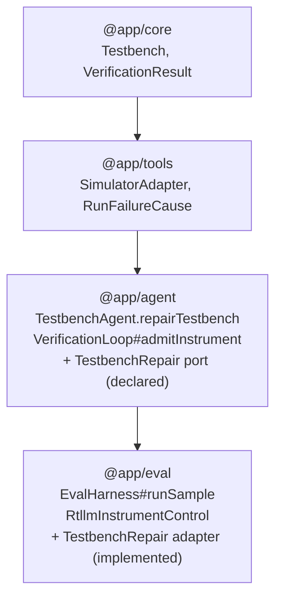
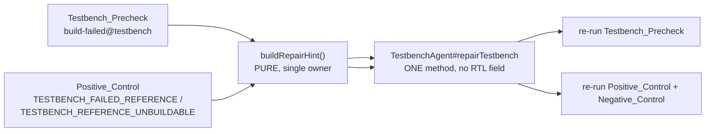
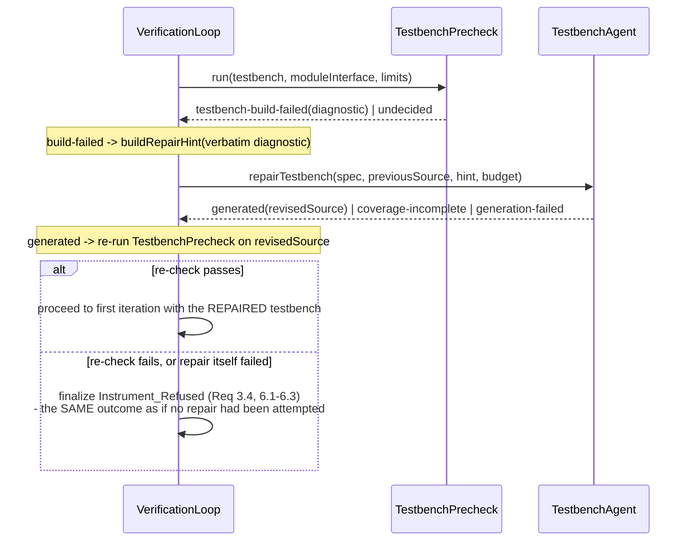
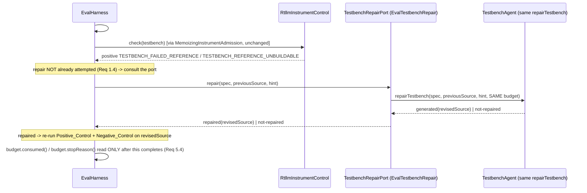

# Design Document

## Overview

Three prompt-wording rewrites aimed at `TESTBENCH_FAILED_REFERENCE` have each failed to shrink it, and the third made it worse in a way that is itself informative: on `stage1-screen-v3`, adding `CONCURRENCY_RULE` moved the class from its pre-v3 count to 226 of 495 (46%) with the population shifting to a different disguise nearly 1:1. A defect that re-enters wearing a new disguise after every rule aimed at its old one is not a vocabulary gap the next paragraph will close. It is evidence that no amount of FIRST-DRAFT prompt engineering will close this class, because the model cannot see, before it writes a word, which of five rule families the reference design will falsify it under.

So this design does not add a sixth rule, or reshuffle the five that exist. It adds the one thing a first draft structurally cannot have: **a second attempt informed by which specific rule family the FIRST draft actually violated**, measured against a real control run rather than guessed from a rewritten paragraph. That is a different capability from prompt engineering, and it is bounded the same way every other repair capability in this codebase is bounded - by the Session_Budget, by a fail-safe default, and by re-validation against the identical standard a first draft is held to.

The measured discipline this design is built inside is the one `clarification-answers.md` already settled and restates here because every component below depends on it: a build failure (ours or the toolchain's own) may cross verbatim, because it reveals nothing about any implementation's behaviour; a functional failure against the reference may cross only as a classified hint - a check name and a Defect_Class - because the functional failure signal **is** the positive control's own evidence, and repairing the testbench by that exact signal spends the positive control's independence to fix the positive control. The negative control catches only 28% of positive-passing samples today (58 checked, 16 failed), which is not yet strong enough to carry instrument validity alone if the positive control's independence is spent.

### Why this is two trigger points sharing one primitive, not one trigger point or two implementations

Two measured populations authorize a repair, and they arrive through different code paths for a structural reason, not a historical one:

- a **Testbench_Precheck build failure** is discovered entirely inside `app/agent`, before any reference design is loaded, by `VerificationLoop#admitInstrument` - the same place `instrument-precheck-and-attribution` already put the refusal;
- a **Positive_Control functional or build failure** is discovered only in `app/eval`, because reference designs live only there, and only after `EvalHarness#runSample` has (or would have) refused the sample.

`app/agent` must never import `app/eval` (the standing rule `instrument-precheck-and-attribution` Req 9.7 already set and this spec's Req 8.5 restates). So the positive-control-path repair is driven by a new port, `TestbenchRepair`, declared in `app/agent/orchestrator` and implemented in `app/eval` - the identical role-local-port shape `InstrumentAdmission` already uses for the identical reason. Both trigger points call the **same** new method on `TestbenchAgent`, so the precheck path and the positive-control path cannot drift into two independently-evolving repair implementations (Req 8.1, 8.2).

### The at-most-once bound is one counter, not two independent gates

A sample whose Testbench_Precheck already triggered a repair must not be repaired again if the (already-repaired) testbench then fails the positive control (Req 1.3, 1.4). Because the precheck-path repair happens entirely inside `#admitInstrument`, by the time control reaches `#iterate` (and later, the harness's positive-control step), the loop already knows whether a repair was attempted. That fact is carried on the loop's own outcome as `Repair_Provenance` (see Data Models), and the harness reads it back before ever consulting the `TestbenchRepair` port - so the "one counter" is a value threaded through the outcome, not a separate piece of mutable state either layer has to remember to consult.

### The anti-circular guarantee extends with no new channel

`GenerateTestbenchRequest` and `TestbenchGenerationInput` have no field RTL could occupy; that is what makes Property 4 of the base design hold by construction. The new repair request type is built to the same discipline: it carries the Spec, the previously-generated testbench source, and a `RepairHint` - and nothing else. Neither field can hold RTL, so a repair call is exactly as incapable of seeing the candidate as a first-draft generation call is, and the same property test that already asserts this for `generateTestbench` is extended to the repair method rather than duplicated (Req 9.6).

### Why the hint is a closed enum and not the conditional prose `prompt.ts` already builds

`prompt.ts`'s five interface-conditioned rule builders (`describeStateAnchoring`, `describeTiming`, `describeInputWindow`, `describeStimulusAdequacy`, plus the two unconditional ones) exist to tell the model what to do on a **first draft**, before anything is known about how it will fail. A repair hint is the opposite kind of fact: it says which rule family a **specific, measured** run actually violated. Reusing the rule-prose builders as literal hint text would require re-auditing every clause by hand against Req 2.4-2.6 every time `prompt.ts`'s wording changes, with nothing in the type system forcing that re-audit. A closed, enumerable `DefectClass` is auditable by inspecting a fixed list once (Q3's stated reasoning) and is exactly what Property 4's extension needs to state over.

## Architecture

### Dependency direction is unchanged



No new edge, for the identical reason `InstrumentAdmission` added none: `TestbenchRepair` is declared in `app/agent/orchestrator`, where the harness (an `app/eval` caller) consults it, and implemented in `app/eval`, the only layer holding reference designs. `app/agent` gains no import of `app/eval` (Req 8.5).

### The one repair primitive, called from two trigger points



`buildRepairHint` is the one function that turns a measured trigger into a `RepairHint`; both call sites build a hint through it and hand the identical shape to `TestbenchAgent#repairTestbench`. Property 4's extension (the anti-circular guarantee) and the anti-circularity of the hint itself (Property 2 below) are both stated over this one function and this one method, so there is exactly one place either could be violated.

### The precheck-path sequence (entirely inside `app/agent`)



This sequence sits entirely inside `#admitInstrument`, before the loop ever reaches a refusal (Req 8.3). One repair attempt at most: if the repaired testbench's re-check ALSO fails, the loop finalizes the refusal the unrepaired failure would have produced and does not repair a second time (Req 3.4).

### The positive-control-path sequence (entirely inside `app/eval`, via the port)



The port is consulted, and any repair-then-recheck sequence completes, strictly before `budget.consumed()` is read for the record - the ordering `#runSample` today reads the budget immediately after `#drive` returns, and this design inserts the repair-and-recheck step into that gap.

## Components and Interfaces

### 1. `app/agent/orchestrator/repair-hint.ts` (new, pure)

The closed vocabulary and the one function that builds a hint from a measured trigger, so Req 2.4-2.6 are auditable by inspecting this one file.

```ts
/**
 * The closed, non-exhaustive-but-stated vocabulary a classified Repair_Hint's
 * defect class is drawn from (Q3). One member per existing prompt.ts rule
 * family, plus a residual member for a failure neither the compiler-diagnostic
 * path nor this vocabulary can explain.
 *
 * Never conditional prose: `prompt.ts`'s rule-describing functions build
 * interface-specific text for a FIRST draft; this enum names which rule FAMILY a
 * measured run violated, and is exhaustively checkable against Req 2.4-2.6 by
 * reading this list once.
 */
export type DefectClass =
  | 'state-anchoring'   // re-anchored to an unreachable state (describeStateAnchoring)
  | 'concurrency'        // stepped a shadow implementation instead of observing (CONCURRENCY_RULE)
  | 'timing'             // assumed an output latency/cycle the Spec never stated (describeTiming)
  | 'input-window'       // assumed which driven inputs form one result (describeInputWindow)
  | 'stimulus-adequacy'  // did not reach a value distinguishing right from wrong (describeStimulusAdequacy)
  | 'unclassified';      // a functional failure this vocabulary cannot name

/**
 * A build diagnostic, carried verbatim (Option A). Used for BOTH a
 * Testbench_Precheck build failure and a Positive_Control build failure
 * (`TESTBENCH_REFERENCE_UNBUILDABLE`) - both are build failures against files
 * this process itself submitted (our own stub, or the benchmark's reference),
 * and neither reveals implementation behaviour (Req 2.1, 2.2).
 */
export interface BuildDiagnosticHint {
  readonly kind: 'build-diagnostic';
  /** The toolchain's own diagnostic text, unmodified. */
  readonly diagnostic: string;
}

/**
 * A classified functional failure (Option C). Used ONLY for
 * `TESTBENCH_FAILED_REFERENCE`. Carries the failing check's name and ONE
 * `DefectClass` - never the reference's observed value, never a diff, never the
 * reference's source (Req 2.3, 2.4, 2.5, 2.6).
 */
export interface ClassifiedFunctionalHint {
  readonly kind: 'classified-functional';
  /** The spec-derived check name that failed; computed by this process, never tool text. */
  readonly failingCheckName: string;
  readonly defectClass: DefectClass;
}

/** Structurally incapable of carrying an observed value, a diff, or reference source. */
export type RepairHint = BuildDiagnosticHint | ClassifiedFunctionalHint;

/** The measured fact a repair hint is built from; nothing beyond what this shape holds. */
export type RepairTrigger =
  | { readonly kind: 'precheck-build-failed'; readonly diagnostic: string }
  | { readonly kind: 'reference-unbuildable'; readonly diagnostic: string }
  | {
      readonly kind: 'failed-reference';
      readonly failingCheckName: string;
      readonly ruleFamily: DefectClass;
    };

/**
 * Build a Repair_Hint from a measured trigger (pure, total, the single owner of
 * Req 2.1-2.6).
 *
 * `diagnostic` and `ruleFamily` are the ONLY two fields this function reads off
 * its input; there is no third field on `RepairTrigger` a reference value or a
 * diff could occupy, so the anti-circularity guarantee is provable by reading
 * this function's five-line body rather than by auditing every call site.
 */
export function buildRepairHint(trigger: RepairTrigger): RepairHint {
  if (trigger.kind === 'failed-reference') {
    return {
      kind: 'classified-functional',
      failingCheckName: trigger.failingCheckName,
      defectClass: trigger.ruleFamily,
    };
  }
  return { kind: 'build-diagnostic', diagnostic: trigger.diagnostic };
}
```

`ruleFamily` on the `failed-reference` trigger is itself derived, not asked of the model or read from tool output - see component 3 for exactly how the caller computes it, because that derivation is the auditable step Req 2.4-2.6 depends on.

### 2. Deriving `ruleFamily` without ever reading the reference's observed value

This is the traceable data flow the design must show, not assert. Two call sites feed `buildRepairHint`, and both stop at a value that already excludes the reference's own output:

**Precheck path (`#admitInstrument`).** `TestbenchPrecheck.run` returns only `'testbench-build-failed' | 'undecided'` - a two-member enum, already the case today. No functional-failure trigger exists on this path at all: a precheck failure is always a build failure, so this path only ever constructs a `BuildDiagnosticHint` from `simulation.stderr` at the precheck's own simulate call (the same `SimulationVerdict.stderr` the precheck already discards today; nothing new is read from it beyond passing the string through).

**Positive-control path (`RtllmInstrumentControl.check` -> `classifyControlRun`).** This is the path Req 2.3's audit must trace exactly:

1. `RtllmInstrumentControl.#run` drives the reference RTL against the sample's testbench through `this.#deps.simulator.simulate(...)`, producing a `SimulationVerdict`. This value **is** the observed behaviour of the reference design - the thing that must never reach the model.
2. `classifyControlRun(simulation)` reads exactly three fields off that verdict: `simulation.failureCause`, `simulation.verdict` (the enum `'pass' | 'fail' | 'error'`), and `simulation.stderr` (routed only into `classifyNonPass`, which itself reads `stderr` only for **emptiness**, per `nonpass-cause.ts`'s own stated contract - `diagnostics: string` is read only via `.trim().length > 0`, never interpolated into a returned value). It returns a `RecordedInstrumentVerdict`: `{ validity: 'invalid', defect: 'TESTBENCH_FAILED_REFERENCE' }` for exactly the case this design's repair may fire on.
3. **The reference's own stdout - which is where the observed value byte-for-byte lives (`Got: y=fffe, Co=1, Expected: y=fffe, Co=0`, the real captured case) - is never read past this point on the repair path.** `classifyControlRun`'s return type is `RecordedInstrumentVerdict`, a closed union of enum members with no free-text field; `stdout` is not a parameter to anything downstream of it. The new repair-triggering code added by this spec reads only `result.verdict` (the `RecordedInstrumentVerdict` union tag and its `defect` member) - never `result.stdout`, never `simulation.stdout`.
4. The failing check's **name** (`ac1_under_simulation_adder_16bit_produces_th` in the real measured case) is available from a structurally different source: `RequiredCheck.name`, computed by `requiredChecks(spec)` in `app/agent/roles/testbench/coverage.ts` - a pure function of the **Spec**, run again against the same Spec the repair already carries. It is not parsed from the control's stdout. (A future task may additionally read `simulation.checks` - the oracle's own per-check pass/fail array, which carries names and booleans only, never a value - to confirm which of the several required checks failed when more than one exists; either source is Spec-derived-or-boolean-only, and neither is the reference's stdout.)
5. `ruleFamily: DefectClass` is derived from **which check failed**, not from anything the reference printed. `RequiredCheck` already carries a `kind: 'criterion' | 'known-answer'` and a `criterionId`; this design adds no new field to `RequiredCheck` and instead maps a failing check to a `DefectClass` by a fixed, Spec-structure-only rule (component 3 below) - the same "derive from structure, never from tool output" discipline `attributedFiles` already established for `RunFailureCause`.

So the chain the audit must accept is: `SimulationVerdict.stdout` (the observed value) -> discarded, never read by the repair path -> `RecordedInstrumentVerdict` (a closed enum) -> `failingCheckName` (Spec-derived, not tool-derived) -> `ruleFamily` (Spec-structure-derived) -> `ClassifiedFunctionalHint`. Every arrow after the first is a pure function of trusted, Spec-owned data; the first arrow is the one this design deliberately never draws.

### 3. `ruleFamily` derivation rule (pure, and where it lives)

```ts
// app/agent/orchestrator/repair-hint.ts (continued)

/**
 * Map a failed required check to the `DefectClass` its own STRUCTURE implies -
 * never from anything a control run printed.
 *
 * A `known-answer` check (a standard block's reference truth table) has no
 * interface-conditioned rule family of its own in `prompt.ts` and maps to
 * `unclassified` rather than guessing one. A `criterion` check maps by the
 * SAME interface facts `prompt.ts`'s own conditional rules already branch on
 * (`declaresVectorDataPort`, `timingQualifierNames`, `inputQualifierNames`),
 * read again here rather than threaded through, so this function has the
 * identical inputs `prompt.ts` had when it decided which rule applied to this
 * Spec - and nothing else.
 */
export function ruleFamilyFor(
  check: RequiredCheck,
  moduleInterface: ModuleInterface,
): DefectClass;
```

This is deliberately a **heuristic mapping over Spec structure**, not a claim that the model's actual mistake is knowable in advance - it cannot be, or the first-draft prompt would already have prevented it. It is stated as a ceiling: a `DefectClass` is the family most likely to explain a failure of that check's shape, given the interface, and `'unclassified'` is the honest fallback when the structure gives no signal. `ponytail:` this mapping is a fixed heuristic table over check shape and interface, not a learned or measured one; if the vault later measures which family a given check-shape/interface pairing actually correlates with, the table should be revisited against that evidence rather than left as a first guess.

### 4. `app/agent/orchestrator/testbench-repair.ts` (new port, no implementation)

```ts
export type TestbenchRepairDecision = 'repaired' | 'not-repaired' | 'undecided';

/**
 * Structurally incapable of carrying candidate RTL or a wider budget handle:
 * the two fields are the previously-generated testbench source and the
 * Repair_Hint, mirroring `InstrumentAdmissionRequest`'s one-field discipline
 * (Req 1.6, 2.8, 2.9).
 */
export interface TestbenchRepairRequest {
  readonly spec: Spec;
  readonly previousSource: string;
  readonly hint: RepairHint;
}

/** The revised testbench a successful repair produced, re-checked exactly like a first draft. */
export interface TestbenchRepairResult {
  readonly decision: 'repaired';
  readonly revisedSource: string;
}

/** Every non-`repaired` outcome collapses to this: the caller proceeds as if no port existed. */
export interface TestbenchRepairDeclined {
  readonly decision: 'not-repaired' | 'undecided';
}

export type TestbenchRepairOutcome = TestbenchRepairResult | TestbenchRepairDeclined;

/**
 * A port the Eval_Harness consults for a Positive_Control-caused Repair_Trigger,
 * before that sample's Session_Budget is read for the record (Req 5.4, 8.4).
 *
 * No implementation lives in `@app/agent`. See `app/eval/testbench-repair.ts`
 * for `EvalTestbenchRepair`, which calls the SAME `TestbenchAgent#repairTestbench`
 * method the precheck path calls directly (Req 8.4).
 */
export interface TestbenchRepair {
  repair(request: TestbenchRepairRequest): Promise<TestbenchRepairOutcome>;
}
```

The three-member decision shape mirrors `InstrumentAdmissionDecision` exactly (Req 6.4): `undecided` is the ONLY thing a throw or an internal failure may report, and both `not-repaired` and `undecided` are handled identically by every caller - "proceed exactly as without a repair" - so collapsing them to one `TestbenchRepairDeclined` shape at the type level (rather than a three-way switch at every call site) makes that equivalence a compile-time fact instead of a convention three different callers each have to remember.

### 5. `TestbenchAgent#repairTestbench` (new method, mirrors `reviseFromErrors`'s shape)

```ts
// app/agent/roles/testbench/types.ts (additions)

/** Structurally incapable of carrying RTL: mirrors GenerateTestbenchRequest's discipline. */
export interface RepairTestbenchRequest {
  readonly sessionId: Ulid;
  readonly spec: Spec;
  readonly previousSource: string;
  readonly hint: RepairHint;
  readonly testbenchId?: Ulid;
}

// app/agent/roles/testbench/testbench-agent.ts (addition)

class TestbenchAgent {
  // ... existing generateTestbench unchanged ...

  /**
   * Revise a previously-generated Testbench from a sanitized Repair_Hint (Req
   * 8.1, 8.2).
   *
   * Structurally identical in spirit to `generateTestbench`: one model call
   * under the SAME injected `budget`, the SAME `#validateCoverage` gate applied
   * to the revised source (Req 6.3 - a repair that produces a coverage-incomplete
   * draft is rejected exactly as a first draft would be), and the SAME Trace
   * recording discipline attributed to the Spec version. Accepts no candidate
   * RTL: the parameter list has no channel for one, the same guarantee
   * `generateTestbench`'s request already gives.
   */
  async repairTestbench(
    request: RepairTestbenchRequest,
    budget: SessionBudgetHandle,
  ): Promise<TestbenchGenerationOutcome>;
}
```

`repairTestbench` returns the SAME `TestbenchGenerationOutcome` union `generateTestbench` returns (`generated | coverage-incomplete | generation-failed`), not a new type - because the re-check obligation (Requirement 3) is "hold the repaired testbench to the identical rule a first draft is held to," and reusing the exact return shape makes that identity a type-level fact rather than a claim two similar-looking types happen to satisfy. Internally it builds a `RepairTestbenchModelInput` (the repair sibling of `TestbenchGenerationInput`, same three-field discipline: `spec`, `previousSource`, `hint` - no OKF re-retrieval, since the model already has a testbench to revise rather than a blank page) and routes one call through `this.#router.invoke(TESTBENCH_MODEL_TASK, ..., budget)` - the **same** `TESTBENCH_MODEL_TASK = 'testbench'` constant `generateTestbench` already uses, not a new `ModelTask` member. Testbench repair is the same measured capability axis as testbench generation (does this agent produce a testbench that measures something), not a separately bake-off-able one the way RTL generation and RTL repair share `'repair'` as a distinct task from `'generation'` for a reason specific to that role's cost profile; reusing `'testbench'` keeps the existing per-role model assignment governing both without inventing a routing entry nothing will ever assign differently. Every path through the method - including the model call failing, the router exhausting its chain, or the revised source failing `#validateCoverage` - produces exactly one of the three existing outcome members (Req 5.5, 6.3), never a fourth shape.

### 6. `VerificationLoop#admitInstrument` wiring (Requirement 8.3)

```ts
// app/agent/orchestrator/verification-loop.ts (changed)

interface VerificationLoopDeps {
  // ... existing fields unchanged ...
  /** The RTL-isolated Testbench_Agent; gains `repairTestbench` alongside `generateTestbench`. */
  readonly testbench: IndependentTestbenchGenerator; // widened, see below
}

interface IndependentTestbenchGenerator {
  generateTestbench(...): Promise<TestbenchGenerationOutcome>; // unchanged
  /** New: the same repair primitive `TestbenchAgent` exposes (Req 8.1, 8.2). */
  repairTestbench(
    request: RepairTestbenchRequest,
    budget: SessionBudgetHandle,
  ): Promise<TestbenchGenerationOutcome>;
}
```

`#admitInstrument`'s existing body already computes `precheckOutcome` from `this.#precheck.run(...)`. This design inserts the repair attempt on exactly the branch that today returns a refusal immediately:

```
precheckOutcome === 'testbench-build-failed'
  -> (NEW) attempt ONE repairTestbench call with a build-diagnostic hint
       -> repair produced a testbench (`generated`)
            -> re-run TestbenchPrecheck against the REVISED testbench file
                 -> re-check undecided -> proceed to #iterate with the repaired testbench,
                    Repair_Provenance = { attempted: true, accepted: true }
                 -> re-check STILL testbench-build-failed -> refuse
                    (Repair_Provenance = { attempted: true, accepted: false }),
                    exactly the InstrumentRefusedModule shape today, no second repair
       -> repair did NOT produce a testbench (coverage-incomplete / generation-failed / threw)
            -> refuse exactly as today (Repair_Provenance = { attempted: true, accepted: false })
  -> precheckOutcome === 'undecided' -> unchanged: consult InstrumentAdmission as today
     (Repair_Provenance = { attempted: false, accepted: false } carried forward -
      this run never reached a precheck-triggered repair, leaving the positive-control
      path free to attempt its own, per the at-most-once counter)
```

The diagnostic text for the build-diagnostic hint is read from the SAME `SimulationVerdict` the precheck's own `run` already produces internally (`this.#simulator.simulate([stub], testbench, limits)`), which today is discarded after `TestbenchPrecheck.run` reduces it to the two-member `PrecheckOutcome` enum. `TestbenchPrecheck.run` gains no new return shape; instead `#admitInstrument` builds its own second call only when it needs the diagnostic - i.e. `TestbenchPrecheck` gains a sibling method, `runWithDiagnostic`, that returns `{ outcome: PrecheckOutcome; diagnostic: string }`, so `run`'s existing signature and every existing caller stay untouched and only `#admitInstrument` opts into the richer return. The re-check after a successful repair calls the plain `run` again (Req 3.1: "using the same Interface_Stub derivation rule as the first run" - literally the same method, same stub-building code, same simulate call shape).

`#admitInstrument`'s return type widens from `{ reason; attributedFiles } | null` to also thread the `RepairProvenance` value forward regardless of which branch it took, so `#iterate` (and, eventually, the harness) can read whether a precheck-path repair happened without re-deriving it.

### 7. `EvalHarness#runSample` wiring (Requirement 5.4, 8.4)

Traced against the exact current body of `#runSample` (see `app/eval/harness.ts`):

```ts
async #runSample(problem: EvalProblem, sampleIndex: number): Promise<SampleResult> {
  const seed = sampleSeed(...);
  const budget = this.#freshBudget();
  const admission = this.#buildAdmission(problem);
  const outcome = await this.#drive(problem, sampleIndex, seed, budget, admission);

  // NEW: read whether the loop already attempted (and used up) the one repair
  // this sample is allowed, before consulting the control or the repair port.
  const repairProvenance = repairProvenanceOf(outcome); // { attempted, accepted }

  // unchanged today:
  const control = admission?.recorded() ?? (await this.#controlInstrument(problem, outcome));

  // NEW: only when the positive control just found exactly the two triggering
  // defects, AND no repair has already been attempted for this sample (Req 1.4).
  const { finalOutcome, finalControl, wasRepaired } = await this.#repairIfTriggered(
    problem, outcome, control, repairProvenance, budget,
  );

  // MOVED (was immediately after #drive): now reads consumed/stopReason AFTER
  // any repair-and-recheck sequence has fully completed (Req 5.4).
  const consumed = budget.consumed();
  const stopReason = budget.stopReason();

  const sample: SampleResult = {
    // ... existing fields, now built from finalOutcome / finalControl ...
    repairProvenance: wasRepaired
      ? { attempted: true, accepted: finalControl.verdict.validity === 'valid' }
      : repairProvenance,
  };
  await this.#captureArtifacts(problem, sample, finalOutcome, finalControl);
  return sample;
}
```

`#repairIfTriggered` is the new private method that owns Requirement 1.1-1.4's gate:

```ts
async #repairIfTriggered(
  problem: EvalProblem,
  outcome: DriveOutcome,
  control: InstrumentControlResult,
  precheckProvenance: RepairProvenance,
  budget: MeteredSessionBudget,
): Promise<{
  readonly finalOutcome: DriveOutcome;
  readonly finalControl: InstrumentControlResult;
  readonly wasRepaired: boolean;
}> {
  const port = this.#resolved.testbenchRepair;
  if (port === null || precheckProvenance.attempted) {
    // No port wired, OR the precheck path already spent this sample's one
    // repair attempt (Req 1.3, 1.4) - proceed exactly as today.
    return { finalOutcome: outcome, finalControl: control, wasRepaired: false };
  }
  const trigger = repairTriggerFor(control.verdict); // null unless the two triggering defects
  if (trigger === null) {
    return { finalOutcome: outcome, finalControl: control, wasRepaired: false };
  }
  const previousSource = testbenchSourceOf(outcome);
  if (previousSource === null) {
    return { finalOutcome: outcome, finalControl: control, wasRepaired: false }; // Req 1.6, 6.1
  }
  let decision: TestbenchRepairOutcome;
  try {
    decision = await port.repair({
      spec: problem.spec,
      previousSource,
      hint: buildRepairHint(trigger),
    });
  } catch {
    return { finalOutcome: outcome, finalControl: control, wasRepaired: false }; // Req 6.1, 6.2
  }
  if (decision.decision !== 'repaired') {
    return { finalOutcome: outcome, finalControl: control, wasRepaired: false }; // Req 6.1, 6.4
  }
  // Re-check under the SAME control and SAME MutationConfig (Req 3.2, 3.6):
  const recheck = await this.#controlInstrument(problem, withRevisedTestbench(outcome, decision.revisedSource));
  return { finalOutcome: withRevisedTestbench(outcome, decision.revisedSource), finalControl: recheck, wasRepaired: true };
}
```

`repairTriggerFor` is the total function reading Requirement 1.1-1.2's closed trigger set directly off `RecordedInstrumentVerdict`: it returns a `RepairTrigger` for exactly `{ validity: 'invalid', defect: 'TESTBENCH_FAILED_REFERENCE' | 'TESTBENCH_REFERENCE_UNBUILDABLE' }` and `null` for every other validity/defect combination, including `TESTBENCH_SURVIVED_MUTANTS`, `CONTROL_RUN_ERRORED`, and every `unchecked` reason (Req 1.1, 1.2) - a total `Record`-style mapping in the same style `MUTATION_UNCHECKED_REASONS` already uses, so a defect code added later is a compile error here rather than a silent no-fire.

The re-check calls the EXISTING `#controlInstrument` unchanged (not a new method): it already runs `RtllmInstrumentControl.check`, which already runs both the positive control and, when a testbench passes it, the negative control via `#probeMutants` (Req 3.2, 3.6 - `combineInstrumentControls`'s existing rule is untouched, so the repaired testbench is held to identically the same standard).

`withRevisedTestbench` is a small pure helper that returns a shallow copy of the `DriveOutcome` with its `testbench.source` field replaced - legal because `testbenchSourceOf`/`candidateRtlOf` already read `outcome.testbench.source` structurally (see `artifact-sink.ts`), so every downstream reader (`#judgeIndependently`, `#captureArtifacts`, the golden judge) sees the repaired source with no further change.

### 8. `app/eval/testbench-repair.ts` (new adapter, mirrors `MemoizingInstrumentAdmission`)

```ts
/** The `TestbenchRepair` port, backed by the SAME TestbenchAgent the loop's setup uses. */
export class EvalTestbenchRepair implements TestbenchRepair {
  constructor(
    private readonly testbenchAgent: RepairingTestbenchGenerator, // { repairTestbench }
    private readonly sessionId: Ulid,
    private readonly budget: SessionBudgetHandle, // the SAME per-sample budget (Req 5.1, 5.5)
  ) {}

  async repair(request: TestbenchRepairRequest): Promise<TestbenchRepairOutcome> {
    let outcome: TestbenchGenerationOutcome;
    try {
      outcome = await this.testbenchAgent.repairTestbench(
        { sessionId: this.sessionId, spec: request.spec, previousSource: request.previousSource, hint: request.hint },
        this.budget,
      );
    } catch {
      return { decision: 'undecided' }; // Req 6.1, 6.2, 6.4
    }
    return outcome.status === 'generated'
      ? { decision: 'repaired', revisedSource: outcome.testbench.source }
      : { decision: 'not-repaired' }; // coverage-incomplete or generation-failed: Req 6.3, 6.1
  }
}
```

No memoization field is needed the way `MemoizingInstrumentAdmission` needs one: that class memoizes because the loop and the harness might BOTH read the same control result, and the control must run at most once either way it is asked for. `EvalTestbenchRepair` has exactly one caller (`#repairIfTriggered`, called at most once per sample because of the `precheckProvenance.attempted` gate upstream of it), so there is no second reader to protect against a duplicate run - Req 1.5's "exactly one model call when it fires" is a property of that single call site, not of this class.

### Records, artifacts, summary

| module | change |
| --- | --- |
| `app/agent/orchestrator/repair-hint.ts` | new: `DefectClass`, `RepairHint`, `RepairTrigger`, `buildRepairHint`, `ruleFamilyFor` |
| `app/agent/orchestrator/testbench-repair.ts` | new port: `TestbenchRepair`, `TestbenchRepairRequest`, `TestbenchRepairDecision`, `TestbenchRepairOutcome` |
| `app/agent/orchestrator/testbench-repair-policy-version.ts` | new: `TESTBENCH_REPAIR_POLICY_VERSION = 1` |
| `app/agent/orchestrator/testbench-precheck.ts` | `runWithDiagnostic` sibling method added; `run` unchanged |
| `app/agent/orchestrator/verification-loop.ts` | `#admitInstrument` gains the precheck-path repair branch; `IndependentTestbenchGenerator` gains `repairTestbench`; every terminal outcome gains `repairProvenance` |
| `app/agent/roles/testbench/types.ts` | `RepairTestbenchRequest`, `RepairTestbenchModelInput` added |
| `app/agent/roles/testbench/testbench-agent.ts` | `repairTestbench` method added, alongside `generateTestbench` |
| `app/agent/roles/testbench/prompt.ts` | `buildRepairModelInput` added (new function; the five first-draft rule builders are untouched, per "what this spec does NOT change") |
| `app/eval/testbench-repair.ts` | new adapter: `EvalTestbenchRepair` |
| `app/eval/harness.ts` | `#runSample` gains `#repairIfTriggered`; `budget.consumed()`/`stopReason()` read moved after it; `EvalHarnessDeps` gains optional `testbenchRepair?: TestbenchRepair` |
| `app/eval/report.ts` | `SampleResult` gains `repairProvenance: RepairProvenance` |
| `app/eval/artifact-sink.ts` | `EvalSampleArtifacts` gains `repairProvenance`, `rejectedPreRepairTestbench`, `repairHintText` |
| `app/eval/sweep/artifact-layout.ts` | `ARTIFACT_DOCUMENT_SCHEMA_VERSION` 7 -> 8; new filename `pre-repair-testbench.v`; `ArtifactDocument` gains the same three fields |
| `app/eval/sweep/results-log.ts` | `RESULTS_SCHEMA_VERSION` 10 -> 11; `SweepSampleRecord` gains `repairAttempted`, `repairAccepted`; `STALE_SCHEMA_ADVICE` gains the v10 -> v11 paragraph |
| `app/eval/sweep/summary.ts` | per-arm repair-attempted count and repair-accepted-on-recheck count (Req 4.5) |
| `app/eval/sweep/config-identity.ts` | folds in `TESTBENCH_REPAIR_POLICY_VERSION` under its own reserved key `__testbenchRepairPolicyVersion` |
| `app/eval/sweep/manifest.ts` | records `testbenchRepairPolicyVersion`, read from the same constant |
| `app/eval/loop-runner.ts` | `EvalSampleRequest`/production adapter unaffected - `repairTestbench` reaches the loop through `IndependentTestbenchGenerator`, which the loop already holds; no new field needed here |

The `TESTBENCH_REPAIR_POLICY_VERSION` fold-in re-hashes `SMOKE_RUN_CONFIG_HASH` and `TBSLICE_RUN_CONFIG_HASH`, the same predicted, deliberate cost the prior spec's `INSTRUMENT_POLICY_VERSION` fold-in paid (Req 7.6).

## Data Models

### `RepairProvenance` (new; Requirement 4)

```ts
// app/agent/orchestrator/verification-loop.ts (or a shared location both layers import)

/**
 * Whether this sample's testbench reached a Testbench_Repair attempt, and
 * whether that attempt produced the testbench the final verdict was decided
 * from. A first-class, closed-shape field - never free text inside an existing
 * note or diagnostic (Req 4.2).
 */
export interface RepairProvenance {
  /** Whether a Testbench_Repair was attempted for this sample, at EITHER trigger point. */
  readonly attempted: boolean;
  /**
   * Whether the attempt's revised testbench is the one the final verdict was
   * decided from (passed its re-check). `false` whenever `attempted` is `false`.
   */
  readonly accepted: boolean;
}

/** The unrepaired baseline every outcome starts from. */
export const NO_REPAIR: RepairProvenance = Object.freeze({ attempted: false, accepted: false });
```

`attempted && !accepted` is the "repair was tried and its re-check failed, so the pre-existing terminal outcome was finalized" case (Requirement 3.4); `attempted && accepted` is "the sample's final verdict was decided from the repaired testbench" (Requirement 3.5); `!attempted` is a first-draft sample, reported identically to how `RESULTS_SCHEMA_VERSION` 10 already reports it (Requirement 4.3). The fourth combination, `!attempted && accepted`, is unrepresentable in the sense that no code path constructs it - `accepted` is set only inside the branch that already confirmed `attempted`.

### `VerificationOutcome` delta

Every member of `VerificationOutcome` (`VerifiedModule`, `UnverifiedModule`, `InstrumentRefusedModule`) gains one required field:

```ts
export interface VerifiedModule {
  // ... existing fields unchanged ...
  readonly repairProvenance: RepairProvenance;
}
// identically for UnverifiedModule and InstrumentRefusedModule
```

Required, not optional, by the same reasoning `SimulationVerdict.failureCause` was made required in the prior spec: an optional field defaults to absent at every existing construction site, and absent would have to be read as "not repaired" - which is exactly the claim a future reader cannot verify unless it is stated everywhere. `VerificationBlocked` and `VerificationSetupFailed` do NOT gain this field: neither reaches a point where a Testbench_Precheck could have run (a blocked or setup-failed sample never produced an admissible testbench to repair), so `NO_REPAIR` is not merely their default, it is the only value that could ever be true for them - and the harness reads `repairProvenanceOf` as a total function over `DriveOutcome` that returns `NO_REPAIR` for both, mirroring `iterationsOf`'s existing "no field, so zero" pattern.

### `SweepSampleRecord` delta (`RESULTS_SCHEMA_VERSION` 10 -> 11)

| field | type | meaning |
| --- | --- | --- |
| `repairAttempted` | `boolean` | `RepairProvenance.attempted` for this sample |
| `repairAccepted` | `boolean` | `RepairProvenance.accepted` for this sample; `false` whenever `repairAttempted` is `false` |

Both required, not optional - the same reasoning `instrumentUncheckedReason` was made required-when-relevant in the v9 -> v10 bump: a v10 record has no way to say whether a repair was attempted because the concept did not exist yet, so there is no honest default to migrate a v10 record's absence into. A v10 (or older) results file is refused wholesale on read, by the same `decodeSampleRecord` refusal rule already applied to a v9 record, and `STALE_SCHEMA_ADVICE` gains a paragraph naming `instrumentValidity`'s meaning as unchanged but `repairAttempted`/`repairAccepted` as newly introduced (Req 7.9) - a v10 `instrumentValidity: 'valid'` already means what a v11 `instrumentValidity: 'valid'` means when `repairAttempted` is `false`, but a v10 reader cannot express "valid after repair" at all, which is exactly the gap Requirement 4.4 exists to close.

### `ArtifactDocument` delta (`ARTIFACT_DOCUMENT_SCHEMA_VERSION` 7 -> 8)

| field | type | meaning |
| --- | --- | --- |
| `repairAttempted` | `boolean` | mirrors the results record |
| `repairAccepted` | `boolean` | mirrors the results record |
| `repairHint` | `string \| null` | the Repair_Hint text handed to the Testbench_Agent, present iff `repairAttempted` |

Plus a new sibling artifact file, `pre-repair-testbench.v`, written (HEAD-kept, same cap as `rejected-testbench.v`) whenever `repairAttempted` is `true` - distinct from `testbench.v` (which always holds the testbench the final verdict was decided from, repaired or not) by filename, mirroring the precedent `instrument-precheck-and-attribution` Req 6.5 already set for `rejected-testbench.v` (Requirement 4.6). The `repairHint` text is bounded by a new `ARTIFACT_CAPS.maxRepairHintChars` constant, in the same manner `MAX_ATTRIBUTION_LINES` already bounds diagnostic capture (Requirement 4.7).

### `EvalSampleArtifacts` and `EvalHarnessDeps` deltas

```ts
// app/eval/artifact-sink.ts
export interface EvalSampleArtifacts {
  // ... existing fields unchanged ...
  readonly repairProvenance: RepairProvenance;
  readonly rejectedPreRepairTestbench: CapturedText | null; // HEAD-kept, present iff repaired
  readonly repairHint: string | null; // present iff repairProvenance.attempted
}

// app/eval/harness.ts
export interface EvalHarnessDeps {
  // ... existing fields unchanged ...
  /**
   * Optional TESTBENCH_REPAIR port for a Positive_Control-caused trigger. Absent
   * behaves exactly as before this spec: the harness never attempts a repair,
   * and every sample's `repairProvenance` is `NO_REPAIR` unless the precheck path
   * already set it (Req 6.1-6.6; design Property 6's equivalent for this port).
   */
  readonly testbenchRepair?: TestbenchRepair;
}
```

## Correctness Properties

*A property is a characteristic or behavior that should hold true across all valid executions of a system - essentially, a formal statement about what the system should do. Properties serve as the bridge between human-readable specifications and machine-verifiable correctness guarantees.*

### Property 1: A repair fires only on the closed trigger set, and at most once per sample

*For any* sequence of Repair_Trigger-shaped events a sample's Testbench_Precheck and Positive_Control produce, `repairTriggerFor` returns a non-null trigger exactly when the event's validity/defect pair is `{ invalid, TESTBENCH_FAILED_REFERENCE }`, `{ invalid, TESTBENCH_REFERENCE_UNBUILDABLE }`, or a Testbench_Precheck `testbench-build-failed`, and never for `{ invalid, TESTBENCH_SURVIVED_MUTANTS }`, `{ invalid, CONTROL_RUN_ERRORED }`, or any `unchecked` reason; and for any sample whose `RepairProvenance.attempted` is already `true`, no further repair call is made regardless of what its subsequent control result is.

**Validates: Requirements 1.1, 1.2, 1.3, 1.4**

### Property 2: A Repair_Hint never carries the reference's observed value, a diff, or its source

*For any* `RepairTrigger` and the `RepairHint` `buildRepairHint` returns for it, the hint's serialized text contains none of: the trigger's own `diagnostic` text interpolated with anything beyond itself, any text computed by comparing an observed value against an expected one, and no substring that is not either the toolchain's own diagnostic (for a `build-diagnostic` hint) or a `failingCheckName` plus one `DefectClass` member drawn from the closed enum (for a `classified-functional` hint). This extends Property 4 of the base HDL-creation-loop design (RTL isolation) to the repair path: *for any* `RepairTestbenchRequest` `TestbenchAgent#repairTestbench` assembles a model input from, the assembled text contains none of the candidate RTL that produced the triggering control run, by the same structural argument - `RepairTestbenchRequest` has no field RTL could occupy.

**Validates: Requirements 2.4, 2.5, 2.6, 2.8, 9.6**

### Property 3: A compiler diagnostic crosses verbatim; a functional failure never does

*For any* Repair_Trigger of kind `precheck-build-failed` or `reference-unbuildable`, the resulting `RepairHint.diagnostic` is byte-identical to the trigger's own `diagnostic` field; and *for any* Repair_Trigger of kind `failed-reference`, the resulting hint carries no field named `diagnostic`, `observed`, `expected`, or `stdout` at all - the type `ClassifiedFunctionalHint` has no such field to populate.

**Validates: Requirements 2.1, 2.2, 2.3, 2.7**

### Property 4: A repaired testbench is re-checked by the identical rule a first draft is held to

*For any* revised testbench source a Testbench_Repair produces, running it back through the Testbench_Precheck (for a precheck-triggered repair) or through `combineInstrumentControls` via a fresh Positive_Control and Negative_Control run (for a positive-control-triggered repair) yields the identical outcome that the SAME source would yield if it had been the sample's first-draft testbench - no separate, more lenient threshold is reachable from the repair path, because both re-checks call the exact same functions (`TestbenchPrecheck.run`, `RtllmInstrumentControl.check`) the first-draft path already calls, with no parameter distinguishing "this source was repaired" from "this source was generated."

**Validates: Requirements 3.1, 3.2, 3.3, 3.5, 3.6**

### Property 5: A failed re-check finalizes the pre-existing outcome, never a second repair

*For any* sample whose Testbench_Repair produced a revised testbench that then fails its re-check, the outcome the loop or harness finalizes is identical - reason for reason, defect for defect - to the outcome that the ORIGINAL, unrepaired failure would have finalized with no repair attempted at all, and no second `repairTestbench` call is made for that sample.

**Validates: Requirements 3.4, 6.1, 6.2, 6.3**

### Property 6: Every repair failure path degrades to exactly the unrepaired outcome, never to a pass

*For any* way a Testbench_Repair attempt can fail to produce an accepted, re-checked testbench - the model call throwing, the Model_Router exhausting its chain, the budget already being exhausted, the revised source failing coverage validation, or the `TestbenchRepairPort` itself throwing - the sample's finalized outcome is identical to the outcome reached with no repair attempted at all, and is never a `verified` outcome, a `valid` Recorded_Instrument_Verdict, or any outcome the un-repaired trigger could not itself have produced.

**Validates: Requirements 6.1, 6.2, 6.3, 6.4, 6.5, 6.6**

### Property 7: Repair_Provenance is exactly `{attempted, accepted}` and nothing else moves with it

*For any* terminal outcome, `repairProvenance.accepted` is `true` only when `repairProvenance.attempted` is `true`, and whenever `repairProvenance.attempted` is `false` the outcome's oracle verdict, golden verdict, and Recorded_Instrument_Verdict are each identical to the value they would hold had the Testbench_Repair capability never been wired into that run at all - so Requirement 4's provenance fact is additive over the pre-existing behaviour and never itself changes a verdict.

**Validates: Requirements 4.1, 4.2, 4.3, 4.4, 6.6**

### Property 8: The repair's cost is charged to, and only to, the sample's own budget, before the record is closed

*For any* sample whose Testbench_Repair attempt runs, every model call and every re-check simulate call inside that attempt charges the identical `SessionBudgetHandle` instance the sample's generation and first-draft testbench calls already charged, `budget.consumed()` and `budget.stopReason()` are read by `#runSample` only after that attempt (successful or not) has fully completed, and no `SessionBudgetHandle` distinct from the sample's own ever reaches `TestbenchRepairRequest`, `RepairTestbenchRequest`, or `EvalTestbenchRepair`'s constructor.

**Validates: Requirements 5.1, 5.2, 5.3, 5.4, 5.5**

### Property 9: The policy version changes the experiment identity

*For any* sweep config, the config hash computed with one `TESTBENCH_REPAIR_POLICY_VERSION` differs from the hash computed with any other value of that constant, holding `INSTRUMENT_POLICY_VERSION` and `TESTBENCH_PROMPT_VERSION` fixed; and the manifest reports the same value the hash was computed from.

**Validates: Requirements 7.1, 7.2, 7.3, 7.4, 7.5**

### Property 10: A stale record is refused, never repaired into meaning something it did not measure

*For any* sample record encoded under a schema version below 11, the results-log reader reports it as a stale-schema line and aggregates nothing from the file that holds it - so a v10 `valid` record is never silently read as "valid, no repair" rather than left correctly unaggregatable.

**Validates: Requirements 7.7, 7.8, 7.9**

### Property 11: `app/agent` gains no import of `app/eval`

*For any* module added or changed by this spec under `app/agent`, that module's import graph contains no path reaching any module under `app/eval` - checked by the same import-boundary lint rule `instrument-precheck-and-attribution` Req 9.7 already established, extended to cover `testbench-repair.ts`, `repair-hint.ts`, and `testbench-repair-policy-version.ts`.

**Validates: Requirements 8.5, 9.5**

### Coverage note

Requirement 1.5 ("exactly one model call when it fires") and Requirement 4.6 ("the rejected pre-repair testbench filename differs from the accepted testbench's") are distinctness/counting claims over a fixed call site and fixed constants respectively, so each is a single assertion rather than a property. Requirement 9.1-9.4 (the repository-wide compile/lint/format/test gate) is enforced by the existing tooling, not by a new property. Requirement 2.9 ("no other externally-sourced content beyond what first-draft generation already assembles") is verified by the SAME serialization-based assertion Property 4 of the base design already performs, extended to `RepairTestbenchModelInput`'s assembled text, rather than by a distinct property statement.

## Error Handling

Every new failure path degrades to the outcome that existed before this spec added a repair capability. That direction is chosen once and applied everywhere: a mechanism added to reduce `TESTBENCH_FAILED_REFERENCE` must never be able to manufacture a pass it did not earn.

| failure | handling | why this direction |
| --- | --- | --- |
| the repair's model call throws | caught; treated as `generation-failed`; original trigger's outcome finalized | a broken repair call must never abort a session or mint a false pass |
| the Model_Router exhausts its chain during repair | `generation-failed`; original trigger's outcome finalized | identical to a first-draft generation failure: infrastructure, not a finding |
| the budget is already exhausted when repair would fire | repair is not attempted; original trigger's outcome finalized | the repair is one bounded charge against the SAME budget, never a separate allowance (Req 5.3) |
| the revised testbench fails `#validateCoverage` | `coverage-incomplete`; original trigger's outcome finalized, revision discarded | a repair that under-covers is not accepted merely for having been attempted |
| the revised testbench fails its re-check (precheck or controls) | the pre-existing terminal outcome (Instrument_Refused, or the classified `invalid` defect) is finalized; no second repair | Requirement 3.4's explicit rule; the re-check is the SAME gate a first draft passes or fails |
| `TestbenchRepairPort.repair` throws | caught; `undecided`; harness proceeds as if the port were absent | mirrors `InstrumentAdmission.admit`'s existing fail-safe catch |
| `TestbenchRepairPort` reports `undecided` | harness proceeds; original control result stands | "could not repair" is not "should not have been refused" |
| no `TestbenchRepair` port wired | every sample's positive-control-path repair is skipped; `repairProvenance` reflects only the precheck path | purely additive: a run that never wires the port behaves exactly as before this spec |
| a sample's precheck-path repair already ran | the positive-control path never consults the port at all | Requirement 1.4's at-most-once bound, enforced by one read of `repairProvenance.attempted` |
| the `TestbenchAgent`'s repair call reads a testbench that no longer parses/exists | `generation-failed`; original trigger's outcome finalized | the same fail-safe `#fail` path `generateTestbench` already uses for an unusable model reply |
| `ruleFamilyFor` is asked about a check shape it does not recognize | returns `'unclassified'` | the residual enum member exists precisely so this function is total, never throwing on an unmapped shape |
| an artifact write for `pre-repair-testbench.v` or the hint text throws | already caught by the harness's existing `#captureArtifacts` catch-all | observability must never fail what it observes |
| a v10 (or older) results file is read after this spec ships | whole file refused, advice text printed naming both changed and newly-introduced fields | a default would invent a repair-provenance fact no v10 run actually measured |

Sanitization, unchanged in kind: `DefectClass` and `RepairProvenance` are closed enums/shapes with no free-text field beyond `BuildDiagnosticHint.diagnostic` (which is trusted, our-own-toolchain text, exactly as `RunFailureAttribution`'s diagnostics already are) and `ClassifiedFunctionalHint.failingCheckName` (Spec-derived, computed by this process, never externally-sourced text). Raw control-run stdout/stderr continue to go only to artifact files under the run directory, beside the pre-repair and post-repair testbench sources - the repair path introduces no new consumer of that text.

## Testing Strategy

Property-based testing applies to the pure, total functions this spec adds or extends: `buildRepairHint`, `ruleFamilyFor`, `repairTriggerFor`, the widened `#admitInstrument` branch logic (via a fake `IndependentTestbenchGenerator` and fake `TestbenchPrecheck`), and the config-identity fold-in - the same reasoning the precedent spec applied, because input variation (which trigger fired, which defect code, which check shape) is exactly what the properties above are stated over.

- **Library**: `fast-check` (already the repository's PBT library; nothing new is added).
- **Iterations**: at least 100 per property test.
- **Tagging**: each property test carries `// Feature: testbench-repair-loop, Property N: <property text>`.
- **One property, one test.** Each of the 11 properties above is implemented by a single property-based test.

Non-vacuity, since several of these properties can pass trivially if an arbitrary is too narrow:

- Property 1's arbitrary MUST generate every member of `InstrumentDefectCode` and every member of `InstrumentUncheckedReason`, not just the two triggering ones, or the "never fires on these" half of the claim is never exercised.
- Property 2 and Property 3's arbitraries for `RepairTrigger` must include a `diagnostic` string containing characters that would resemble a value comparison (`"expected 8'h00, got 8'hff"` as literal diagnostic text) to prove the hint construction does not accidentally leak such text through a shared field - the property must still hold even when the INPUT looks like the thing being forbidden, since the forbidding is structural (no field exists to carry it), not textual (no filter removes it).
- Property 6 must generate at least one trigger through EACH of the five listed failure paths in one run's worth of cases, or the property is trivially true over only the paths that happen to be sampled.
- Property 8's budget claim must be asserted against a metered budget over a trajectory that includes at least one repair attempt, or "same handle charged" is vacuously true on a trajectory with none.
- Property 9 must vary `TESTBENCH_REPAIR_POLICY_VERSION` while holding `INSTRUMENT_POLICY_VERSION` and `TESTBENCH_PROMPT_VERSION` fixed, and vice versa, or a hash collision on the wrong axis would go undetected.

Example-based unit tests, for the specific measured case the requirements document evidence names and this design traced end to end:

- `deepseek.v3.2/rtllm_arithmetic_adder_16bit`'s real, on-disk `sample-1` `TESTBENCH_FAILED_REFERENCE` case (`.eval-runs/stage1-screen-v3/artifacts/deepseek.v3.2/rtllm_arithmetic_adder_16bit/sample-1/`): assert that constructing a `RepairTrigger` from this sample's recorded `RecordedInstrumentVerdict` and its Spec's `requiredChecks` produces a `ClassifiedFunctionalHint` whose serialized text contains neither `"fffe"` nor `"Co=1"` nor `"Co=0"` nor any substring of the real `control-stdout.txt` on disk - the concrete, measured proof that the traced data flow in Component 2 holds for a real case and not only for a constructed one.
- The real `adder_16bit` Testbench_Precheck build failure (from the precedent spec's own fixtures) run through `buildRepairHint`, asserting the resulting `BuildDiagnosticHint.diagnostic` is byte-identical to the precheck's own captured stderr.
- A repaired testbench that re-fails its Testbench_Precheck: assert the finalized `InstrumentRefusedModule.reason` equals what the SAME unrepaired failure would have produced, with `repairProvenance: { attempted: true, accepted: false }` the only visible difference.
- `STALE_SCHEMA_ADVICE`'s v10 -> v11 paragraph naming both the unchanged `instrumentValidity` meaning and the newly introduced `repairAttempted`/`repairAccepted` fields.

Integration tests, kept to a handful because they cost real toolchain runs:

- One end-to-end harness run over a fake loop runner and a fake `TestbenchRepair` port asserting that a `TESTBENCH_FAILED_REFERENCE` sample followed by a successful repair-and-recheck yields `repairAttempted: true, repairAccepted: true` and a `valid` final verdict, with `budget.consumed()` reflecting the repair's own charge.
- One end-to-end `VerificationLoop` run over a fake simulator asserting that a Testbench_Precheck build failure followed by a successful repair-and-recheck reaches the first iteration with the repaired testbench, never consulting `InstrumentAdmission` at all (because the precheck path already resolved before that gate).

Regression pins:

- `SMOKE_RUN_CONFIG_HASH` and `TBSLICE_RUN_CONFIG_HASH` updated to the values the folded-in `TESTBENCH_REPAIR_POLICY_VERSION` produces, each with the reason appended to that constant's history comment (Req 7.6).
- The existing passing/skipped gate holds at no fewer passing tests than measured immediately before this spec's changes began (Req 9.4).
